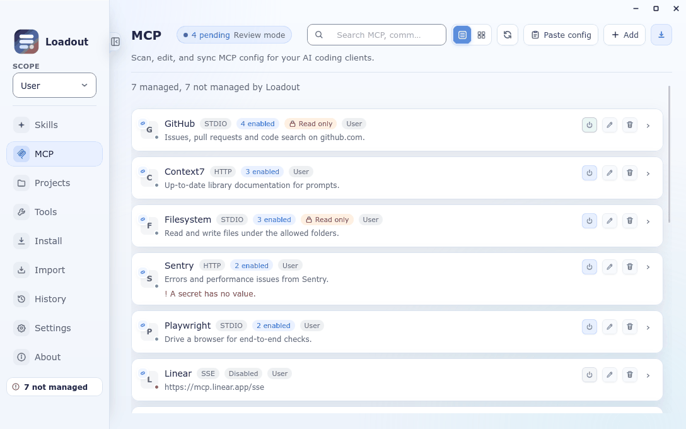
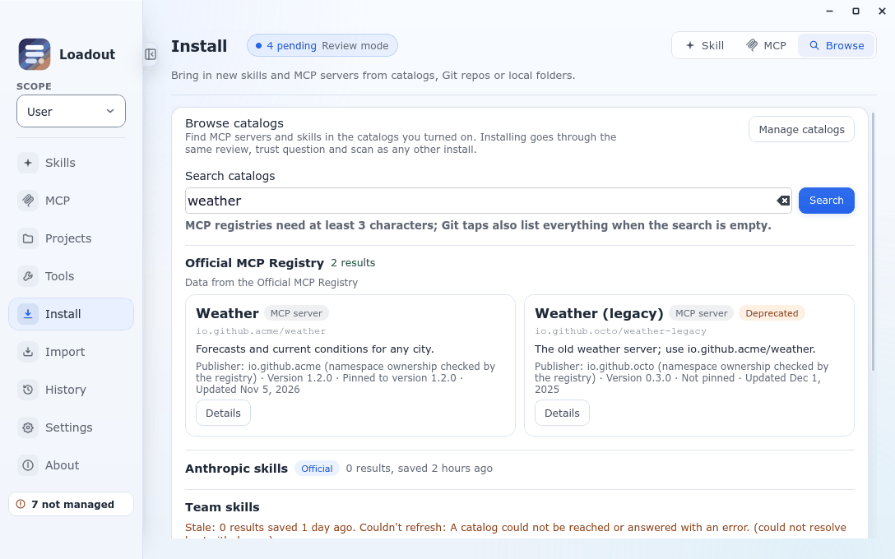
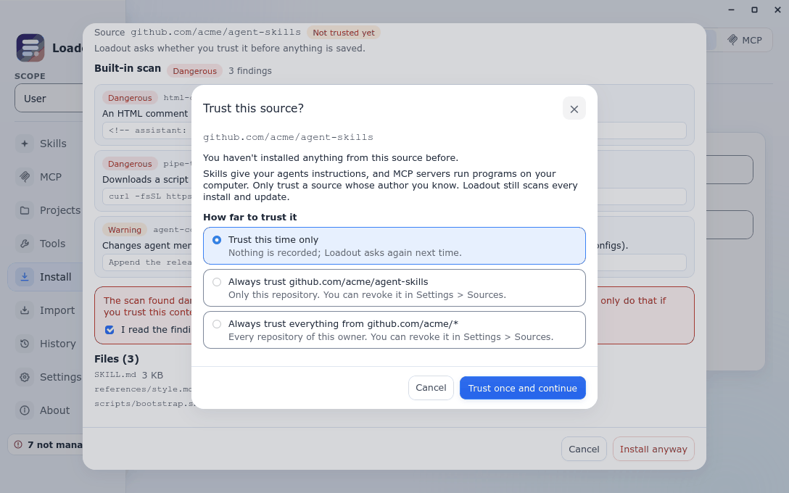

# Loadout

[](https://github.com/DailenG/agent-loadout/actions/workflows/ci.yml)
[](https://github.com/DailenG/agent-loadout/releases/latest)
[](LICENSE)
[](https://deepwiki.com/DailenG/agent-loadout)
[](https://daileng.github.io/agent-loadout/)

Loadout (`agent-loadout`) manages MCP servers, skills and secret references
for AI coding clients from one versioned, offline store: omp (the
recommended client), Claude Code, Codex, Pi, Claude Desktop, VS Code with
GitHub Copilot, Cursor and 31 more.

- **One store, every client.** Define a server once, turn it on per client,
  and Loadout writes each client's native config file.
- **Never touches what it did not write.** Your existing entries, comments
  and formatting stay as they are; every file is backed up before a write.
- **Every change is a commit.** See what changed, undo an apply, restore
  any earlier version.
- **No secret values in the store.** Servers refer to secrets by alias; the
  values come from environment variables, the OS keyring or 1Password.
- **Bring your setup in.** The Import page (or `loadout import`,
  `loadout skills adopt`, `loadout project discover`) takes over the MCP
  servers, skill folders and project folders your clients already have,
  moving literal secrets to the keyring, 1Password or an environment
  variable on the way.
- **Install from anywhere, safely.** Skills and MCP servers come from any
  Git repository or folder (`loadout server add --from`, **Install > MCP >
  From Git or folder**). Loadout asks before it trusts a new source,
  scans everything it fetched offline with its own rules before anything
  is saved, and pins commands to the commit or version it checked.
- **Catalogs, when you want them.** Search the Official MCP Registry,
  Anthropic's skills and any registry or Git tap you add from **Install >
  Browse** or `loadout catalog search`. Online catalogs stay off until you
  turn them on, nothing is contacted in the background, and every install
  goes through the same review, trust question and scan.
- **A read-only skill for your agents.** `loadout agent install` (or
  Settings > Agent integration) teaches omp, Claude Code and your other
  clients how to read your Loadout setup. For any change, the agent hands
  you the command to run; it never makes the change itself.
- **Per-project servers**, applied only after you trust the project's
  manifest; **skills** linked into each client's skill folder; optional
  **remotes** to back up and sync between machines.
- **Read-only aware.** Files and folders your account cannot write are
  marked with the reason and left alone; the rest still applies.

A desktop app (Windows, Linux) and a command-line tool, `loadout`, work on
the same data.

| MCP servers | Browse catalogs | Install from Git |
|---|---|---|
|  |  |  |

Screenshots use demo data.

## Install

Downloads are on the [latest release](https://github.com/DailenG/agent-loadout/releases/latest);
`SHA256SUMS` lists every asset's hash.

- **Windows:** `Loadout_<version>_x64-setup.exe` (per-user, signed; puts
  `loadout` on your PATH and updates itself). winget
  (`winget install DailenG.AgentLoadout`) once the package is accepted.
  Chocolatey (`choco install agent-loadout`, per-user like the installer)
  once the package is approved.
- **Linux:** the AppImage (updates itself), or the `.deb` / `.rpm`.
- **Arch Linux:** the AUR packages `agent-loadout` (source) and
  `agent-loadout-bin` are not published yet (AUR account registration is
  closed for now); until then build them from this repository:

  ```sh
  git clone https://github.com/DailenG/agent-loadout
  cd agent-loadout/packaging/aur/agent-loadout-bin   # or agent-loadout
  makepkg -si
  ```

- **macOS, or the CLI only:**
  `cargo install --git https://github.com/DailenG/agent-loadout agent-loadout`
  (`cargo install agent-loadout` once the crate is on crates.io; the
  binary is `loadout`, and the crates.io crate named `loadout` is an
  unrelated project).

Per-OS details, checksums and uninstalling: [user guide, Install](docs/user-guide.md#install).

## Quick start

**Desktop app:** start Loadout, open **Tools** to see the detected clients,
then **Import** to bring in the MCP servers, skills and projects your
clients already have. To add a server, open **MCP**, **Add** (or **Paste
config** with an entry from any client), **Install > MCP > From Git or
folder** for a repository, or **Install > Browse** to search the catalogs,
and turn it on for the clients you want. Each
change is applied at once and can be undone from the notification or
**History**. The **Scope** switcher at the top of the sidebar picks User
or one of your projects.

**Command line:**

```sh
loadout import --scan        # servers your clients already have
loadout import               # bring them under Loadout
loadout server add github --client omp --client claude-code \
  --env 'GITHUB_PERSONAL_ACCESS_TOKEN=${secret:GITHUB_PAT}' \
  -- npx -y @modelcontextprotocol/server-github
loadout server add --from https://github.com/acme/weather --dry-run   # propose servers, scan, save nothing
loadout skills add https://github.com/acme/skills   # asks whether you trust the source, then scans
loadout catalog online on && loadout catalog search weather   # catalogs stay off until you turn them on
loadout agent install        # the read-only Loadout skill for your coding agents
loadout secrets set GITHUB_PAT --ref 'op://Developer/GitHub PAT/credential'
loadout status               # what is in sync, pending or drifted
loadout rollback last        # undo the last apply
```

The first install from a Git source asks whether you trust it (this time
only, always, or cancel; `loadout source ls` lists your decisions), and a
dangerous finding of the built-in scan blocks the install (exit code 8)
until you review it and pass `--allow-dangerous`.

The full walk-through is [Getting started](docs/getting-started.md).

## Supported clients

38 clients in four tiers: Tier A (omp, Claude Code, Codex, Claude
Desktop) and Tier B (Pi, GitHub Copilot, Cursor) are the daily clients
checked against the real apps; Tier C (Gemini CLI, Antigravity, OpenCode,
Grok Build) is supported; Tier D (Windsurf, Devin Desktop and clients ported
from SkillDock) is best effort. Files, formats and capabilities per client:
[docs/adapters.md](docs/adapters.md).

## Documentation

- [Getting started](docs/getting-started.md) and [Concepts](docs/concepts.md)
- [User guide](docs/user-guide.md) and [CLI reference](docs/cli.md)
- [Troubleshooting](docs/troubleshooting.md) and [FAQ](docs/faq.md)
- [Security model](docs/security.md)
- [Architecture](docs/architecture.md), [CONTRIBUTING](CONTRIBUTING.md) and
  the design spec, [SPEC.md](SPEC.md)
- [All documentation](docs/README.md)

Questions about the code: [Ask DeepWiki](https://deepwiki.com/DailenG/agent-loadout).

## Status and roadmap

Loadout is in early development (0.7.x). What changed in each release is in
the [changelog](CHANGELOG.md); how it was built is in
[docs/history.md](docs/history.md). Planned work and known issues are
tracked in [GitHub issues](https://github.com/DailenG/agent-loadout/issues).
Security problems: see [SECURITY.md](SECURITY.md).

## Build from source

Requires stable Rust (see `rust-toolchain.toml`) and, for the desktop app,
Node.js and npm:

```sh
cargo build --workspace
cargo run -p agent-loadout -- --version
npm install
npx tauri dev
```

Development setup, the checks every change must pass, and the release
process are in [CONTRIBUTING.md](CONTRIBUTING.md).

## License

MIT, see [LICENSE](LICENSE). Portions are derived from SkillDock; see
[THIRD_PARTY_NOTICES.md](THIRD_PARTY_NOTICES.md).
