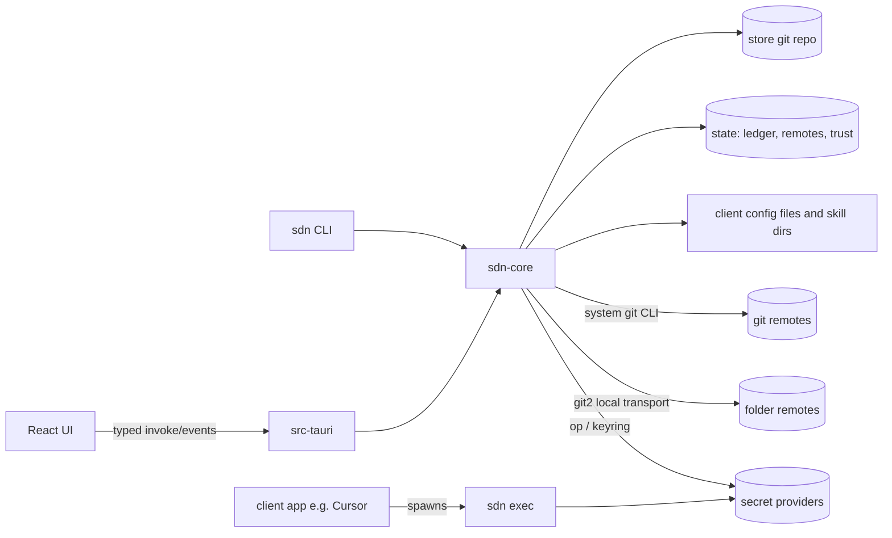
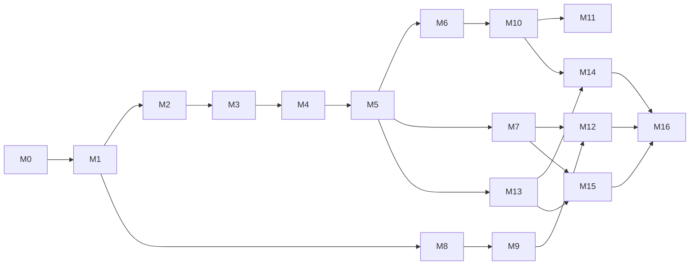

# SkillDock Next: Specification

Status: draft v1 for review (2026-11-14). Spec only; nothing here is implemented.

Conventions:

- `sdn` is a **placeholder** for the final product name (see Appendix C). Every identifier containing `sdn` (binary, data dir, manifest dir, env vars, crate names) is renamed by one search/replace in M0.
- MUST / SHOULD / MAY carry RFC 2119 meaning.
- `[verify]` marks a client behavior that was not confirmed against primary docs on 2026-11-14. The adapter that depends on it MUST ship with a fixture test plus a manual check against the real client before it is marked stable.
- `~` is the user profile directory. On Windows this is the Known Folder `FOLDERID_Profile` (`%USERPROFILE%`), **never** `$HOME`. `<P>` is a project root folder.
- "SkillDock" means the read-only reference at `../skilldock` (fork `DailenG/skilldock`, HEAD `181b52b`).

---

## 1. Context: what SkillDock does and where it fails

SkillDock is a Tauri 2 app (Rust backend about 75k lines, React frontend about 58k lines) that manages Skills, MCP servers and plugins for about 35 AI coding tools. These findings from reading its code drive this design:

| Area | SkillDock as built (file refs) | Consequence |
|---|---|---|
| MCP registry | `~/.skilldock/config/mcp-servers.json`, `{schemaVersion:1, servers:[McpServerRecord]}`; `server` is untyped JSON; env/header values are plaintext (`mcp_manager.rs:131-164`) | Secrets on disk and in the UI |
| Ownership | Three lists per record: `importedFromAppIds`, `managedAppIds`, `pendingSyncAppIds`; OpenCode special-cased in about 10 places | **Disable deletes the native entry outright**, even user-authored ones (`remove_server_from_app`) |
| Editing client files | Only OpenCode uses a CST (`jsonc-parser`); other JSON is re-serialized with `serde_json` (comments lost, keys alphabetized), YAML re-emitted, Codex upsert runs `mcp.remove("servers")` (deletes the whole legacy table) | Data and formatting loss |
| "local-align" | Frontend-only refetch with cooldowns (`mcp.tsx:873-898`); per-app state is computed from live files; drift never persisted | No real drift detection |
| Scope | User scope only; no Claude Code `.mcp.json` / local scope, no `.cursor/mcp.json`, no Claude Desktop, no VS Code | Requirement 2 is entirely new |
| Tool filtering | Rewrites servers into `npx -y mcp-filter ...` or `npx -y mcp-remote@latest ...` wrappers; headers end up in argv | Unpinned network dependency in client configs |
| Backup | Git CLI + GitHub REST; repo `skilldock-backup`, branch `main` hard-coded; token in plaintext `~/.skilldock/credentials/github.json` | No offline history, no tags |
| Auth | Device flow with baked-in `DEFAULT_OAUTH_CLIENT_ID = "Ov23livYZ8NWkByWZMLz"` (`github_api.rs`), override only via env `SKILLDOCK_GITHUB_CLIENT_ID`; classic `repo` scope | **Sync 404s once upstream's OAuth app vanished** |
| Updater | Endpoint `github.com/wanghuan9/skilldock/releases/latest/download/latest.json` (`tauri.conf.json`) | Second dead upstream dependency |
| Secrets in backup | `env`/`headers` dropped wholesale, key names kept in `requiredSecrets`; the frontend never reads `requiredSecrets` | Restore on a new machine silently loses secrets |
| Merge | Object-level 3-way for skills; MCP, preferences and plugin trees: **local wins silently** | Silent data loss |
| Restore | Replaces `~/.skilldock/skills` wholesale and pushes a new commit; no pre-restore undo point | Destructive |
| Status values | Localized Chinese strings persisted as state (`"已启用"`); frontend regex-parses Chinese errors (`缺少环境变量`) | Fragile, not i18n-safe |
| Tool registry | 5+ hand-maintained tables (`build_tool_configs`, `tool_skills_path_for_home`, `known_roots`, `mcp_config_path_for_tool`, `target_app_specs`) plus a 6-entry declarative `tool_adapters.rs` | Drift between tables |
| Windows paths | `HOME` preferred over `USERPROFILE` (Git Bash `HOME` redirects everything) | Wrong files on Windows |
| Linux | Not released (CI builds macOS and Windows only) | Requirement 8 is new work |

What SkillDock gets right and this spec keeps: the GUI layout and flows, the managed/unmanaged/mismatch model for tool skill dirs, directory links into tools (junction fallback on Windows), the per-item "Enable in Tools" pill grid plus per-tool Manage dialog, atomic temp-file plus `ReplaceFileW` writes, tool discovery for MCP servers, and the declarative direction of `tool_adapters.rs`.

---

## 2. Goals and non-goals

### Goals

1. **SkillDock-identical GUI** (layout, flows, look) on Tauri 2, backed by a reusable Rust core crate shared with a CLI (`sdn apply|status|diff|backup|restore` and more).
2. **MCP management at two scopes:** system (user-wide) and project (any folder with a manifest that layers over system). Writes every client's native project-level config. Shows the effective config per folder with per-entry provenance.
3. **Versioned store:** every change is a commit in a local git repo under the app data dir (fully offline). History, semantic diff, restore any version, named tags. Remotes are optional push targets.
4. **Vendor independence:** nothing breaks if any vendor, upstream repo or service disappears. No baked-in OAuth client ids. Remote auth uses the user's own git credentials or a user-supplied OAuth app id. Plain folders (NAS, Resilio) are first-class remotes.
5. **Secrets by reference only:** `${env:NAME}`, `op://vault/item/field`, 1Password Developer Environments, OS keyring. No secret value ever enters the store, a snapshot or a remote. Restore on a new machine shows "missing secret" state.
6. **First-class clients:** Claude Code, Claude Desktop, Cursor, VS Code, GitHub Copilot, Windsurf, Devin Desktop, Codex, Gemini CLI, Antigravity, OpenCode, Pi, oh-my-pi (omp), Grok Build; all other SkillDock clients ported at user scope. Format-preserving edits; never touch entries the app did not create; drift detection with adopt/import.
7. **Skills:** keep SkillDock's store, link/copy distribution, `~/.agents/skills` scan; add project scope.
8. **Platforms:** Windows 11 (primary) and Arch Linux on Hyprland/Wayland as first-class builds; macOS best effort.
9. **Migration** from `~/.skilldock` and from existing client configs.

### Non-goals (v1)

- MCP proxies, gateways or container runtimes (ToolHive, 1MCP, Docker MCP gateway, MetaMCP), per LANDSCAPE.md.
- Rewriting servers into wrapper commands for tool filtering (SkillDock's `mcp-filter`/`mcp-remote`). Tool filtering is written only through native client fields.
- Plugin management, SkillHub publishing and the Publish route. Deferred (Open question Q3). The GUI keeps their nav slots hidden behind a feature flag.
- Built-in marketplaces as required dependencies. Catalog sources are optional add-ons (M17).
- Managing client settings unrelated to MCP and skills (rules, hooks, permissions, models).
- Team or multi-user servers. The store is personal; project manifests may be shared through the project's own repo.
- Encrypting the store. It contains no secrets by construction (§11), so encryption is unnecessary.

---

## 3. Glossary

| Term | Meaning |
|---|---|
| Store | The versioned git repo `<SDN_HOME>/store` holding desired state (servers, skills, secret references, project mirrors, machine overlays). |
| State | Machine-local, unversioned data `<SDN_HOME>/state` (ledger, remotes, trust, journals, local settings). |
| Client | An MCP/skills consumer (Claude Code, Cursor, ...). Has an adapter. |
| Target | One native config file + container + scope for one or more clients, e.g. `<P>/.mcp.json` `/mcpServers`. |
| Native entry | One server entry inside a target (e.g. key `github` under `mcpServers`). |
| Ledger | Machine-local record of every native entry or skill link the app wrote or adopted, with a keyed hash of what was written. Defines ownership. |
| Foreign entry | A native entry with no ledger record. Never modified or deleted without an explicit adopt. |
| Layer | One source of desired state for a folder: system, project (shared), project-local (private). |
| Effective config | What a given client actually loads in a given folder, after our layers and the client's own precedence rules. |
| Apply | Reconcile targets with desired state, via a plan the user can inspect. |
| Drift | A native entry we own whose current content differs from what we last wrote. |
| Ref | A secret reference (`${env:X}`, `${secret:ALIAS}`, `op://...`, `op-env://...`, `keyring://...`). |
| Delivery mode | How a ref reaches the MCP server: `env`, `launch`, `command`, `inline` (§11.4). |

---

## 4. Architecture

### 4.1 Repository and crates

```
sdn/                           (Cargo workspace + npm package)
  crates/
    sdn-core/                  lib: everything below, no Tauri dependency
      src/env.rs               Env + Fs facade (paths, OS, vars); injected everywhere
      src/model/               schemas: server, secrets, project, machine, settings, skill-meta
      src/store/               git2-backed store: transactions, commits, tags, log, diff, restore, merge
      src/remote/              git (system git CLI), folder (repo-per-machine, mirror, archive)
      src/formats/             format-preserving editors: json/jsonc, json5 (read), toml, yaml
      src/adapters/            AdapterSpec table + mappers per client; detection
      src/layering/            manifests, merge, effective config, provenance
      src/apply/               ledger, planner, executor, journal, backups, lock
      src/secrets/             ref grammar, catalog, providers, delivery rendering, leak scanner
      src/skills/              skill store, frontmatter, link/junction/copy, agents-cli scan
      src/migrate/             SkillDock importer, first-run client scan
      src/events.rs            typed change events (for GUI watchers and CLI output)
    sdn-cli/                   bin `sdn` (clap); thin over sdn-core; also `sdn exec`, `sdn git-credential`
    sdn-testkit/               dev-dependency: temp HOME builder, fixtures, fake providers, op stub
  src-tauri/                   bin: Tauri app; commands are thin wrappers over sdn-core
  src/                         React frontend (ported from SkillDock)
  fixtures/                    client config fixtures + golden outputs (shared by Rust tests)
```

Rules:

- `sdn-core` MUST NOT read process-global state directly (`std::env`, `dirs::home_dir`, `SystemTime::now`). It receives an `Env` (paths, OS, env vars, clock) and an `Fs` trait object. Tests use `RootedFs`, which panics on any path outside the temp root. This is the guarantee that tests never touch real agent configs.
- Errors are typed: `enum CoreError { code: ErrorCode, ... }` with stable `snake_case` codes (`parse_error`, `foreign_entry`, `missing_secret`, ...). The frontend and CLI localize from codes. No localized strings cross the IPC boundary as state.
- All mutating core APIs go through `Store::transaction(op, |tx| ...)`, which validates, writes store files, runs the leak scanner and commits once (§9.2).
- One cross-process lock `<SDN_HOME>/state/sdn.lock` (`fd-lock`) is held by any process mutating the store, ledger or client files. GUI and CLI can run concurrently; the second waits up to 10 s, then fails with `locked`.

### 4.2 Git implementation choice

- **Local store operations** (init, commit, log, diff, tag, read blobs, merge-base, file-level merge, local-path fetch/push for folder remotes) use `git2` with `vendored-libgit2` and **no** `https`/`ssh` features. No OpenSSL, no system git required. The store works fully offline on a machine without git installed.
- **Network remotes** shell out to the system `git` CLI, because that is the only way to honor the user's own credential setup: Git Credential Manager on Windows, `gh auth git-credential`, SSH agent, any configured helper. If `git` is absent, network remotes show `git_not_found` and everything else keeps working.
- `gix` was considered; rejected for v1 because push support and credential-helper integration are less mature. Revisit later; the store module hides the backend behind a trait.

### 4.3 Frontend

- Port SkillDock's React 18 + Vite + TypeScript frontend and `src/styles/tokens.css` verbatim first (look and feel parity), then restructure:
  - Typed IPC: generate TS bindings for commands and events from Rust with `tauri-specta`. Replace `invokeOrFallback` silent fixture fallback with an explicit mock transport used only in tests and Storybook-style dev mode.
  - Server state via TanStack Query (cache + invalidation on core change events) instead of the 90-member god Context and ad-hoc cooldowns (`ROUTE_LOCAL_ALIGN_COOLDOWN_MS`, `MCP_LOCAL_ALIGN_COOLDOWN_MS`, ...).
  - Route modules split per page; header toolbars rendered through React context slots instead of `document.getElementById` portals.
  - Statuses are enums; i18n keys only in presentation.
  - Keep CodeMirror 6 + `@codemirror/merge` for diffs and TOML editing; keep `react-markdown`.
- Tauri: CSP enabled (SkillDock ships `"csp": null`); capabilities minimal (dialog, process, optional updater, window controls). Plugins: `dialog`, `process`, `updater` (optional, §16.4).

### 4.4 Process model



The GUI watches target files, manifests and skill dirs with `notify` (debounced 500 ms, coalesced) and re-runs drift detection for affected targets only.

### 4.5 Data directory layout

`SDN_HOME` default (overridable with env `SDN_HOME` or Settings; see Q2):

| OS | Default |
|---|---|
| Windows | `%LOCALAPPDATA%\sdn` (not Roaming: a roaming profile must not sync a live git repo) |
| Linux | `${XDG_DATA_HOME:-~/.local/share}/sdn` |
| macOS | `~/Library/Application Support/sdn` |

The app MUST warn when `SDN_HOME` resolves inside a file-sync root (Resilio `.sync` marker, OneDrive, Dropbox, Syncthing `.stfolder`, Google Drive): file sync tools corrupt live git repos. Sync folders are for **folder remotes** (§9.7), not for `SDN_HOME`.

```
<SDN_HOME>/
  store/                          git repo (branch main); desired state; NEVER contains secret values
    sdn.toml                      store identity: schema, store_id (ULID), created_at
    servers/<id>.toml             one MCP server per file (§5.2)
    secrets.toml                  secret reference catalog: aliases -> refs (§5.3)
    clients.toml                  per-client preferences (§5.4)
    settings.toml                 portable UI and behavior preferences
    skills/<id>/...               managed skill content (SKILL.md + files, no .git)
    skill-meta/<id>.toml          skill metadata: source, tags, enablement (§12)
    projects/<project-id>/
      project.toml                mirror of <P>/.sdn/project.toml
      project.local.toml          mirror of <P>/.sdn/project.local.toml (refs only)
    machines/<machine-id>.toml    per-machine overlay: label, OS, project paths, overrides (§5.6)
  state/                          machine-local, unversioned
    machine.toml                  machine_id (ULID), label; created on first run
    ledger.json                   ownership ledger (§8.1)
    ledger.key                    32-byte HMAC key for ledger hashes (or stored in OS keyring)
    remotes.toml                  remotes for this machine (§9.6)
    trust.json                    trusted project manifests (path, id, content hash)
    local-settings.toml           window geometry, default editor path, feature flags
    merge/                        in-progress pull merge state (§9.9)
    journal/<apply-id>.json       apply journals for crash recovery (§8.4)
    applies/<apply-id>.json       apply results (last 200)
    sdn.lock                      cross-process lock
  backups/                        machine-local, NEVER pushed; user-only permissions
    files/<ts>-<apply-id>/<encoded-path>   pre-write copies of client files (may contain secrets)
    trash/<ts>/<encoded-path>     items removed by explicit user delete (skills, entries)
  cache/
    skill-sources/<id>/           upstream clones for update checks (re-creatable)
    tools/<server-id>.json        last MCP tool discovery result
  imports/
    skilldock-backup.git          bare copy of SkillDock's backup repo (migration, §15)
  logs/sdn.log                    rotating, redacted
```

Encoding for backup paths: absolute path with drive colon and separators percent-encoded, so restores are unambiguous across OSes.

---

## 5. Schemas

All store files are TOML (human-diffable, comment-friendly), `schema = 1` at the top, validated on read and write. Unknown keys are preserved on rewrite (store files are edited through `toml_edit`, so user comments survive). JSON Schemas are generated from the Rust types (`schemars`) and published in `docs/schema/` for editor completion.

### 5.1 Identifiers

- Server id, skill id, project id, secret alias: `^[a-z0-9][a-z0-9._-]{0,63}$` (secret aliases also allow `A-Z`, `_`: `^[A-Za-z_][A-Za-z0-9_]{0,63}$` so they double as env var names).
- The file name MUST equal the id (`servers/github.toml` has `id = "github"`).
- The native entry key written to clients defaults to the server id; `native_name` overrides it per client when a client restricts names (Gemini recommends no underscores; Claude Code allows `[A-Za-z0-9_-]`; Pi treats `-` and `_` as equal).

### 5.2 Server (`store/servers/<id>.toml`)

```toml
schema = 1
id = "github"
display_name = "GitHub"
description = "Issues, pull requests and code search"
tags = ["dev"]

transport = "stdio"                 # stdio | http | sse
command = "npx"
args = ["-y", "@modelcontextprotocol/server-github"]
# cwd = "${project}"                # template vars: ${home}, ${project}, ${sdn_home}

[env]
GITHUB_PERSONAL_ACCESS_TOKEN = "${secret:GITHUB_PAT}"   # reference, never a value
GITHUB_TOOLSETS = "repos,issues"                         # literal non-secret values are fine

[enable]                            # system scope (user-wide) enablement
clients = ["claude-code", "cursor", "codex", "omp", "pi", "copilot"]
# clients = "all-detected"          # every detected client whose capabilities fit

[delivery]                          # how refs reach the server (section 11.4)
mode = "auto"                       # auto | env | launch | command | inline

[tools]                             # written only via native fields (Codex enabled_tools/disabled_tools,
deny = ["delete_repository"]        # Gemini includeTools/excludeTools, Copilot tools, Pi toolExposure)

[os.windows]                        # per-OS deep-merged overrides
# command = "C:\\tools\\gh-mcp.exe"

[client.codex]                      # native passthrough fields, checked against the adapter allowlist
startup_timeout_sec = 60
[client.gemini]
trust = false
native_name = "github-mcp"

[meta]
homepage = "https://github.com/github/github-mcp-server"
origin = "imported:cursor"          # manual | imported:<client> | migrated:skilldock | catalog:<source>
```

Remote example:

```toml
schema = 1
id = "linear"
transport = "http"
url = "https://mcp.linear.app/mcp"
[headers]
Authorization = "Bearer ${secret:LINEAR_TOKEN}"
[enable]
clients = "all-detected"
```

Validation (typed, unlike SkillDock's untyped `serde_json::Value`): `stdio` requires `command`, forbids `url`/`headers`; `http`/`sse` require `url`, forbid `command`/`args`/`env`; every string field is parsed by the ref grammar (§11.2); `client.<id>` keys must be in that adapter's passthrough allowlist; `enable.clients` ids must exist in the adapter table (unknown ids are a warning, kept, so a newer store opened by an older app does not lose data).

Windows `npx`/`.cmd` shims: adapters with `windows_shell_shim` (clients that spawn without a shell, e.g. Claude Desktop) render `command = "cmd"`, `args = ["/c", "npx", ...]` automatically. The store keeps the portable `npx`.

### 5.3 Secret catalog (`store/secrets.toml`)

```toml
schema = 1

[secrets.GITHUB_PAT]
ref = "op://Developer/GitHub PAT/credential"
description = "Fine-grained PAT, contents:read on selected repos"

[secrets.LINEAR_TOKEN]
ref = "op-env://blgexucrwfr2dtsxe2q4uu7dp4/LINEAR_TOKEN"   # 1Password Developer Environment

[secrets.OPENAI_API_KEY]
ref = "keyring://sdn/OPENAI_API_KEY"

[secrets.HASS_TOKEN]
ref = "env:HASS_TOKEN"              # plain environment variable
env_name = "HASS_TOKEN"             # env var name used by env delivery (default: alias)
```

Only references and metadata. A per-machine overlay may override `ref` (§5.6), so one alias can resolve from 1Password on Windows and from the keyring on Arch.

### 5.4 Client preferences (`store/clients.toml`)

```toml
schema = 1
[claude-code]
project_shared_target = ".mcp.json"          # where project.toml layer goes
project_local_target = "local-scope"         # ~/.claude.json projects[<P>].mcpServers
[vscode]
variants = ["Code"]                          # Code | Code - Insiders | VSCodium
profiles = "default"                         # default | all | ["<profile-id>", ...]
[omp]
profiles = ["default"]                       # omp named profiles to target
[windsurf]
enabled = false                              # opt a client out of everything
```

### 5.5 Project manifest (`<P>/.sdn/project.toml`)

```toml
schema = 1
id = "skilldock-next-7k2f"          # generated on init: slug + 4 random chars; survives moves
name = "SkillDock Next"

[defaults]
clients = "all-detected"            # clients that receive project-scope files; or an explicit list

[servers.github]                    # override a system server in this folder
from = "github"                     # inherit store/servers/github.toml
[servers.github.env]
GITHUB_TOOLSETS = "repos,issues,pull_requests,actions"

[servers.postgres]                  # project-only server, inline definition
transport = "stdio"
command = "uvx"
args = ["postgres-mcp", "--access-mode=restricted"]
clients = ["claude-code", "cursor", "codex"]
[servers.postgres.env]
DATABASE_URI = "${env:DATABASE_URL}"

[servers.playwright]
from = "playwright"                 # a store server used as a template, not enabled system-wide

[servers.slack]
enabled = false                     # suppress a system server in this folder

[skills]
enable = ["repo-conventions", "tauri-release"]
share = false                       # false: link + .git/info/exclude; true: copy files for teammates
```

`<P>/.sdn/project.local.toml` has the same schema (no `id`, it inherits), is personal, and is listed in `<P>/.sdn/.gitignore` (created on init). On init the user chooses **Shared** (manifest committed with the project) or **Private** (`.sdn/` added to `<P>/.git/info/exclude`; nothing visible to teammates).

### 5.6 Machine overlay (`store/machines/<machine-id>.toml`)

Written only by the machine it describes (so merges never conflict on it).

```toml
schema = 1
machine_id = "01JCX3R8Q6T5W1V9Y2Z7A4B6C8"
label = "dailen-desktop"
os = "windows"

[enable]
exclude_clients = ["claude-desktop"]

[secrets.GITHUB_PAT]                # per-machine ref override
ref = "keyring://sdn/GITHUB_PAT"

[servers.filesystem]                # per-machine field overrides for system servers
args = ["-y", "@modelcontextprotocol/server-filesystem", "D:\\Code"]

[projects.skilldock-next-7k2f]      # where this project lives on this machine
path = "C:\\Users\\<user>\\Code\\skilldock-next"
```

### 5.7 Portable settings (`store/settings.toml`)

`theme`, `language`, `apply_mode` (`instant` | `review`), `new_server_enable` (`all-detected` | `none`, maps SkillDock `mcpInstallActivation`), `new_skill_enable`, `agents_cli_compat`, `list_view` preferences. Machine-specific values (editor path, window size) live in `state/local-settings.toml`.

---

## 6. Layering and merge rules

### 6.1 Layers

For a folder `F` and a client `C`, lowest to highest:

1. **System**: store servers with `C` in `enable.clients`, after OS overrides (`[os.<os>]`) and the machine overlay. Written to `C`'s user-scope target.
2. **Project (shared)**: the nearest manifest at or above `F` (`<P>/.sdn/project.toml`). Written to `C`'s project target.
3. **Project-local (private)**: `<P>/.sdn/project.local.toml`. Written to `C`'s private project target when the client has one; otherwise merged into the project target (with a warning if that file is shared, see 6.5).

Nested manifests: v1 uses the **nearest** manifest only; outer manifests are not merged (documented limitation, revisit for monorepos). A manifest directly in `~` is ignored (it would be "every folder").

### 6.2 Server resolution within project layers

For each `servers.<name>` in the merged project layer:

- `from = "<id>"`: start from store server `<id>` (whether or not it is enabled system-wide), then deep-merge the project fields over it. Unknown `<id>` is an error (`unknown_template`).
- No `from`: the table is a complete definition, validated like a store server.
- `enabled = false` alone: a **suppression** of the same-named system server in this folder.
- `clients`: list of clients that get this entry at project scope; defaults to `[defaults].clients`.

Deep merge: tables merge recursively (so `env` and `headers` merge key by key), arrays replace (`args`), scalars replace. `unset = ["env.FOO", "headers.X-Debug"]` removes inherited keys. The local layer merges over the shared layer with the same function, keyed by server name.

### 6.3 What gets written

Per client `C` with a project target:

| Desired | Written to project target | Notes |
|---|---|---|
| Project-only server | Full entry | |
| Override of system server (`from` + fields) | Full entry with the same native name | Shadows the user entry where the client's project precedence is "replace" (Claude Code, Pi, omp, Grok). Adapters with `project_semantics = DeepMerge` (Codex, OpenCode) get a full entry too; an `unset` on such a client raises `unset_not_expressible` because the user-scope key would still merge in. |
| Suppression (`enabled = false`) | Via the adapter's `project_disable` mechanism (table 7.4) | Unsupported: warning `cannot_suppress_in_project` in the effective view, with the fix "remove `C` from the system enable list and add the server to the projects that need it". |

### 6.4 Effective config and provenance

`effective(F, C)` returns, for every server name `C` would load in `F`:

```json
{ "name": "github", "loaded": true,
  "winner": { "layer": "project", "file": "<P>/.mcp.json", "source": "store:github+project" },
  "shadowed": [{ "layer": "system", "file": "~/.claude.json" }],
  "also_visible_to": ["copilot", "grok", "omp"],
  "status": "synced", "warnings": [] }
```

Layers reported: `system`, `project`, `project-local`, `foreign:<file>` (entries we do not own but the client loads), `client-compat:<file>` (entries the client imports from another tool's file, e.g. Grok reading `~/.claude.json`, `.cursor/mcp.json` and `.mcp.json`; omp reading `.claude/`, `.cursor/`, `.vscode/`). Each adapter declares its native precedence order and compat sources so the computation matches what the client does. Duplicates across sources are flagged (`duplicate_via_compat`).

### 6.5 Shared native files

Some files are read by several clients. Workspace-root `<P>/.mcp.json` is read by Claude Code (project scope), GitHub Copilot (native workspace file), Grok (compat) and omp (fallback). The apply engine treats a **file** as the unit: the entries written are the union for every client mapped to it, and the effective view lists all readers. Enabling a server at project scope "for Claude Code only" therefore also exposes it to Copilot; the UI shows that before apply.

A project-local layer entry must not land in a file that is tracked by the project's git repo (checked with `git ls-files` via git2). If the client has no private project target, the user picks: put it in the shared file and add that file to `.git/info/exclude`, or skip that client.

---

## 7. Client adapters

### 7.1 Adapter model

Adapters are **data first**: one declarative table (replacing SkillDock's five tables), plus small mapper implementations for odd shapes.

```rust
pub struct AdapterSpec {
    pub id: &'static str,                  // "claude-code"
    pub display_name: &'static str,
    pub tier: Tier,                        // FirstClass | Ported
    pub detect: &'static [Probe],          // config dir exists, executable on PATH, Windows App Paths/registry, MSIX package
    pub mcp: Option<McpSpec>,
    pub skills: Option<SkillsSpec>,
}

pub struct McpSpec {
    pub user: &'static [Location],          // ordered candidates: first existing wins; else [0] is created
    pub project: &'static [Location],       // relative to <P>
    pub project_local: &'static [Location], // may point into a user file with a {project} key
    pub format: Format,                     // Json | Jsonc | Json5ReadOnly | Toml | Yaml
    pub container: ContainerPath,           // "/mcpServers", "/projects/{project_key}/mcpServers", "mcp_servers", ...
    pub mapper: &'static dyn EntryMapper,
    pub caps: Caps,
}

pub struct Caps {
    pub transports: TransportSet,           // stdio | http | sse
    pub env_ref: Option<EnvRefSyntax>,      // DollarBrace "${X}", DollarBraceEnv "${env:X}", BraceEnv "{env:X}", CodexForward
    pub env_ref_fields: FieldSet,           // which fields the client expands
    pub command_ref: Option<CommandRef>,    // "!cmd" (Pi, omp) or headersHelper (Claude Code)
    pub native_disable: Option<DisableMech>,// EnabledFalse | DisabledTrue | ListMember(path)
    pub project_disable: Option<ProjectDisable>,
    pub project_semantics: ProjectSemantics,// Replace | DeepMerge | Unknown
    pub precedence: &'static [Source],      // for effective-config computation
    pub compat_reads: &'static [CompatSource],
    pub trust_gate: Option<TrustGate>,      // client requires trust/approval for project files
    pub rewrites_file_at_runtime: bool,     // ~/.claude.json: extra CAS care
    pub restart_required: bool,             // Claude Desktop reads only at launch
    pub tool_filter: Option<ToolFilterMech>,
    pub windows_shell_shim: bool,
    pub passthrough_allowlist: &'static [&'static str],
}

pub trait EntryMapper: Sync {
    fn to_native(&self, s: &RenderedServer, cx: &WriteCx) -> Result<NativeValue, MapError>;
    fn from_native(&self, key: &str, v: &NativeValue) -> Result<ServerDef, MapError>;
    fn canonical(&self, v: &NativeValue) -> Canonical; // sorted, defaults dropped; used for equality and hashing
}

pub enum Location {
    Home(&'static str),                     // ~/...
    AppData(&'static str),                  // %APPDATA% | ~/Library/Application Support | $XDG_CONFIG_HOME
    LocalAppData(&'static str),             // %LOCALAPPDATA% (Windows only)
    XdgConfigAllOs(&'static str),           // $XDG_CONFIG_HOME or ~/.config, also on Windows (OpenCode, Crush)
    EnvDir { var: &'static str, fallback: &'static Location, rel: &'static str }, // CODEX_HOME, COPILOT_HOME, PI_CODING_AGENT_DIR, CLAUDE_CONFIG_DIR
    Project(&'static str),                  // <P>/...
    Glob(&'static str),                     // MSIX package dirs, VS Code profiles
}
```

`MapError::UnsupportedTransport` (e.g. SSE on Codex or Pi) and `MapError::UnsupportedField` are reported per target as `blocked`; they never silently drop data.

### 7.2 Format-preserving editors

| Format | Implementation | Guarantees |
|---|---|---|
| JSON (strict) and JSONC | `jsonc-parser` CST (already used by SkillDock for OpenCode) | Comments, key order, indentation, trailing-comma style preserved; strict files never gain comments or trailing commas. |
| JSON5 | read with `json5`; write only through the JSONC CST when the file parses as JSONC; otherwise `read_only_format` | No lossy rewrites (SkillDock wrote strict JSON over JSON5). |
| TOML | `toml_edit`, updating keys **inside** the existing table in place | Comments and unknown keys inside our own server table survive (SkillDock replaced the whole table). Never touches tables outside the target entry. |
| YAML | span splice: parse with a marker-aware parser (`saphyr`), locate the entry node's byte span, replace only that span with freshly emitted YAML at the same indentation | If the node cannot be located unambiguously (anchors, aliases, flow style), the target is `read_only_format`. Only Ported clients use YAML. |

Common rules: detect and keep BOM, line endings (CRLF on Windows files), final newline, indentation width. Editing a document with no logical change MUST return byte-identical text (property-tested). New keys are appended at the end of the container. A missing file is created with the minimal skeleton (omp also gets its `$schema` line, matching what omp itself writes).

### 7.3 First-class clients: MCP

Paths: `~` per Conventions; `%APPDATA%` is Roaming; `$XDG_CONFIG_HOME` defaults to `~/.config`.

| Client (id) | Format | User scope | Project (shared) | Project-local (private) | Container and entry shape |
|---|---|---|---|---|---|
| Claude Code (`claude-code`) | JSON | `~/.claude.json` (all OS; `$CLAUDE_CONFIG_DIR/.claude.json` when set [verify]) | `<P>/.mcp.json` | `~/.claude.json` at `projects["<P>"].mcpServers` (key format of `<P>` on Windows [verify]) | `mcpServers.<n>`: `{type, command, args, env}` or `{type: "http"/"sse"/"ws", url, headers, headersHelper}`; `type` required for remote entries |
| Claude Desktop (`claude-desktop`) | JSON | Win `%APPDATA%\Claude\claude_desktop_config.json`, plus MSIX copy `%LOCALAPPDATA%\Packages\Claude_*\LocalCache\Roaming\Claude\claude_desktop_config.json` when present (write both, warn); Linux `$XDG_CONFIG_HOME/Claude/claude_desktop_config.json`; macOS `~/Library/Application Support/Claude/claude_desktop_config.json` | none | none | `mcpServers.<n>`: stdio only (remote servers are Connectors in the app UI) |
| Cursor (`cursor`) | JSON | `~/.cursor/mcp.json` | `<P>/.cursor/mcp.json` | none | `mcpServers.<n>`: `{command, args, env, envFile}` or `{url, headers}` |
| VS Code, editor-managed (`vscode`) | JSONC | Win `%APPDATA%\Code\User\mcp.json`; Linux `$XDG_CONFIG_HOME/Code/User/mcp.json`; macOS `~/Library/Application Support/Code/User/mcp.json`; variants `Code - Insiders`, `VSCodium`; profiles `User/profiles/<id>/mcp.json` | `<P>/.vscode/mcp.json` | none | `servers.<n>`: `{type, command, args, env, envFile, cwd}` or `{type, url, headers}`; existing `inputs[]` preserved, never generated. VS Code marks this "Local harness" format deprecated, removal February 2027. |
| GitHub Copilot, CLI and VS Code Copilot harness (`copilot`) | JSON | `$COPILOT_HOME/mcp-config.json`, else `~/.copilot/mcp-config.json` | `<P>/.mcp.json` (shared file, 6.5) | none | `mcpServers.<n>`: `{type, command, args, env, cwd, tools}` or `{type, url, headers, tools, oauthClientId}` |
| Windsurf, legacy Cascade (`windsurf`) | JSON | `~/.codeium/windsurf/mcp_config.json` | `<P>/.windsurf/mcp_config.json` [verify] | none | `mcpServers.<n>`: `{command, args, env}` or `{serverUrl, headers}` [verify `url` vs `serverUrl`] |
| Devin Desktop, Windsurf successor (`devin`) | JSON | Linux/macOS `~/.config/devin/mcp_config.json`; Win `%APPDATA%\devin\mcp_config.json` | `<P>/.devin/mcp_config.json` | `<P>/.devin/mcp_config.local.json` | `mcpServers.<n>`: `{command, args, env}` or `{url, transport}` |
| Codex (`codex`) | TOML | `$CODEX_HOME/config.toml`, else `~/.codex/config.toml` | `<P>/.codex/config.toml` (loaded only for trusted projects) | none | `[mcp_servers.<n>]`: `command, args, env, env_vars, cwd` or `url, bearer_token_env_var, http_headers, env_http_headers`; `enabled, startup_timeout_sec, tool_timeout_sec, enabled_tools, disabled_tools`. No SSE. Legacy `[mcp.servers]` read-only, never deleted (fixes SkillDock bug). |
| Gemini CLI (`gemini`) | JSON | `~/.gemini/settings.json` | `<P>/.gemini/settings.json` (trusted folders) | none | `mcpServers.<n>`: `{command, args, env, cwd}` or `{url}` (SSE) or `{httpUrl}` (HTTP); `headers, timeout, trust, includeTools, excludeTools`; no `type` field |
| Antigravity (`antigravity`) | JSON | `~/.gemini/config/mcp_config.json` | `<P>/.agents/mcp_config.json` | none | `mcpServers.<n>`: `{command, args, env}` or `{serverUrl, headers, timeoutSeconds}`; no SSE, no `httpUrl` |
| OpenCode (`opencode`) | JSONC | `$XDG_CONFIG_HOME/opencode/opencode.json[c]` (also `~/.config` on Windows) | `<P>/opencode.json[c]` (reads `<P>/.opencode/` too) | none | `mcp.<n>`: `{type: "local", command: [cmd, ...args], environment, enabled}` or `{type: "remote", url, headers, enabled}` |
| Pi (`pi`) | JSON | `~/.pi/agent/mcp.json` | `<P>/.pi/mcp.json` (project trust required) | none | `mcpServers.<n>`: `{command, args, env, cwd}` or `{url, headers, oauth}`; optional `type` (`stdio`, `http`, `streamable-http`); `enabled, exposure, toolExposure, description, timeout` (seconds). No SSE. If `pi-mcp-adapter` is installed, built-in MCP is replaced: adapter reports `client_mcp_replaced_by_extension`. |
| oh-my-pi (`omp`) | JSON | `~/.omp/agent/mcp.json` (honors `PI_CONFIG_DIR`, `PI_CODING_AGENT_DIR`; named profiles `~/.omp/profiles/<name>/agent/mcp.json` per `clients.toml`) | `<P>/.omp/mcp.json` | none | `mcpServers.<n>`: `{type, command, args, env, cwd}` or `{type, url, headers, auth, oauth}`; `enabled, timeout` (ms), `instructions`; top-level `disabledServers`/`enabledServers` preserved |
| Grok Build (`grok`) | TOML | `~/.grok/config.toml` | `<P>/.grok/config.toml` (Grok walks cwd to git root) | none | `[mcp_servers.<n>]`: `command, args, env` or `url, headers`; `startup_timeout_sec, tool_timeout_sec` |

### 7.4 First-class clients: capabilities

| Client | Transports | Env ref written | Command ref | Native disable | Project suppression of a user server | Project precedence | Trust gate | Notes |
|---|---|---|---|---|---|---|---|---|
| claude-code | stdio, http, sse, ws | `${VAR}`, `${VAR:-d}` in command, args, env, url, headers | `headersHelper` (http/ws) | none in entry | `projects["<P>"].disabledMcpServers` list membership | Replace (local > project > user; whole entry) | `.mcp.json` approval | `~/.claude.json` rewritten by Claude Code constantly: CAS write, retry |
| claude-desktop | stdio | none (literal) | none | none (remove) | n/a | n/a | none | `restart_required`; `windows_shell_shim` |
| cursor | stdio, http, sse | `${env:NAME}`, `${userHome}`, `${workspaceFolder}` | none | none [verify] | unsupported [verify] | Replace [verify] | none | |
| vscode | stdio, http, sse | `${env:NAME}` | none | none [verify] | unsupported | n/a (separate files) | workspace trust | deprecated format |
| copilot | stdio, http, sse | `${NAME}`, `${NAME:-d}` | none | none [verify] | unsupported | [verify] | none | `tools` field for filtering |
| windsurf | stdio, http, sse | `${env:NAME}` | none | `disabled: true` [verify] | unsupported [verify] | [verify] | none | |
| devin | stdio, http, sse | `${env:VAR}` [verify fields] | none | [verify] | [verify] | local > project > user [verify] | none | |
| codex | stdio, http | `env_vars = ["NAME"]` (forward), `bearer_token_env_var`, `env_http_headers` | none | `enabled = false` | project `enabled = false` [verify merge] | DeepMerge [verify] | trusted projects only | no `${}` expansion |
| gemini | stdio, http, sse | `${VAR}` | none | none | project `mcp.excluded` [verify] | DeepMerge of settings [verify] | trusted folders | `includeTools`/`excludeTools` |
| antigravity | stdio, http | [verify] | none | [verify] | [verify] | [verify] | [verify] | |
| opencode | stdio, http, sse | `{env:NAME}` (also `{file:path}`) | none | `enabled: false` | project `enabled: false` | DeepMerge (per omp's documented OpenCode behavior) | none | |
| pi | stdio, http | `${VAR}` | `!command` (whole value, env/headers) | `enabled: false` | project `{ "enabled": false }` keeps the rest | Replace (enabled-only entries override) | project trust | |
| omp | stdio, http, sse | `${VAR}`, `${VAR:-d}`, bare env name | `!command` (env/headers) | `enabled: false` | project `enabled: false` | Replace (project first) | none | reads many other clients' files: compat duplicates |
| grok | stdio, http | `${VAR}`, `${VAR:-d}` | none | [verify] | unsupported (same-name replaces) | Replace | folder trust | reads `~/.claude.json`, `.cursor/mcp.json`, `.mcp.json` (compat) |

### 7.5 Ported clients (Tier 2, user scope in v1)

Carried over from SkillDock's tables (`mcp_manager.rs:1336-1527`, `tool_adapters.rs`), with the OS fixes noted. Project scope for these is `[verify]` and out of v1 scope.

| id | Format | User-scope MCP file | Container | Skills dir |
|---|---|---|---|---|
| augment | JSON | `~/.augment/settings.json` | `mcpServers` | `~/.augment/skills` |
| cline | JSON | `~/.cline/data/settings/cline_mcp_settings.json` | `mcpServers` (native `disabled` used) | `~/.cline/skills` |
| roo-code | JSON | `AppData/Code/User/globalStorage/RooVeterinaryInc.roo-cline/settings/mcp_settings.json` | `mcpServers` | `~/.roo/skills` |
| kilo-code | JSON | `AppData/Code/User/globalStorage/kilocode.kilo-code/settings/mcp_settings.json` | `mcpServers` | `~/.kilocode/skills` |
| kiro | JSON | `~/.kiro/settings/mcp.json` | `mcpServers` | `~/.kiro/skills` |
| junie | JSON | `~/.junie/mcp/mcp.json` | `mcpServers` | `~/.junie/skills` |
| droid | JSON | `~/.factory/mcp.json` | `mcpServers` | `~/.factory/skills` |
| commandcode | JSON | `~/.commandcode/mcp.json` | `mcpServers` | `~/.commandcode/skills` |
| crush | JSON | `XdgConfigAllOs/crush/crush.json` | `mcp` | `XdgConfigAllOs/crush/skills` |
| qoder | JSON | `~/.config/Qoder/SharedClientCache/mcp.json` (SkillDock uses this on every OS [verify per OS]) | `mcpServers` | `~/.qoder/skills` |
| trae / trae-cn | JSON | `AppData/Trae/User/mcp.json` / `AppData/Trae CN/User/mcp.json` (+ `User/profiles/*/mcp.json`) | `mcpServers` | `~/.trae/skills` / `~/.trae-cn/skills` |
| codebuddy | JSON5 (read), JSONC write when possible | first of `~/.codebuddy/.mcp.json`, `~/.codebuddy/mcp.json`, `~/.codebuddy.json` | `mcpServers` | `~/.codebuddy/skills` |
| iflow | JSON | first of `~/.iflow/settings.json`, `~/.iflow/mcp/config.json` | `mcpServers` | `~/.iflow/skills` |
| qwen-code | JSON | `~/.qwen/settings.json` | `mcpServers` (Gemini mapping) | `~/.qwen/skills` |
| zencoder | JSON | `~/.zencoder/settings.json` | `zencoder.mcpServers` [verify nested vs dotted key] | `~/.zencoder/skills` |
| openclaw | JSON5 (read) | `~/.openclaw/openclaw.json` | `mcp.servers` (agent-JSON shape) | `~/.openclaw/skills` |
| mimo-code | JSON | `~/.config/mimocode/mimocode.json` | `mcp` (command array) | `~/.config/mimocode/skills` |
| workbuddy | JSON | `~/.workbuddy/.mcp.json` | `mcpServers` | `~/.workbuddy/skills` |
| zcode | JSON | `~/.zcode/cli/config.json` | `mcp.servers` (`enable` flag) | `~/.zcode/skills` |
| continue | YAML | `~/.continue/config.yaml` | `mcpServers` (array, matched by `name`) | `~/.continue/skills` |
| goose | YAML | `$GOOSE_PATH_ROOT/config/config.yaml`; else Win `%APPDATA%\Block\goose\config\config.yaml`; else `~/.config/goose/config.yaml` | `extensions.<n>` (`cmd`, `envs`, `streamable_http`; headers supported [verify], SSE rejected) | same dir `/skills` |
| hermes | YAML | `~/.hermes/config.yaml` | `mcp_servers.<n>` | `~/.hermes/skills` |
| intellij | n/a | none (skills only) | n/a | `~/.junie/skills` (shared with junie) |

Transport inference on read is unified across all mappers (SkillDock was inconsistent): explicit type wins; `httpUrl` means http; `serverUrl` means http; bare `url` means http except where the client documents SSE semantics (Gemini `url` = SSE); `command` means stdio. OpenCode/OpenClaw/MiMo `remote` maps to http unless the URL path ends in `/sse` (SkillDock always mapped it to SSE).

### 7.6 Skills targets

| Client | User scope | Project scope |
|---|---|---|
| claude-code | `~/.claude/skills` | `<P>/.claude/skills` |
| codex | `~/.codex/skills` (SkillDock) and `~/.agents/skills` [verify which Codex reads] | `<P>/.agents/skills` [verify] |
| cursor | `~/.cursor/skills` | `<P>/.cursor/skills` [verify] |
| copilot / vscode | `~/.copilot/skills` | `<P>/.github/skills` [verify] |
| windsurf / devin | `~/.codeium/windsurf/skills` / [verify] | [verify] |
| gemini | `~/.gemini/skills` | `<P>/.gemini/skills` [verify] |
| antigravity | `~/.gemini/config/skills` | `<P>/.agents/skills` [verify] |
| opencode | `XdgConfigAllOs/opencode/skills` | `<P>/.opencode/skills` [verify] |
| pi | `~/.pi/agent/skills` | `<P>/.pi/skills` [verify] |
| omp | `~/.omp/agent/skills` | `<P>/.omp/skills` [verify] |
| grok | `~/.grok/skills` | `<P>/.grok/skills` [verify] |
| shared standard | `~/.agents/skills` (scanned, see §12.5) | `<P>/.agents/skills` |

### 7.7 Detection

A client is "detected" when any probe passes: its config dir exists, its executable is on `PATH`, a Windows App Paths/uninstall registry entry exists (replaces SkillDock's macOS-only `.app` scan, which is dead code on Windows), or an MSIX package dir exists. Detection is advisory: the user can force-enable a client in `clients.toml`. Detection never writes anything (SkillDock's `list_tool_configs` wrote JetBrains `trusted-paths.xml` as a side effect; that is forbidden here).

---

## 8. Apply, drift and adopt

### 8.1 Ledger

`state/ledger.json`, machine-local:

```json
{ "schema": 1,
  "entries": [{
    "kind": "mcp_entry",
    "client": "cursor", "scope": "project", "project_id": "skilldock-next-7k2f",
    "file": "C:/Users/<user>/Code/skilldock-next/.cursor/mcp.json",
    "container": "/mcpServers", "key": "github",
    "server_id": "github", "origin": "created",
    "written_hash": "hmac-sha256:9f1c...",
    "written_at": "2026-11-14T20:31:07Z", "store_commit": "4be1c2d",
    "delivery": "env"
  }, {
    "kind": "list_member", "client": "claude-code", "file": "~/.claude.json",
    "container": "/projects/C:\\Users\\<user>\\...\\skilldock-next/disabledMcpServers", "key": "slack"
  }, {
    "kind": "skill_link", "client": "claude-code", "scope": "user",
    "path": "~/.claude/skills/repo-conventions", "method": "junction",
    "target": "<SDN_HOME>/store/skills/repo-conventions", "written_hash": "..."
  }]}
```

- `written_hash` is HMAC-SHA256 (key in `state/ledger.key` or the OS keyring) over the mapper's canonical form of what was written. Keyed because inline-delivered entries contain secret values; a plain hash would be an offline guessing oracle.
- `origin`: `created` (we wrote a new entry) or `adopted` (pre-existing entry the user handed to us).
- The ledger is the only definition of ownership. It is not versioned or synced: ownership is a fact about files on this machine.

### 8.2 Entry states

| State | Meaning | Default action |
|---|---|---|
| `synced` | Native equals desired and equals what we wrote | none |
| `pending_create` / `pending_update` / `pending_remove` | Desired changed; file not yet updated | apply |
| `drifted` | We own it; native changed since we wrote it | ask: overwrite / import change into store / release ownership |
| `missing` | We own it; someone deleted it | ask: re-create (default) / respect deletion (remove from enable list) |
| `conflict` | `drifted` and desired also changed | ask, with 3-way view (last written / native / desired) |
| `foreign` | Native entry we do not own | never touched; offered for adopt/import |
| `collision` | Foreign entry with the same name as a desired entry | ask: adopt and overwrite / import theirs / skip |
| `blocked` | `missing_secret`, `unsupported_transport`, `parse_error`, `read_only_format`, `trust_required`, `file_locked`, `cannot_suppress_in_project` | report |

### 8.3 Planning algorithm

```
plan(selection):                          # selection = scopes x clients x folders
  desired_by_target = render(effective layers)          # 6.3; secrets rendered per delivery mode (11.4)
  for target in targets(selection):
    doc = read(target.file)                             # missing file = empty doc; parse error = blocked(parse_error)
    observed = doc.list(target.container)
    for name in desired ∪ observed ∪ ledger(target):
      d, o, l = desired[name], observed[name], ledger[name]
      match (d, o, l):
        (D, -, -)                       => Create
        (D, -, L)                       => Missing           # default re-create
        (D, O, -) if canon(O)==canon(D) => AdoptSilently     # identical: record ledger, no write
        (D, O, -)                       => Collision
        (D, O, L) if h(O)==L.hash       => canon(O)==canon(D) ? Synced : Update
        (D, O, L) if canon(O)==canon(D) => Synced (refresh ledger hash)
        (D, O, L)                       => Conflict          # drift + desired change
        (-, O, L) if h(O)==L.hash       => Remove or NativeDisable (per user preference and caps)
        (-, O, L)                       => DriftedOrphan     # ask: remove anyway / release
        (-, -, L)                       => DropLedger
        (-, O, -)                       => Foreign           # untouched
  return Plan { per_file_ops, per_file_text_diff, warnings }
```

`sdn diff` and the GUI "Pending changes" drawer render the plan as unified diffs of each file (before/after text), with secret values masked in inline mode.

### 8.4 Execution

Per target file, in order, holding the global lock:

1. Re-read the file; if its bytes differ from what was planned against, re-plan that file (up to 3 times, then `file_changed_during_apply`).
2. Copy the original bytes to `backups/files/<ts>-<apply-id>/<encoded-path>` (user-only ACL on Windows, mode 0600 on Unix).
3. Apply edits through the format editor. Re-parse the result and re-read our entries through the mapper; they MUST equal desired, and every non-owned entry MUST be byte-identical to before. Otherwise abort this file (`self_check_failed`).
4. Atomic write: temp file in the same dir (`.<name>.sdn-<rand>.tmp`), write, `fsync`, copy permissions, compare-and-swap check (re-hash target), then `rename` (Unix) or `ReplaceFileW` (Windows, keeps ACLs and attributes), then `fsync` the directory (Unix). Locked by another process on Windows: retry with backoff for 2 s, then `file_locked`.
5. Update the ledger (atomic write) immediately after each file.
6. Append the result to `state/journal/<apply-id>.json`. On next start, an unfinished journal is reported with per-file outcomes; no automatic replay.

Invariants (each has a test):

- Never delete a file we did not create; never delete a foreign entry; never modify keys outside entries we own (plus list members we own).
- Disable uses the native disable mechanism when `clients.toml` asks for it and caps allow; otherwise removes only owned, unchanged entries.
- A failed file never prevents other files; the result lists every file's outcome.
- Applying an unchanged plan is a no-op with zero writes.

### 8.5 Drift detection triggers

GUI: file watcher on every target file, manifest and skill target dir; window focus; manual Refresh. CLI: `sdn status`. Drift is never auto-reverted.

### 8.6 Adopt and import

- **Scan** (GUI "Scan Import", CLI `sdn import --scan`): reads every detected client's user target and every known project folder's targets; lists foreign entries grouped by name. Identical definitions (canonical equality after transport normalization) across clients collapse into one candidate with several sources. Differing definitions are shown side by side; the user picks one, or imports both as `name` and `name-<client>`. (SkillDock silently kept whichever app it scanned last.)
- **Import** creates the store server (through secret extraction, §11.7), sets `enable.clients` to the clients where it was found, and records ledger entries with `origin = adopted` when the rendered entry equals the observed one; when rendering would reformat it, the plan shows that diff first.
- **Import only** copies the definition into the store without taking ownership of the native entries.
- **Adopt drift**: "Import their change" turns a drifted native entry into a store edit (commit `adopt: cursor/github drift`).

---

## 9. Versioning store

### 9.1 Repo

`<SDN_HOME>/store` is a normal git repo, branch `main`, readable by any git client. Initial commit: `init: store <store_id>`. Store id (`sdn.toml`) ties remotes and machines to one logical store.

### 9.2 Commit per change

Every core mutation is one commit, created by `Store::transaction`:

```
server: update github (env.GITHUB_TOOLSETS)

Sdn-Op: server.update
Sdn-Entity: server/github
Sdn-Scope: system
Sdn-Machine: 01JCX3R8Q6T5W1V9Y2Z7A4B6C8 (dailen-desktop)
Sdn-Client: sdn-gui/0.1.0
```

- Author and committer: `sdn <machine-label>` / `<machine-id>@sdn.invalid`, passed to git2 directly (no git config is read or written).
- A GUI bulk action ("Enable all", batch toggle, import of 12 servers) is one commit; SkillDock looped single toggles.
- Before commit: schema validation and the leak scanner (§11.8). A failing scan aborts the transaction with `secret_detected` and the offending path/key.
- Apply runs are not commits (they change client files, not desired state) but are recorded in `state/applies/` with the store commit they applied.

### 9.3 History and diff

- `history` lists commits with op, entity, scope, machine, time; filter by entity (`Sdn-Entity` trailer or path) or scope.
- **Semantic diff** between any two revisions: per entity added / removed / changed fields (`env.GITHUB_TOOLSETS: "repos" -> "repos,issues"`), refs shown as refs. Skill content changes show as file diffs. **Raw diff** is the unified git diff.
- **Live diff**: desired (any revision) vs current client files, which is the apply plan.

### 9.4 Tags

- User tags: annotated, name `^[A-Za-z0-9._-]{1,64}$` (e.g. `pre-reset`), message, machine. Never pruned.
- Automatic tags under `auto/`: `auto/pre-restore/<ts>`, `auto/pre-pull/<ts>`, `auto/pre-migrate/<ts>`, `auto/post-migrate/<ts>`. Pruned after 90 days (configurable).
- Tags are pushed to git remotes and included in folder remotes.

### 9.5 Restore and rollback

- `restore <rev>`: creates tag `auto/pre-restore/<ts>`, then a **new commit** whose tree equals `<rev>`'s tree (or only the selected entities with `--path`). History is never rewritten; a restore is itself undoable.
- `machines/<other-machine>.toml` files are never changed by a restore made on this machine (single-writer rule).
- Project manifests: a restore that changes `projects/<id>/project.toml` writes it back to `<P>/.sdn/project.toml` only after confirmation, because that file may be shared with a team.
- After restore, the GUI opens the apply plan. `apply_mode = instant` still asks here, because a restore can touch many files.
- **Client-file rollback** (separate from store restore): any `backups/files/<apply>` snapshot can be restored for one file or a whole apply run. It goes through the same atomic write and updates the ledger. This covers mistakes in foreign content that the store never versioned.
- Retention: `backups/files` keeps the last 50 apply runs or 30 days, whichever is larger.

### 9.6 Remotes (optional)

Remotes are machine-local config (`state/remotes.toml`), because URLs, mount paths and auth differ per machine:

```toml
[[remote]]
name = "github"
kind = "git"
url = "git@github.com:DailenG/sdn-store.git"
auth = "system"             # system | gh | token
push = "on-commit"          # manual | on-commit | interval:15m
pull = "on-start"           # manual | on-start | interval:15m

[[remote]]
name = "resilio"
kind = "folder"
path = "D:\\Backups\\sdn"
mode = "repo-per-machine"   # repo-per-machine | mirror | archive
push = "on-commit"

[[remote]]
name = "nas-export"
kind = "folder"
path = "\\\\nas\\backup\\sdn"
mode = "archive"
keep = 30
```

#### Git remotes

- Executed with the system `git` CLI in `store/`: `git push <url> refs/heads/main:refs/heads/main 'refs/tags/*:refs/tags/*'` and `git fetch <url> +refs/heads/main:refs/remotes/<name>/main '+refs/tags/*:refs/tags/*'`. Progress parsed from stderr; idle timeout 120 s.
- `auth = system`: no flags; whatever the user's git does (GCM, SSH agent, `gh auth setup-git`, any helper).
- `auth = gh`: `git -c credential.helper= -c credential.helper='!gh auth git-credential'`.
- `auth = token`: `git -c credential.helper= -c credential.helper='!"<abs path>/sdn" git-credential --remote <name>'`; `sdn git-credential` implements the git credential protocol and returns `username=x-access-token` plus a token read from the OS keyring. No askpass shell scripts (SkillDock's `git-askpass.sh` needed `sh` on Windows), no token in environment variables or argv.

#### Folder remotes

- **`repo-per-machine`** (default for synced folders such as Resilio, Syncthing, OneDrive, NAS shares): layout `<path>/<store_id>/<machine_id>.git`, a bare repo written **only** by its machine via git2 local transport. Other machines only read it. A single writer per file set is what makes file-sync tools safe: git objects are immutable files and refs change by atomic rename, so the sync tool never sees two writers on one file. Pull fetches every sibling `*.git` and merges (§9.9). A partially synced sibling (refs ahead of objects) fails fetch with missing objects and is reported as `remote_incomplete` (retry later), not as an error. No git CLI needed.
- **`mirror`**: export-only, human-browsable copy of the HEAD tree at `<path>/<store_id>/<machine_id>/latest/` plus `EXPORT.json` (`commit`, `time`, `machine`, `schema`). Overwritten each push via temp dir + rename.
- **`archive`**: export-only `<path>/<store_id>/<machine_id>/sdn-<yyyymmdd-hhmmss>-<shortsha>.zip` containing the HEAD tree and `EXPORT.json`; keeps the newest `keep` archives.
- `sdn restore --from <dir|zip|bare-repo>` bootstraps a new machine from any of the three.
- A single shared bare repo in a synced folder is supported only as `kind = "git"` with a `file://` URL and shows a warning (two machines writing the same refs through a sync tool can corrupt it).

### 9.7 GitHub conveniences (optional, never required)

- "Create private repository": uses `gh repo create <name> --private` when `gh` is installed and logged in, otherwise the REST API with a token from the keyring. The repo name is user-chosen (SkillDock hard-coded `skilldock-backup`).
- Device flow: available **only** when the user enters their own OAuth App client id in Settings (stored in `state/local-settings.toml`). There is no compiled-in default and no environment-variable default. Requested scope is `repo` only because device-flow OAuth apps cannot scope to one repo; the UI recommends a fine-grained PAT (Contents read/write on one repo) instead.
- Any other git host works the same way through `kind = "git"`.

### 9.8 Push

`on-commit` pushes after each commit (debounced 5 s, coalescing bursts). A non-fast-forward rejection triggers pull (merge) and one retry. Push failures never block local work; the History page and Settings show remote status (`ahead N`, `behind N`, `last error`). Folder `repo-per-machine` pushes cannot be rejected (single writer).

### 9.9 Pull and merge

1. Tag `auto/pre-pull/<ts>`.
2. Fetch each remote head (`repo-per-machine`: every sibling).
3. Per incoming head: ancestor of HEAD: nothing; HEAD is its ancestor: fast-forward; otherwise **entity-level 3-way merge** against the merge base:
   - Entities: `servers/<id>.toml`, `secrets.toml` per alias, `clients.toml` and `settings.toml` per key, `projects/<id>/*` per server/skill key, `skill-meta/<id>.toml` per field, `skills/<id>/**` per file (text 3-way via git2 `merge_file`; binary: conflict), `machines/<id>.toml` always taken from the newer side of that machine's own history (single writer, never a conflict).
   - TOML entities are parsed and merged per field: changed on one side: take it; both changed identically: take it; both changed differently, or delete versus modify: **conflict** for that field. Nothing is silently resolved in favor of local (SkillDock did that for MCP, preferences and plugins).
4. No conflicts: merge commit `merge: <remote>[/<machine>]` with both parents.
5. Conflicts: write `state/merge/MERGE_STATE.json` (base/ours/theirs per field, local only, not in the repo; SkillDock stored conflicts in the synced repo, which looped). HEAD stays unchanged. Local edits remain allowed; resolution re-runs the merge against the current HEAD. The GUI resolver offers per field: ours / theirs / edit; per entity: ours / theirs / keep both (rename theirs to `<id>-<machine-label>`).
6. After a pull that changed desired state, show "N servers, M skills changed by pull. Review and apply?" Apply never runs automatically after pull unless `pull_apply = auto` is set.

---

## 10. Vendor independence

This section exists because SkillDock's sync died when its upstream's OAuth app disappeared, and its updater still points at a dead upstream release feed.

Rules (each is a release-blocking test or review checklist item):

1. **No compiled-in credentials or client ids.** No OAuth client id, API key or token appears in the binary. A CI check greps release artifacts and source for known id patterns (`Ov23li`, `Iv1.`, `ghp_`, `github_pat_`).
2. **Every core feature works offline with no account**: editing, apply, drift, history, tags, restore, folder remotes, skills from local folders.
3. **Remote auth is the user's**: system git credentials (GCM, SSH keys, `gh`), a PAT the user pastes (stored in the OS keyring), or device flow with an OAuth app id the user registers and enters. Nothing depends on an app registration owned by anyone else.
4. **Any git host or none.** GitHub is one URL among many; folders (NAS, Resilio) are first-class.
5. **Data is plain and portable.** The store is a git repo of TOML and Markdown readable without this app; exports are zip files. A user can leave and keep everything.
6. **No runtime fetches from third parties.** No unpinned `npx` wrappers in client configs, no scraping, no silent `npx --yes skills` download (SkillDock did all three). Optional network features (catalogs, skill update checks, tool discovery for remote servers, app updates) are off or degrade to "unreachable" without breaking anything.
7. **Updater is optional and configurable.** Endpoint and public key live in Settings with a default pointing at the release repo of this project; the app runs normally with the updater disabled. Linux packages (AUR, deb, rpm) disable the in-app updater.
8. **Skill content is vendored** in the store; upstream repos are only update sources. A deleted upstream shows `source_unreachable` and nothing else changes.
9. **Third-party CLIs are optional providers** (`op`, `gh`, `git`, `skills`). Each missing one disables only its own feature, with a clear status.

---

## 11. Secrets

### 11.1 Principles

1. No secret **value** is ever written to the store, a commit, a tag, an export, a log line, a crash report or IPC payloads to the webview (except the one-way "set keyring value" input).
2. References are first-class data; they are versioned and synced.
3. Values are resolved as late as possible: by the client or by the server's launcher, otherwise at apply time into user-private files only.
4. Missing secrets are visible state, never silent loss.

### 11.2 Reference grammar

Inside any string field of a server definition:

| Form | Meaning |
|---|---|
| `${env:NAME}` | environment variable `NAME` |
| `${secret:ALIAS}` | alias from `secrets.toml` (with machine overlay) |
| `${home}`, `${project}`, `${sdn_home}` | non-secret path variables, resolved at apply time (or rendered as the client's own variable, e.g. Cursor `${workspaceFolder}`, Claude Code `${CLAUDE_PROJECT_DIR:-.}`) |
| `$${` | literal `${` |

`ref` values in `secrets.toml` (whole-value provider URIs):

| Ref | Provider | Resolution |
|---|---|---|
| `env:NAME` | process environment | read env |
| `op://vault/item/field` (optionally `?attribute=otp`) | 1Password item | `op read --no-newline <ref>` |
| `op-env://<environment-id>/<NAME>` | 1Password Developer Environment | `op run --environment <id> -- ...` at launch; for inline resolution, list secrets with the CLI's environment secret listing command (1Password CLI 2.42+, replaces `op environment read` which 1Password deprecates on 2026-11-17 and removes 2027-01-20) [verify exact flags] |
| `keyring://<service>/<account>` | OS keyring (`keyring` crate): Windows Credential Manager, macOS Keychain, Linux Secret Service | keyring get |

Provider URIs are not allowed inline in templates; they must go through an alias. This keeps the template parser trivial and avoids ambiguity with literal strings that contain `op://`.

### 11.3 Resolution statuses

`resolved`, `missing` (env unset, keyring entry absent, 1Password item or variable not found), `locked` (1Password needs sign-in or approval), `provider_unavailable` (`op` not installed or too old; no Secret Service on Linux), `unverifiable` (env delivery: the variable is not in sdn's own environment but may exist in the client's, e.g. a 1Password-mounted `.env`), `error`.

### 11.4 Delivery modes

| Mode | Who resolves, when | Where the value exists | Applies to |
|---|---|---|---|
| `env` (passthrough) | the client, at client start or server spawn | the client's process environment | clients and fields with `env_ref` support (7.4) |
| `launch` | `sdn exec`, at MCP server process start | memory of the server process | stdio servers on every client |
| `command` | the client, at connect time, by running a command | memory | omp and Pi `!command` in env/headers; Claude Code `headersHelper` for http headers |
| `inline` | sdn, at apply time | plaintext inside the client's config file | fallback; user-scope or private project files only |

`auto` picks, per (server, client, field):

1. `${env:X}` refs: `env` when the client expands that field; otherwise `inline` from sdn's environment, with warning `inline_env_fallback`.
2. Provider refs (`op`, `op-env`, `keyring`):
   - stdio: `launch` if the `sdn` CLI is on PATH (installer puts it there), else `inline`.
   - http/sse headers: `command` where supported (`!op read <ref>` for omp/Pi; `headersHelper` printing the header JSON via `sdn secret-header` for Claude Code); else `env` if the user enabled "export provider secrets to my environment" (§11.6); else `inline`.
3. `inline` is refused for targets classified as shared (project files tracked by git, or flagged shared). Those get `blocked: secret_in_shared_file` with fixes: switch to `env` or `launch`, or move the server to the project-local layer.

Rendering examples for alias `GITHUB_PAT` (env name `GITHUB_PAT`) on `env.GITHUB_PERSONAL_ACCESS_TOKEN`:

| Client | `env` mode | `launch` mode |
|---|---|---|
| Claude Code, Copilot, omp, Pi, Grok, Gemini | `"GITHUB_PERSONAL_ACCESS_TOKEN": "${GITHUB_PAT}"` | `"command": "sdn", "args": ["exec", "--ref", "GITHUB_PERSONAL_ACCESS_TOKEN=op://Developer/GitHub PAT/credential", "--", "npx", "-y", "@modelcontextprotocol/server-github"]` |
| Cursor, VS Code, Windsurf | `"${env:GITHUB_PAT}"` | same as above |
| OpenCode | `"{env:GITHUB_PAT}"` | `command: ["sdn", "exec", "--ref", "...", "--", "npx", ...]` |
| Codex | `env_vars = ["GITHUB_PERSONAL_ACCESS_TOKEN"]`: Codex forwards a parent variable under its own name and cannot rename it, so `env` works only when the alias's `env_name` equals the server's env key; otherwise `auto` picks `launch` | `command = "sdn"`, `args = [...]` |
| Claude Desktop | not supported: `launch` or `inline` | same as above |

### 11.5 `sdn exec`

`sdn exec [--ref NAME=REF]... [--op-env <environment-id>] -- <cmd> [args...]`

- Self-contained: the refs are in its argv (refs, never values), so it does not read the store at runtime and cannot diverge from what was applied.
- Resolves all refs; if every ref comes from one 1Password Environment, it delegates to `op run --environment <id> -- <cmd>` (1Password injects and masks values itself).
- Never writes to stdout (stdout is the MCP JSON-RPC channel). Errors go to stderr with a stable prefix `sdn-exec:`; exit code 78 for config errors, 77 for missing secrets.
- Unix: `execvp` (no extra process). Windows: spawns the child with inherited handles, attaches it to a Job Object with kill-on-close so the client killing `sdn exec` kills the server tree, and forwards the exit code.
- Interaction cost: the 1Password desktop integration may prompt for approval when a client starts servers. A 1Password service account token (stored in the keyring as `keyring://sdn/OP_SERVICE_ACCOUNT_TOKEN`, scoped to the needed vault or Environment) removes prompts. This tradeoff is Q6.

### 11.6 Environment export helper

`sdn env --export [--shell pwsh|bash|zsh|fish] [--aliases A,B]` prints export statements for selected aliases (resolving them), for users who choose `env` delivery with GUI clients. On Windows, the GUI offers "set as user environment variables" (registry `HKCU\Environment`, plaintext at rest, explicit opt-in with a warning). For 1Password Environments, the recommended path is 1Password's own local `.env` mount or `op run` launchers, documented, not reimplemented.

### 11.7 Secret extraction on import, adopt and migration

Every imported literal value in `env`, `headers`, `args` and URLs is classified:

- Sensitive when the key matches `(?i)(token|secret|password|passwd|api[_-]?key|auth|credential|private[_-]?key|bearer)`, the value matches a known token format (`ghp_`, `github_pat_`, `gho_`, `sk-`, `sk-ant-`, `xox[abposr]-`, `AKIA[0-9A-Z]{16}`, `AIza`, `glpat-`, `-----BEGIN ... PRIVATE KEY-----`, JWT shape), a URL contains userinfo or a token-like query parameter, or entropy exceeds 3.5 bits/char over 20+ chars under a sensitive key. SkillDock's `SENSITIVE_ARGUMENT_NAMES` list is included.
- The import wizard shows each sensitive value masked and requires a destination: **save to OS keyring** (default; creates `keyring://sdn/<ALIAS>`), **map to 1Password** (pick an existing `op://` item or Environment variable; nothing is uploaded to 1Password by this app), **environment variable** (alias with `env:`), or **mark as not secret** (records an allowlist hash in `store/.sdn-allow`, so the scanner stops flagging it).
- Non-sensitive literals (`LOG_LEVEL=info`) stay literal (SkillDock dropped all env values on export).

### 11.8 Leak scanner

Runs on every store transaction and before every push/export: the classifier above over all staged text, plus exact-match against values resolved during this process lifetime (kept only as keyed hashes in memory). Store files: a hit blocks the commit. Skill files: a hit blocks with an override that records the allowlist hash. `sdn doctor --scan-history` scans all reachable commits (for stores imported from elsewhere) and reports; it never rewrites history automatically.

### 11.9 Missing-secret UX on a new machine

After `restore --from` or a first pull:

1. A "Secrets" checklist lists every alias used by enabled servers, with status per alias and the servers/clients that need it.
2. Quick fixes per alias: enter value into keyring, choose a 1Password item, confirm an env var, or "skip for now".
3. Apply treats servers with `missing` refs (for `inline` and `launch` delivery) as `blocked: missing_secret` for those clients: their entries are not written, or are written with native disable where the client supports it and the user chose that. `env` delivery is written (the client resolves later) with an `unverifiable` badge.
4. MCP list cards show the badge "Missing secret: GITHUB_PAT" (replacing SkillDock's client-side placeholder regex and its regex over Chinese backend errors).

### 11.10 1Password Developer Environments bulk mapping

"Map a 1Password Environment" (Settings > Secrets): enter an Environment id; sdn lists variable **names** via the CLI and creates aliases `op-env://<id>/<NAME>` in bulk for selected names. Values are not read during mapping.

---

## 12. Skills

### 12.1 Store and metadata

- Content: `store/skills/<id>/` (SKILL.md plus files). Nested `.git` dirs are excluded (SkillDock committed whole object databases into its backup repo). Size limits from SkillDock kept: 100 MB per skill, warning at 500 MB total.
- Metadata: `store/skill-meta/<id>.toml` (kept outside the skill dir so agents never see it):

```toml
schema = 1
id = "repo-conventions"
name = "repo-conventions"              # from SKILL.md frontmatter
tags = ["team"]                         # SkillDock allowed one tag; now a list
[source]
kind = "git"                           # git | local | agents-cli | catalog | authored
url = "https://github.com/acme/skills"
path = "skills/repo-conventions"
ref = "main"
commit = "3f2a9c1"
[enable]
clients = ["claude-code", "codex", "omp", "pi"]
method = "link"                        # link | copy
```

- Identity is the id, not the name (SkillDock dropped same-named skills on install). Same-name installs get `<name>-2` after confirmation.
- Frontmatter parsed with a real YAML parser; all fields preserved and shown (SkillDock read only single-line `name`/`description`).

### 12.2 Distribution

- `link`: Unix symlink; Windows directory **junction** by default (no Developer Mode or admin needed), symlink when available and chosen. Created with Win32 APIs (`junction` crate), not `cmd /c mklink /J`.
- `copy`: materialized copy with a `.sdn-managed` marker file; tracked in the ledger by content hash so edits in place show as drift.
- Conflict rules from SkillDock kept: an existing link pointing elsewhere is a collision (ask), a real dir or file with the same name is never overwritten (`foreign`, offer import).
- Disable removes only ledger-owned links/copies whose hash is unchanged.

### 12.3 Project scope

- `[skills] enable = [...]` in the project manifest; targets from table 7.6.
- `share = false` (default): links, and each link path is appended to `<P>/.git/info/exclude` (local, never committed) so the project repo stays clean. SkillDock edited `.git/info/exclude` **and** ran `git rm --cached` inside skill repos; this app never stages anything in a user repo.
- `share = true`: copies, intended to be committed for teammates; updates rewrite the copies.

### 12.4 Sources and updates

- Git install: clone into `cache/skill-sources/<id>` with the system git (sparse checkout for `/tree/<ref>/<path>` URLs, as SkillDock), copy the skill dir into the store, commit `skill: add <id> from <url>@<sha>`.
- Local install: folder, `.zip` or `.skill` (zip-slip and symlink-escape checks).
- Update check: `git fetch` in the cache clone; show file diff (CodeMirror merge view, ported from `SkillDiffView`); update copies the new content into the store and commits. Local edits to a store skill are visible as store history.
- Agents CLI (`~/.agents/skills`, `~/.agents/.skill-lock.json`): scanned read-only when compatibility is on (default on for new installs, like SkillDock). Update/remove via the `skills` CLI only if installed; never `npx --yes`. "Vendor into store" converts one into a store skill.

### 12.5 Tool skill directories

Per client and scope, entries are classified as SkillDock does: `managed` (ledger-owned link/copy), `unmanaged` (real dir), `mismatch` (link to something else). Actions: open folder, import unmanaged into store, delete (moves to `backups/trash/`, never hard-deletes).

---

## 13. GUI

### 13.1 Shell (mirrors SkillDock)

Same grid, tokens, sidebar widths (174 px / 86 px collapsed), header with title, description and toolbar, light/dark/system themes, toasts, tooltips, list/grid toggles. Differences: a **scope switcher** at the top of the sidebar and two new nav items.

```
+----------------------+-------------------------------------------------------------+
| [icon] sdn           |  MCP                                  [search][≡/▦][Refresh]|
| Scope: [System    v] |  Scan, edit, and sync MCP config      [Scan Import][Add]    |
|   System (user-wide) |  for 14 tools          (3 pending)    [Review & Apply]      |
|   skilldock-next     +-------------------------------------------------------------+
|   home-lab           |                                                             |
|   + Add folder...    |   (page content)                                            |
| -------------------- |                                                             |
|  * Skills            |                                                             |
|      MCP             |                                                             |
|  [] Projects   (new) |                                                             |
|  T  Tools            |                                                             |
|  v  Install          |                                                             |
|  @  History    (new) |                                                             |
|  o  Settings         |                                                             |
|  i  About            |                                                             |
+----------------------+-------------------------------------------------------------+
```

- Plugins and Publish nav items exist behind a feature flag (hidden in v1, Q3).
- Window chrome: Windows custom controls (`decorations: false`, as SkillDock); Linux native decorations (Hyprland tiles windows; no custom bar); macOS Overlay title bar.
- Header shows a **pending changes** pill when `apply_mode = review` or when an instant apply left blocked/failed items; clicking opens the Apply drawer.

### 13.2 MCP page (scope-aware)

List row (SkillDock card plus layer chips and per-client states):

```
+-----------------------------------------------------------------------------------+
| (G)* github   [12 tools] [Enabled 5]  [System] [Project override]   ✎  🗑  ⌄      |
|     Issues, pull requests and code search                                          |
|     ! Missing secret: GITHUB_PAT                                                   |
+-----------------------------------------------------------------------------------+
  expanded:
  Basic Info:  Description | Full Command (refs shown, never values) | Origin | Scope
  Enable in Tools:   [Claude Code ✓] [Cursor ✓] [Codex ✓] [VS Code ○] [omp ⚠ drift]
                     [Pi ✓] [Claude Desktop ⛔ missing secret]   [Enable All][Disable All]
  Layers (project scope only): System ~/.claude.json  -> shadowed by Project <P>/.mcp.json
  Tools 10/12 enabled  [Enable All][Disable All]  [create_issue] [delete_repository ✗] ...
```

Pill states: enabled/synced (green), disabled (gray), pending (blue ring), drift/conflict (amber, click opens resolver), blocked (red with reason tooltip), not supported at this scope (hatched, tooltip e.g. "Claude Desktop has no project config").

Edit dialog: tabs **Form | TOML | Preview**.
- Form: name, transport, command/args (chip editor) or URL; env and headers as key/value rows where each value is literal or a ref (picker: env var, secret alias, new keyring secret, 1Password item); enable clients checkbox grid with logos (as SkillDock, not-installed clients disabled); delivery mode; tool allow/deny.
- TOML: CodeMirror on the server file.
- Preview: per-client rendered native entry (masked), including blocked reasons.
- Paste-anything: pasting a client JSON/TOML snippet (any client's shape) auto-detects and converts.

Project scope: the list shows the **effective** servers for the folder; actions write to the project or project-local manifest (a "Write to: Project (shared) / Local (private)" selector in the dialog).

### 13.3 Projects page (new)

```
+------------------------------------------------------------------------------------+
| Projects                                        [+ Add folder] [Init manifest...]  |
+------------------------------------------------------------------------------------+
| skilldock-next   C:\Users\<user>\Code\skilldock-next              |
|   Shared manifest · 3 servers · 2 skills · 5 clients · ✓ trusted · 1 pending     |
|   [Open] [Effective config] [Apply] [Remove from list]                             |
| home-lab         D:\Code\home-lab   Private manifest · ⚠ manifest changed (git pull)|
|   [Review change & trust]                                                          |
+------------------------------------------------------------------------------------+
```

Add folder: pick a folder; if `.sdn/project.toml` exists, bind it (and its id) to this machine; else offer init (Shared or Private). Untrusted or changed manifests require review of the diff before any apply ("project manifests can run commands through stdio servers").

Effective config view (per folder): matrix, rows = server names, columns = clients:

```
                 Claude Code   Cursor   Codex    VS Code   omp      Grok
github           P ✓           P ✓      P ✓      S ✓       P ✓      P ✓ (+compat dup)
postgres         P ✓           P ✓      P ✓      -         -        -
slack            S ⊘ suppressed S ⚠ cannot suppress  S ⊘   S ✓      S ⚠
context7 (foreign in ~/.cursor/mcp.json)   -     F ✓ ...
legend: S system  P project  L local  F foreign  C client-compat; ✓ loaded ⊘ suppressed
```

Clicking a cell shows the provenance chain (winner file, shadowed entries, readers of the same file) and the actual native snippet.

### 13.4 Apply drawer and drift resolver (new)

- Drawer lists files grouped by scope with op counts; each expands to a unified diff (masked). Buttons: Apply all, Apply selected, Discard pending (review mode).
- Resolver for `drifted` / `conflict` / `collision`: three columns (last written, current file, desired) with actions Overwrite, Import theirs into store, Release ownership, Skip.

### 13.5 History page (new, modeled on SkillDock's backup history dialog)

```
+-------------------------------------------------------------------------------------+
| History                  [filter: all v] [entity...]   [Tag current...] [Remotes ▸] |
+-------------------------------------------------------------------------------------+
| ● server: update github (env.GITHUB_TOOLSETS)   dailen-desktop · 2 min ago          |
| ● project skilldock-next: add postgres          dailen-desktop · 1 h ago  🏷 pre-reset|
| ● merge: resilio/arch-laptop                    arch-laptop · yesterday              |
|   [Show diff] [Restore this version] [Restore entity...] [Tag] [Download zip]       |
+-------------------------------------------------------------------------------------+
| Remotes: github ✓ in sync · resilio ↑2 · nas-export last archive 3 h ago            |
| Conflicts (1): secrets.toml GITHUB_PAT ref differs  [Resolve]                        |
+-------------------------------------------------------------------------------------+
```

Diff view: semantic by default, toggle raw. Restore opens a preview ("adds 1, changes 3, removes 0 entities") then the apply plan. A "Client file backups" tab lists apply runs with per-file restore.

### 13.6 Settings (SkillDock sections plus new ones)

1. App Preferences (as SkillDock: storage folder with Open, language, default editor, Agent Skills CLI compatibility, appearance, header style, tag filter layout, card layout).
2. Apply Behavior (new): Instant (SkillDock-like: each change applies immediately) or Review; disable behavior (remove vs native disable); pull apply (manual/auto).
3. Install Behavior (as SkillDock): enable new skills / new MCPs by default.
4. Versioning & Backup (replaces "Account & Backup"): remotes list with status; Add remote wizard (Git URL / Folder / GitHub helper); auth choice per git remote (System git credentials, gh, Token in keyring, Device flow with your own OAuth app id); push/pull buttons; auto tag retention.
5. Secrets (new): providers status (1Password CLI version and sign-in state, OS keyring backend, Secret Service on Linux), alias list with status and fixes, "Map a 1Password Environment", "Check all".
6. Software Updates: enable/disable, endpoint, public key; hidden on Linux package builds.
7. Cache; Tool Status (as SkillDock).

### 13.7 Tools, Skills, Install

- **Tools**: SkillDock grid (logo, type badge, Manage); paths shown per scope (User / Project for the active folder) with open buttons; capability summary (transports, env refs, project support). Manage dialog tabs Skills | MCP (Plugins hidden), scope-aware.
- **Skills**: SkillDock list/grid/grouped views, source tabs per tool with managed/unmanaged/mismatch, detail with "Enable in Tools" pills, file browser, diff view; scope-aware (project scope shows project-enabled skills).
- **Install**: Skill: Git | Local (Catalog tab only when a catalog source is enabled, M17). MCP: Manual form | Paste config | Catalog (optional). Plugin tab hidden.

---

## 14. CLI

`sdn [--home <SDN_HOME>] [--json] [--yes] [-v] <command>`

| Command | Purpose |
|---|---|
| `sdn status [PATH] [--client C] [--scope system\|project\|all] [--check]` | States per target/entry; `--check` exits 3 on pending/drift |
| `sdn diff [PATH] [--client C] [--exit-code]` | Apply plan as file diffs (masked) |
| `sdn diff --rev A..B [--raw]` | Semantic store diff between revisions |
| `sdn apply [PATH] [--client C] [--scope ...] [--dry-run] [--on-conflict ask\|skip\|overwrite\|import]` | Reconcile; `PATH` selects the project; no PATH = system + all known projects |
| `sdn effective [PATH] [--client C]` | Effective config with provenance |
| `sdn backup [-m MSG] [--tag NAME] [--remote NAME\|--all] [--no-push]` | Ensure state is committed (no-op if clean), optional tag, push to remotes |
| `sdn restore <REV\|TAG> [--path ENTITY]... [--apply]` | Restore store version as new commit (auto tag first) |
| `sdn restore --from <DIR\|ZIP\|BARE-REPO>` | Bootstrap a new machine from a folder/zip/repo export |
| `sdn restore --files <APPLY-ID> [--file PATH]` | Restore client files from pre-apply backups |
| `sdn history [--entity server/github] [--limit N]`, `sdn show <REV>` | History and details |
| `sdn tag <NAME> [REV] [-m MSG]`, `sdn tag --list`, `sdn tag --delete NAME` | Tags |
| `sdn remote add git <NAME> <URL> [--auth system\|gh\|token]` / `add folder <NAME> <PATH> [--mode ...]` / `ls` / `rm` / `push [NAME]` / `pull [NAME]` | Remotes |
| `sdn server ls\|show\|add\|edit\|rm <ID>`, `sdn server enable\|disable <ID> --client C... [--project PATH [--local]]` | Server CRUD and enablement |
| `sdn project init [PATH] [--private]`, `add PATH`, `ls`, `rm ID`, `trust PATH` | Projects |
| `sdn import [--scan] [--client C] [--scope ...]`, `sdn adopt [ENTRY...] [--all-identical]` | Import and adopt |
| `sdn skills ls\|add <URL\|PATH>\|rm\|enable\|disable\|update\|scan` | Skills |
| `sdn secrets ls\|check\|set <ALIAS> [--keyring]\|map-op-env <ENV-ID>` | Secrets |
| `sdn env --export [--shell ...] [--aliases ...]` | Print exports (§11.6) |
| `sdn exec [--ref NAME=REF]... [--op-env ID] -- <cmd> [args]` | Launch-time secret injection (§11.5) |
| `sdn git-credential get\|store\|erase --remote NAME` | Git credential helper (internal) |
| `sdn migrate skilldock [--from PATH] [--dry-run]` | Migration (§15) |
| `sdn doctor [--scan-history]` | Store integrity, schema, providers, paths, sync-folder warning |
| `sdn completions <shell>` | Shell completions |

Exit codes: 0 ok; 1 error; 2 usage; 3 pending or drift (`--check`, `--exit-code`); 4 unresolved conflicts; 5 blocked by missing secrets; 6 lock timeout. `--json` output schemas are versioned (`"schema": 1`) and snapshot-tested.

---

## 15. Migration

### 15.1 From SkillDock (`sdn migrate skilldock`, also a first-run wizard)

`~/.skilldock` is read **only**; nothing in it is modified or deleted (verified by hashing the tree before and after in tests). Tag `auto/pre-migrate/<ts>` is created on the empty or existing store first.

| SkillDock source | Mapping |
|---|---|
| `~/.skilldock/config/mcp-servers.json` (fallbacks `~/.skilldock/mcp-servers.json`, `~/.skillm/mcp-servers.json`) | One `servers/<id>.toml` per record; `server` JSON validated and typed; `description`, `sourceUrl` to `meta` |
| `enabledAppIds` | `enable.clients` (ids are compatible; `windsurf` stays `windsurf`) |
| `managedAppIds` | Ledger `adopted` if the native entry renders identically; otherwise listed for review |
| `importedFromAppIds` | Left foreign; the post-migration scan auto-adopts identical entries and lists the rest |
| `tools[].isEnabled = false` | `[tools] deny` |
| `mcp-filter` / `mcp-remote` wrappers (in registry and in client files written by SkillDock) | Unwrapped back to native stdio/http + tool filters; the wrapped client entries become `collision` with a one-click "replace SkillDock wrapper" |
| Absolute `command` rewrites (`~/.local/bin/...`) | Kept as-is, flagged "machine-specific path" with an offer to move into `[os.*]` or the machine overlay |
| Plaintext env/header values | Secret extraction wizard (§11.7) |
| `~/.skilldock/skills/<name>` | Copied into `store/skills/<id>` (no `.git`); git remote + HEAD to `[source]` |
| Tags (`data/skill-tags.json`, `state.json`) | `tags` |
| Tool enablement | Read from links on disk (truth), not SkillDock's persisted Chinese labels; existing links into `~/.skilldock/skills` are re-pointed to the store on first apply (planned as updates, shown in the plan) |
| `config/settings.json` | theme, language, default editor, agents-cli compat, install activation |
| `credentials/github.json` | Offer to move the token into the OS keyring for a `token` remote; never copied into the store |
| `backup/repo` | Bare-cloned to `<SDN_HOME>/imports/skilldock-backup.git` (history preserved, read-only); the wizard can import one chosen node's MCP + skills as a migration commit |
| Plugins, SkillHub state | Not migrated (non-goal); listed in the report |

The report (GUI page and `--json`) lists every item: migrated, needs review, skipped (with reason). Running both apps against the same client files afterwards causes churn; the wizard recommends disabling SkillDock's MCP sync or uninstalling it, and offers to keep `~/.skilldock` untouched for rollback.

### 15.2 From existing client configs (no SkillDock)

First run: detect clients, run the Scan (§8.6) over user scope; offer "Add project folders" to scan their project files too. Nothing is written to client files during migration; the first apply is a separate, previewed step.

---

## 16. Platforms and packaging

### 16.1 Windows 11 (primary)

- Paths from Known Folders (`FOLDERID_Profile`, `RoamingAppData`, `LocalAppData`); `HOME` ignored (Git Bash/MSYS set it).
- Long paths (`\\?\` prefix internally); CRLF and BOM preserved per file.
- `ReplaceFileW` atomic replace; retry on sharing violations (editors and Claude Code hold files briefly).
- Junctions for skill links; Job Objects in `sdn exec`.
- Claude Desktop MSIX virtualized config detection (§7.3).
- Installer: NSIS per-user (no admin), adds `sdn.exe` to the user `PATH`; optional MSI. Code signing is Q14 (unsigned builds trigger SmartScreen).

### 16.2 Arch Linux on Hyprland/Wayland (first-class)

- XDG base dirs honored; `$XDG_CONFIG_HOME` used where clients use it.
- WebKitGTK 4.1 (Tauri 2). Documented and auto-detected workaround toggle for blank windows on some GPU/driver combinations (`WEBKIT_DISABLE_DMABUF_RENDERER=1`), settable in `local-settings.toml` and applied by a launcher wrapper.
- Native decorations; no custom title bar; works under tiling; file dialogs through xdg-desktop-portal.
- OS keyring needs a Secret Service provider (gnome-keyring, KWallet, or KeePassXC); `provider_unavailable` with that hint otherwise.
- Packages: AppImage, `.deb`, `.rpm` from CI; AUR `sdn-bin` (from release tarball) and `sdn` (from source) PKGBUILDs maintained in `packaging/aur/`. In-app updater disabled in AUR/deb/rpm builds.
- CI: build on Ubuntu 22.04 (AppImage glibc baseline) and an `archlinux:latest` container job running `cargo test --workspace`, `npm test` and `makepkg --nobuild` validation.

### 16.3 macOS (nice-to-have)

Paths and Overlay title bar as SkillDock; unsigned DMG from CI; no notarization in v1.

### 16.4 Updates

`tauri-plugin-updater` only on Windows (and AppImage), endpoint and public key configurable, default pointing at this project's GitHub releases, off switch in Settings. Release signing key is the project's own (SkillDock's fork key is not reused).

---

## 17. Security

- Project manifests can define stdio commands, so binding a folder is like running its code. Trust is per manifest content hash (`state/trust.json`); a changed manifest (e.g. after `git pull`) shows its diff and needs re-trust before project apply.
- Tauri: CSP on, minimal capabilities, every command validates paths (must be inside known targets, project roots or `SDN_HOME`).
- Zip-slip and symlink-escape checks on skill import (SkillDock's `marketplace_package.rs` limits kept: 500 files, 5 MB per file, 20 MB total for archives).
- Logs: redaction layer for any string that equals a resolved secret or matches the classifier.
- Failure feedback: no automatic recording of config contents (SkillDock recorded every failure with paths and config); "Copy diagnostic report" is explicit and redacted.
- Tool discovery (spawning servers to list tools) runs only on explicit request or for newly added servers, with resolved secrets in memory only, and a 20 s timeout.

---

## 18. License and attribution

- License: MIT.
- `LICENSE` contains this project's copyright line **and** SkillDock's notice, because portions are derived from it:
  - `Copyright (c) 2026 wanghuan` (SkillDock, MIT)
  - `Copyright (c) 2026 <Dailen's legal name>` (this project)
- `THIRD_PARTY_NOTICES.md` lists every reused file with origin (`DailenG/skilldock@181b52b <path>`), license and copyright, plus full license texts. Files derived from SkillDock keep a header comment: `// Portions derived from SkillDock (https://github.com/DailenG/skilldock), MIT, Copyright (c) 2026 wanghuan`.
- Expected reuse from SkillDock: `tokens.css`, shell layout (`App.tsx` structure), `AppSelect`, `AppTooltip`, `BatchActions`, notifications, `ToolSyncPanel`, `ToolManageDialog`, `SkillDiffView`, skill list/card components, i18n catalog, tool logo set, the client path tables, the Windows junction and `ReplaceFileW` logic. Rewritten from scratch: `mcp_manager.rs`, `backup_*.rs`, `github_*.rs`, `commands.rs`, `plugin_manager.rs`.
- CC Switch, agentsync, rulesync, MCPM, ruler (all MIT): ideas freely; any copied code gets the same header and a notice entry.
- **gaal (AGPL-3.0): ideas only.** No code, no doc text, no test fixtures copied. Implementers of the env-reference and upsert features MUST NOT open gaal's source while implementing them; the design here is derived from LANDSCAPE.md's one-line summary.
- Dependency policy: `cargo-deny` in CI denies GPL/AGPL/SSPL licenses and unknown licenses; `license-checker` equivalent for npm.
- Tool logos are third-party trademarks used nominatively to identify clients; the app icon and name are new (not SkillDock's).

---

## 19. Testing strategy

1. **Hermetic environment.** `sdn-testkit::TempHome` builds a temp root with `home/`, `appdata/`, `localappdata/`, `xdg/`, and projects; produces an `Env` and `RootedFs`. Any access outside the root panics. CLI tests pass `--home` and set `HOME`/`USERPROFILE`/`APPDATA`/`XDG_*`/`CODEX_HOME`/`COPILOT_HOME`/`CLAUDE_CONFIG_DIR`/`PI_CODING_AGENT_DIR` to the temp root. No test may touch real agent configs.
2. **Fixtures.** `fixtures/clients/<client>/<case>/` with real-world-shaped inputs: comments, CRLF, BOM, unicode, trailing commas (JSONC), unrelated keys, foreign servers, legacy shapes (Codex `[mcp.servers]`, Gemini `httpUrl`/`url`, OpenCode command arrays, Continue arrays), a large sanitized `~/.claude.json` with `projects` map.
3. **Golden tests** (`insta`): `to_native` per client x transport x delivery mode; upsert/remove/disable resulting file text; effective config for a fixture folder tree; semantic diffs; plan rendering; migration of a fixture `~/.skilldock` (including SkillDock-written `mcp-filter`/`mcp-remote` wrappers and plaintext secrets).
4. **Property tests** (`proptest`): no-op edits are byte-identical; upsert-then-remove restores original bytes; foreign entries byte-identical after any operation; canonicalization idempotent.
5. **Apply scenarios**: every row of the planning table (8.3), CAS race (file changed between plan and write), crash mid-apply (journal reporting), lock contention between two processes, Windows sharing-violation retry.
6. **Store and remotes**: commit-per-op and trailers; tags; restore whole/partial; merge matrix (entity type x change kind x side); two simulated machines syncing through a temp folder with `repo-per-machine`; partial-sync simulation (refs without objects); git remote tests against a local bare repo via the system git (skipped with a notice when git is absent); offline operation with git absent.
7. **Secrets**: ref grammar; delivery selection matrix; leak scanner on every commit (test walks all objects in the test store and asserts no planted secret value appears); `op` stub binary on `PATH` emulating `op read`, `op run --environment`, locked and missing states; in-memory keyring; `sdn exec` passthrough (stdin/stdout bytes untouched, stderr only for errors, exit codes, Windows job-object kill).
8. **Frontend**: Vitest + Testing Library against a typed mock transport (explicit, test-only); component tests for pills, resolver, effective matrix, history diff. Visual parity checklist against SkillDock screenshots (`docs/images/*.png`) for Skills, MCP, Tools, Settings.
9. **E2E smoke**: `tauri-driver` (WebDriver) on Windows and Linux CI: launch with temp `SDN_HOME`/`HOME`, add a server, enable for Cursor, assert `home/.cursor/mcp.json` content and a new commit.
10. **Real-client verification** (manual, documented script `scripts/verify-clients.md`): on Dailen's Windows and Arch machines, with temp config dirs where clients support overrides, run each client's own lister (`claude mcp list`, `codex mcp list`, `gemini mcp list`, `pi mcp list`, `grok mcp list`, omp `/mcp list`) to confirm written configs load. Clears `[verify]` markers.
11. **CI matrix**: windows-latest, ubuntu-22.04, archlinux container, macos-latest; `cargo fmt --check`, `clippy -D warnings`, `cargo test --workspace`, `cargo deny check`, `npm test`, `tsc --noEmit`, bundle build.

---

## 20. Milestones

Each milestone is sized for one AI coding-agent session (roughly one focused PR). Every milestone ends with green CI on all legs and updated docs.

| # | Title | Scope | Acceptance criteria |
|---|---|---|---|
| M0 | Bootstrap | Cargo workspace (`sdn-core`, `sdn-cli`, `sdn-testkit`, `src-tauri`); SkillDock frontend shell, `tokens.css` and components ported with attribution headers; Plugins/Publish/Install-market hidden behind flags; CI matrix; LICENSE, THIRD_PARTY_NOTICES, cargo-deny | CI green on 4 legs; NSIS and AppImage/deb artifacts built; app opens with SkillDock-identical shell and empty pages; `sdn --version` works; no `wanghuan9` URLs or OAuth ids in the tree (CI grep) |
| M1 | Core model and store | `Env`/`Fs` with `RootedFs`; schemas (server, secrets, project, machine, clients, settings, skill-meta) with validation and JSON Schema export; git2 store init/open; `Store::transaction` with trailers; `sdn server add/ls/show/rm`, `sdn history` | Schema error tests; each CLI mutation yields exactly one commit with correct trailers; tests never escape temp root |
| M2 | Format-preserving editors | JSON/JSONC CST editor, TOML in-place editor, YAML span splice, JSON5 read-only; BOM/CRLF/indent detection | Property tests (no-op identical, upsert/remove round trip, foreign bytes untouched); comment-retention fixtures pass for every format |
| M3 | Adapters I | Adapter framework (spec table, caps, mappers, detection); Claude Code (user, project, local, `disabledMcpServers`), Claude Desktop (incl. MSIX), Cursor, VS Code (variants, profiles), Copilot, Codex | Golden `to_native`/`from_native` for stdio/http/sse per client; unsupported transport yields `blocked`; detection tests per OS via `Env` |
| M4 | Adapters II | Windsurf, Devin, Gemini, Antigravity, OpenCode, Pi, omp (profiles), Grok; Ported tier table; compat-source declarations | Same as M3 for these clients; Codex legacy table never deleted (regression test for SkillDock bug) |
| M5 | Apply engine (system scope) | Ledger with HMAC, planner (8.3), executor (CAS, backups, atomic write, journal), global lock; `sdn status/diff/apply/import/adopt` | Every planning-table row has a scenario test; foreign entries untouched; identical entries auto-adopt; disable never deletes foreign entries; second `apply` is zero-write |
| M6 | Project scope | Manifests (+local), trust store, layering and deep merge, effective config and provenance, shared-file handling, project suppression caps; `sdn project ...`, `sdn effective` | Golden effective output for a fixture tree; project files written for every first-class client with a project target; `cannot_suppress_in_project` and `unset_not_expressible` warnings tested; untrusted manifest blocks apply |
| M7 | Secrets | Ref grammar, catalog, machine overrides, providers (env, keyring, op, op-env), delivery modes and per-client rendering, `sdn exec`, `sdn env`, leak scanner, extraction classifier, statuses; `sdn secrets ...` | No planted secret value in any store object across the whole test suite; op stub tests incl. locked/missing; exec transparency tests on Windows and Linux; inline refused for git-tracked project files |
| M8 | History, tags, restore | Semantic diff, tags (user + auto with retention), restore whole/partial as new commit, client-file backup restore; `sdn tag/show/restore/backup --no-push` | Restore is undoable (restore of restore returns original tree); project-manifest write-back requires confirmation flag; retention pruning tested |
| M9 | Remotes and merge | Git remotes via system git with `system`/`gh`/`token` auth and `sdn git-credential`; folder `repo-per-machine`, `mirror`, `archive`; entity-level 3-way merge, `MERGE_STATE.json`, resolution API; `restore --from` | Two-machine sync via temp folder converges; conflict scenarios produce field-level conflicts, never silent local-wins; works with git binary absent (folder remotes OK, git remotes `git_not_found`); no token in env or argv of spawned git (asserted) |
| M10 | GUI I: shell, MCP, Tools | tauri-specta typed IPC, TanStack Query, scope switcher (System only), MCP page parity (list/grid, pills with new states, edit dialog Form/TOML/Preview, paste-anything, tool discovery), Tools page, Apply drawer (instant + review) | WebDriver smoke: add server, enable Cursor, file written in temp HOME, commit created; parity checklist vs SkillDock screenshots signed off by Dailen |
| M11 | GUI II: Projects and drift | Projects page, add folder/init/trust flows, scope switcher with projects, effective matrix with provenance, drift/conflict/collision resolver | Smoke: add folder, init private manifest, add project server, see `.cursor/mcp.json` written and matrix provenance correct; resolver actions covered by component tests |
| M12 | GUI III: History, remotes, secrets | History page (filter, semantic/raw diff, restore, tags, zip download, client-file backups), Settings Versioning & Backup (remote wizard, status), Secrets screen (providers, aliases, fixes, 1Password Environment mapping), merge conflict resolver, new-machine secrets checklist | Smoke: tag, change, restore tag, apply; folder remote push shows status; missing-secret badge appears after restore into a fresh temp HOME |
| M13 | Skills core and CLI | Skill store + meta, YAML frontmatter, git/local install, link (junction/symlink)/copy, ledger integration, project scope with `.git/info/exclude`, agents-cli scan, tool-dir classification, update check; `sdn skills ...` | Junction created without admin on Windows CI; real dir never overwritten; project links excluded from git status of a fixture repo; upstream removed => `source_unreachable`, content intact |
| M14 | Skills GUI | Port SkillDock Skills page (list/grid/grouped, source tabs, detail, pills, file browser, diff), Install > Skill (Git, Local), scope-aware | Parity checklist for Skills screenshots; smoke: install local skill, enable for Claude Code, link exists |
| M15 | Migration | SkillDock importer (all rows of 15.1) + first-run client scan wizard (GUI + `sdn migrate skilldock`) | Fixture `~/.skilldock` migrates to expected golden store; `~/.skilldock` tree hash unchanged; wrapper entries offered for replacement; report lists every item |
| M16 | Packaging and release | Windows NSIS (per-user, PATH), AppImage/deb/rpm, AUR PKGBUILDs, macOS DMG; optional updater with configurable endpoint; user docs (README, user guide, adapter contribution guide, verify-clients script) | Fresh install on Windows 11 and Arch/Hyprland VMs passes the manual checklist; app fully usable with updater disabled and no network |
| M17 | Optional post-v1 | Plugins port, optional catalog sources (official MCP Registry, skills.sh, ClawHub) with isolation, Tier 2 project scopes, macOS polish, nested project manifests | Defined when scheduled |



---

## 21. Open questions for Dailen

1. **Name**: pick from Appendix C (or another); it fixes binary, data dir and manifest dir names.
2. **Data dir**: platform-native default (`%LOCALAPPDATA%\sdn`, `~/.local/share/sdn`) or a dotdir like SkillDock (`~/.sdn`)? Either way it must not live inside a Resilio folder.
3. **Plugins, Publish, marketplaces**: drop, defer to M17 (spec default), or keep in v1?
4. **VS Code**: which do you use: Copilot harness (`~/.copilot/mcp-config.json` + root `.mcp.json`), the deprecated editor format (`mcp.json` / `.vscode/mcp.json`, removal Feb 2027), Insiders, VSCodium, profiles? Spec supports all; this sets defaults.
5. **Windsurf vs Devin Desktop**: which is installed now (Windsurf was renamed Devin Desktop in June 2026 with new config paths)?
6. **1Password delivery default**: `launch` via `sdn exec` (no plaintext on disk, possible approval prompts when clients start servers, or a service account token in the keyring to avoid prompts) versus `inline` (plaintext in user-scope client files, resolved at apply). Is a 1Password service account acceptable?
7. **1Password Developer Environments**: one Environment for MCP secrets or several? Is 1Password CLI 2.42+ installed on both machines?
8. **Project manifest**: `.sdn/project.toml` (dir, room for local file and skills) versus a single root `sdn.toml`? Default Shared or Private on init?
9. **Project skills**: link + `.git/info/exclude` (spec default) or committed copies?
10. **Apply mode default**: Instant (SkillDock behavior, spec default) or Review?
11. **Remotes**: which first: GitHub private repo, NAS path, Resilio folder? Is the `repo-per-machine` layout on Resilio acceptable? Which NAS protocol (SMB on Windows, NFS/SMB mount on Arch)?
12. **Claude Desktop on Arch**: do you run an unofficial build there, i.e. should the Linux adapter be enabled by default?
13. **Language**: English only, or keep SkillDock's zh-CN catalog?
14. **Windows code signing**: acceptable to ship unsigned (SmartScreen warning) for personal use?
15. **Clients in daily use** on each machine, to order M3/M4 and the `[verify]` checks.

---

## Appendix A: SkillDock reuse map

| SkillDock file | Decision |
|---|---|
| `src/styles/tokens.css`, `src/app/App.tsx` layout, `src/app/components/*`, `src/app/notifications.tsx` | Port (attribution), then split into modules |
| `src/features/skills/components/*` (cards, `ToolSyncPanel`, `ToolManageDialog`, `SkillDiffView`, file dialogs) | Port, swap data layer to typed IPC + TanStack Query |
| `src/app/routes/mcp.tsx` | Port layout and copy; rewrite logic (no placeholder regex, no Chinese error parsing, bulk commands) |
| `src/app/routes/settings.tsx` | Port sections; replace Account & Backup with Versioning & Backup and Secrets |
| `src/app/i18n.tsx`, `backend-i18n/*` | Keep `en` (and `zh-CN` per Q13); drop backend string localization (errors are codes now) |
| `src-tauri/src/tool_adapters.rs`, path tables in `mcp_manager.rs`/`commands.rs`/`library.rs` | Data merged into the single adapter table |
| `library.rs` junction + link detection, `mcp_manager.rs` `write_text_value`/`replace_file` | Port logic (with fsync and unique temp names added) |
| `mcp_manager.rs` tool discovery over stdio/http | Port core idea; no wrappers |
| `mcp_manager.rs` rest, `backup_*.rs`, `github_*.rs`, `commands.rs`, `state.rs`, `workspace.rs` | Rewrite |
| `plugin_manager.rs`, `plugin_hosts.rs`, `*_market.rs`, `skillhub_publishing.rs` | Not ported in v1 |

## Appendix B: Sources consulted (2026-11-14)

- Claude Code MCP reference (scopes, precedence, `${VAR}` expansion, `disabledMcpServers`, `headersHelper`): https://code.claude.com/docs/en/mcp
- oh-my-pi MCP config (paths, profiles, `${VAR}`, `!command`, project precedence): https://github.com/can1357/oh-my-pi/blob/main/docs/mcp-config.md
- Pi MCP servers (paths, trust, `enabled`-only project overrides, no SSE): https://pi.dev/docs/latest/mcp
- VS Code MCP configuration reference (Copilot native files, deprecated `servers` format): https://code.visualstudio.com/docs/agents/reference/mcp-configuration
- Codex MCP and config reference (project `.codex/config.toml`, trusted projects): https://developers.openai.com/codex/mcp/ , https://developers.openai.com/codex/config-reference
- Grok Build MCP servers (`~/.grok/config.toml`, project scope, compat sources): https://docs.x.ai/build/features/mcp-servers
- OpenCode MCP servers: https://docs.opencode.ai/docs/mcp-servers
- Devin Desktop (Windsurf) MCP paths (secondary source, checked against Devin docs by its author): https://eseospace.com/blog/windsurf-devin-desktop-mcp-setup/
- Gemini CLI and Antigravity MCP (secondary): https://eseospace.com/blog/gemini-cli-mcp-setup/
- Claude Desktop config locations incl. MSIX issue (secondary): https://eseospace.com/blog/claude-desktop-config-file-location/
- Cursor MCP (`${env:NAME}` interpolation): https://cursor.com/docs/mcp
- 1Password Environments, programmatic read and `op run --environment`: https://www.1password.dev/environments/read-environment-variables
- SkillDock source (read-only): `../skilldock` at `181b52b`

## Appendix C: Name suggestions

Collision checks (crates.io, AUR, winget, GitHub orgs) not yet done.

1. **Berth**: where a vessel is assigned its place; CLI `berth apply`. Keeps the dock lineage.
2. **Loadout**: the set of tools an agent carries, per machine and per project; CLI `loadout apply`.
3. **Harbormaster**: the one who decides what goes where across docks; CLI `hm`.
4. **Mooring**: secure, versioned, recoverable attachment; CLI `moor`.
5. **Slipway**: where vessels are built and launched; CLI `slip`.
