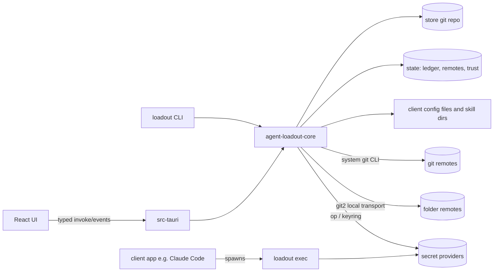
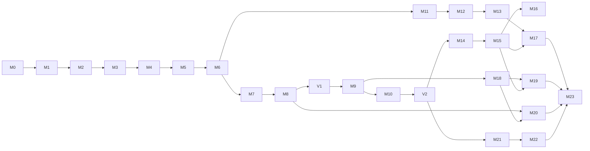

# Loadout (agent-loadout): Specification

Status: draft v2 for review (2026-11-14), formerly "SkillDock Next"; project renamed to `agent-loadout` on 2026-11-14 (display name and binary stay "Loadout"/`loadout`). The maintainer's answers are folded in (§21 Decisions). Spec only; nothing here is implemented.

Conventions:

- Names: project, repository and package name **agent-loadout**; product display name **Loadout**; typed CLI binary `loadout`. Identifiers and the name-collision check are in Appendix C. Every brand string (binary, data dir, manifest dir, env vars, app id, commit-trailer and keyring prefixes, package and repo names) comes from one module, `agent_loadout_core::brand`.
- MUST / SHOULD / MAY carry RFC 2119 meaning.
- `[verify]` marks a client behavior that was not confirmed against primary docs on 2026-11-14. The adapter that depends on it MUST ship with a fixture test plus a manual check against the real client before it is marked stable.
- `~` is the user profile directory. On Windows this is the Known Folder `FOLDERID_Profile` (`%USERPROFILE%`), **never** `$HOME`. `<P>` is a project root folder.
- "SkillDock" means the read-only reference at `../skilldock` (fork `DailenG/skilldock`, HEAD `181b52b`).

---

## 1. Context: what SkillDock does and where it fails

SkillDock is a Tauri 2 app (Rust backend about 75k lines, React frontend about 58k lines) that manages Skills, MCP servers and plugins for about 35 AI coding tools. These findings from reading its code drive this design:

| Area | SkillDock as built (file refs) | Consequence |
|---|---|---|
| MCP registry | `~/.skilldock/config/mcp-servers.json`, `{schemaVersion:1, servers:[McpServerRecord]}`; `server` is untyped JSON; env/header values are plaintext (`mcp_manager.rs:131-164`) | Secrets on disk and in the UI |
| Ownership | Three lists per record: `importedFromAppIds`, `managedAppIds`, `pendingSyncAppIds`; OpenCode special-cased in about 10 places | **Disable deletes the native entry outright**, even user-authored ones (`remove_server_from_app`) |
| Editing client files | Only OpenCode uses a CST (`jsonc-parser`); other JSON is re-serialized with `serde_json` (comments lost, keys alphabetized), YAML re-emitted, Codex upsert runs `mcp.remove("servers")` (deletes the whole legacy table) | Data and formatting loss |
| "local-align" | Frontend-only refetch with cooldowns (`mcp.tsx:873-898`); per-app state is computed from live files; drift never persisted | No real drift detection |
| Scope | User scope only; no Claude Code `.mcp.json` / local scope, no `.cursor/mcp.json`, no Claude Desktop, no VS Code | Requirement 2 is entirely new |
| Tool filtering | Rewrites servers into `npx -y mcp-filter ...` or `npx -y mcp-remote@latest ...` wrappers; headers end up in argv | Unpinned network dependency in client configs |
| Backup | Git CLI + GitHub REST; repo `skilldock-backup`, branch `main` hard-coded; token in plaintext `~/.skilldock/credentials/github.json` | No offline history, no tags |
| Auth | Device flow with baked-in `DEFAULT_OAUTH_CLIENT_ID = "Ov23livYZ8NWkByWZMLz"` (`github_api.rs`), override only via env `SKILLDOCK_GITHUB_CLIENT_ID`; classic `repo` scope | **Sync 404s once upstream's OAuth app vanished** |
| Updater | Endpoint `github.com/wanghuan9/skilldock/releases/latest/download/latest.json` (`tauri.conf.json`) | Second dead upstream dependency |
| Secrets in backup | `env`/`headers` dropped wholesale, key names kept in `requiredSecrets`; the frontend never reads `requiredSecrets` | Restore on a new machine silently loses secrets |
| Merge | Object-level 3-way for skills; MCP, preferences and plugin trees: **local wins silently** | Silent data loss |
| Restore | Replaces `~/.skilldock/skills` wholesale and pushes a new commit; no pre-restore undo point | Destructive |
| Status values | Localized Chinese status labels persisted as state; frontend regex-parses Chinese backend error text | Fragile, not i18n-safe |
| Tool registry | 5+ hand-maintained tables (`build_tool_configs`, `tool_skills_path_for_home`, `known_roots`, `mcp_config_path_for_tool`, `target_app_specs`) plus a 6-entry declarative `tool_adapters.rs` | Drift between tables |
| Windows paths | `HOME` preferred over `USERPROFILE` (Git Bash `HOME` redirects everything) | Wrong files on Windows |
| Linux | Not released (CI builds macOS and Windows only) | Requirement 8 is new work |

What SkillDock gets right and this spec keeps: the GUI layout and flows, the managed/unmanaged/mismatch model for tool skill dirs, directory links into tools (junction fallback on Windows), the per-item "Enable in Tools" pill grid plus per-tool Manage dialog, atomic temp-file plus `ReplaceFileW` writes, tool discovery for MCP servers, and the declarative direction of `tool_adapters.rs`.

---

## 2. Goals and non-goals

### Goals

1. **SkillDock-identical GUI** (layout, flows, look) on Tauri 2, backed by a reusable Rust core crate shared with a CLI (`loadout apply|status|diff|backup|restore` and more).
2. **MCP management at two scopes:** system (user-wide) and project (any folder with a manifest that layers over system). Writes every client's native project-level config. Shows the effective config per folder with per-entry provenance.
3. **Versioned store:** every change and every apply is a commit in a local git repo under the app data dir (fully offline). History, semantic diff, restore any version, one-click rollback of any apply, named tags. Backup remotes are optional push targets: any git URL, or any local, network or synced folder. None is configured by default.
4. **Vendor independence:** nothing breaks if any vendor, upstream repo or service disappears. No baked-in OAuth client ids. Remote auth uses the user's own git credentials or a user-supplied OAuth app id. Plain folders (USB drive, NAS share, a folder synced by any sync tool) are first-class remotes.
5. **Secrets by reference only:** `${env:NAME}`, `op://vault/item/field`, 1Password Environments, OS keyring. 1Password values are fetched by the launcher (`loadout exec`) at server start and never written to disk. No secret value ever enters the store, a snapshot or a remote. Restore on a new machine shows "missing secret" state; a machine without the 1Password CLI degrades to env and keyring refs.
6. **Clients by tier** (Decision 15). Tier A, daily, built and verified first: Claude Code, omp, Codex, Claude Desktop (Windows only). Tier B, daily: VS Code Stable with GitHub Copilot, Cursor, Pi (moved from Tier A on 2026-11-21; its adapter was built with Tier A in M5). Tier C: Gemini CLI, Antigravity, OpenCode, Grok Build. Tier D, best effort: Windsurf and Devin Desktop (not installed), the legacy VS Code editor format (read/import only), and all other SkillDock clients at user scope. Format-preserving edits; never touch entries the app did not create; drift detection with adopt/import.
7. **Skills:** keep SkillDock's store, link/copy distribution, `~/.agents/skills` scan; add project scope.
8. **Platforms:** Windows 11 (primary) and Arch Linux on Hyprland/Wayland as first-class builds; macOS best effort.
9. **Migration** from `~/.skilldock` and from existing client configs.

### Non-goals (v1)

- MCP proxies, gateways or container runtimes (ToolHive, 1MCP, Docker MCP gateway, MetaMCP), per [LANDSCAPE.md](docs/internal/LANDSCAPE.md).
- Rewriting servers into wrapper commands for tool filtering (SkillDock's `mcp-filter`/`mcp-remote`). Tool filtering is written only through native client fields.
- Plugin management, marketplaces, SkillHub publishing and the Publish route: deferred post-v1 (Decision 3). The GUI keeps their nav slots hidden behind a feature flag.
- Built-in catalogs as required dependencies. Catalog sources are optional post-v1 add-ons.
- Managing client settings unrelated to MCP and skills (rules, hooks, permissions, models).
- Team or multi-user servers. The store is personal; project manifests may be shared through the project's own repo.
- Encrypting the store. It contains no secrets by construction (§11), so encryption is unnecessary.

---

## 3. Glossary

| Term | Meaning |
|---|---|
| Store | The versioned git repo `<LOADOUT_HOME>/store` holding desired state (servers, skills, secret references, project mirrors, machine overlays, apply records). |
| State | Machine-local, unversioned data `<LOADOUT_HOME>/state` (ledger, remotes, trust, journals, local settings). |
| Client | An MCP/skills consumer (Claude Code, Cursor, ...). Has an adapter. |
| Target | One native config file + container + scope for one or more clients, e.g. `<P>/.mcp.json` `/mcpServers`. |
| Native entry | One server entry inside a target (e.g. key `github` under `mcpServers`). |
| Ledger | Machine-local record of every native entry or skill link the app wrote or adopted, with a keyed hash of what was written. Defines ownership. |
| Foreign entry | A native entry with no ledger record. Never modified or deleted without an explicit adopt. |
| Layer | One source of desired state for a folder: system, project (shared), project-local (private). |
| Effective config | What a given client actually loads in a given folder, after our layers and the client's own precedence rules. |
| Apply | Reconcile targets with desired state, via a plan the user can inspect. |
| Drift | A native entry we own whose current content differs from what we last wrote. |
| Ref | A secret reference (`${env:X}`, `${secret:ALIAS}`, `op://...`, `op-env://...`, `keyring://...`). |
| Delivery mode | How a ref reaches the MCP server: `env`, `launch`, `command`, `inline` (§11.4). |

---

## 4. Architecture

### 4.1 Repository and crates

```
agent-loadout/                 (Cargo workspace + private package.json, never published to npm)
  crates/
    agent-loadout-core/        lib: everything below, no Tauri dependency
      src/brand.rs             single source of brand strings (names, dirs, env var, app id, prefixes)
      src/env.rs               Env + Fs facade (paths, OS, vars); injected everywhere
      src/model/               schemas: server, secrets, project, machine, applied, settings, skill-meta
      src/store/               git2-backed store: transactions, commits, tags, log, diff, restore, merge
      src/remote/              git (system git CLI), folder (per-machine subfolders: repo, mirror, archive), sync-artifact filter, UNC resolution
      src/formats/             format-preserving editors: json/jsonc, toml, then yaml, json5 (read)
      src/adapters/            AdapterSpec table + mappers per client; detection
      src/layering/            manifests, merge, effective config, provenance
      src/apply/               ledger, planner, executor, journal, backups, lock, apply commits, rollback
      src/secrets/             ref grammar, catalog, providers, delivery rendering, leak scanner
      src/skills/              skill store, frontmatter, link/junction/copy, agents-cli scan
      src/migrate/             SkillDock importer, first-run client scan
      src/events.rs            typed change events (for GUI watchers and CLI output)
    agent-loadout/             CLI crate (`cargo install agent-loadout`), bin `loadout` (clap); thin over agent-loadout-core; also `loadout exec`, `loadout git-credential`
    agent-loadout-testkit/     dev-dependency (unpublished): temp HOME builder, fixtures, fake providers, op/gh stubs
  src-tauri/                   crate `agent-loadout-app` (unpublished), bin: Tauri app (productName Loadout, `mainBinaryName` `agent-loadout-app` so it never clashes with `loadout.exe` on case-insensitive file systems; identifier dev.dailen.loadout); commands are thin wrappers over agent-loadout-core
  src/                         React frontend (ported from SkillDock)
  fixtures/                    client config fixtures + golden outputs (shared by Rust tests)
```

Rules:

- `agent-loadout-core` MUST NOT read process-global state directly (`std::env`, `dirs::home_dir`, `SystemTime::now`). It receives an `Env` (paths, OS, env vars, clock) and an `Fs` trait object. Tests use `RootedFs`, which panics on any path outside the temp root. This is the guarantee that tests never touch real agent configs.
- Errors are typed: `enum CoreError { code: ErrorCode, ... }` with stable `snake_case` codes (`parse_error`, `foreign_entry`, `missing_secret`, ...). The frontend and CLI localize from codes. No localized strings cross the IPC boundary as state.
- All mutating core APIs go through `Store::transaction(op, |tx| ...)`, which validates, writes store files, runs the leak scanner and commits once (§9.2).
- One cross-process lock `<LOADOUT_HOME>/state/loadout.lock` (`fd-lock`) is held by any process mutating the store, ledger or client files. GUI and CLI can run concurrently; the second waits up to 10 s, then fails with `locked`.

### 4.2 Git implementation choice

- **Local store operations** (init, commit, log, diff, tag, read blobs, merge-base, file-level merge, local-path fetch/push for folder remotes) use `git2` with `vendored-libgit2` and **no** `https`/`ssh` features. No OpenSSL, no system git required. The store works fully offline on a machine without git installed.
- **Network remotes** shell out to the system `git` CLI, because that is the only way to honor the user's own credential setup: Git Credential Manager on Windows, `gh auth git-credential`, SSH agent, any configured helper. If `git` is absent, network remotes show `git_not_found` and everything else keeps working.
- `gix` was considered; rejected for v1 because push support and credential-helper integration are less mature. Revisit later; the store module hides the backend behind a trait.

### 4.3 Frontend

- Port SkillDock's React 18 + Vite + TypeScript frontend and `src/styles/tokens.css` verbatim first (look and feel parity), then restructure:
  - Typed IPC: generate TS bindings for commands and events from Rust with `tauri-specta`. Replace `invokeOrFallback` silent fixture fallback with an explicit mock transport used only in tests and Storybook-style dev mode.
  - Server state via TanStack Query (cache + invalidation on core change events) instead of the 90-member god Context and ad-hoc cooldowns (`ROUTE_LOCAL_ALIGN_COOLDOWN_MS`, `MCP_LOCAL_ALIGN_COOLDOWN_MS`, ...).
  - Route modules split per page; header toolbars rendered through React context slots instead of `document.getElementById` portals.
  - Statuses are enums. **English only** (Decision 13): display strings live in one presentation-layer catalog (`src/i18n/en.ts`) keyed by enum and error code; no zh-CN catalog, no language setting.
  - Keep CodeMirror 6 + `@codemirror/merge` for diffs and TOML editing; keep `react-markdown`.
- Tauri: CSP enabled (SkillDock ships `"csp": null`); capabilities minimal (dialog, process, optional updater, window controls). Plugins: `dialog`, `process`, `updater` (optional, §16.4).

### 4.4 Process model



The GUI watches target files, manifests and skill dirs with `notify` (debounced 500 ms, coalesced) and re-runs drift detection for affected targets only.

### 4.5 Data directory layout

`LOADOUT_HOME` default (overridable with env `LOADOUT_HOME` or Settings):

| OS | Default |
|---|---|
| Windows | `%LOCALAPPDATA%\Loadout` (Known Folder `FOLDERID_LocalAppData`; not Roaming: a roaming profile must not sync a live git repo) |
| Linux | `${XDG_DATA_HOME:-~/.local/share}/loadout` |
| macOS | `~/Library/Application Support/Loadout` |

`LOADOUT_HOME` (the live store and state) must never live inside a file-sync root (OneDrive, Dropbox, Google Drive, Syncthing, Resilio Sync or similar): sync tools corrupt live git repos and lock files. Detection walks the ancestors of the resolved path for a Resilio `.sync` dir (containing `ID` or `IgnoreList`) or a Syncthing `.stfolder`, and compares against the OneDrive, Dropbox and Google Drive roots from their known registry and config locations. On a hit the GUI shows a blocking warning that needs an explicit "use anyway" (recorded in `state/local-settings.toml`), the CLI repeats the warning on every mutating command, and `loadout doctor` reports `sync_root_detected`. The defaults never resolve into a sync root; the check guards overrides. The rule covers only the live data folder: a **backup** folder remote inside a synced folder is supported and safe (§9.6), because each machine writes only its own subfolder there through immutable objects and atomic renames, and nothing in it is a live working repo.

```
<LOADOUT_HOME>/
  store/                          git repo (branch main); desired state; NEVER contains secret values
    loadout.toml                  store identity: schema, store_id (ULID), created_at
    servers/<id>.toml             one MCP server per file (§5.2)
    secrets.toml                  secret reference catalog: aliases -> refs (§5.3)
    clients.toml                  per-client preferences (§5.4)
    settings.toml                 portable UI and behavior preferences
    skills/<id>/...               managed skill content (SKILL.md + files, no .git)
    skill-meta/<id>.toml          skill metadata: source, tags, enablement (§12)
    projects/<project-id>/
      project.toml                mirror of <P>/.loadout/project.toml (when shared)
      project.local.toml          mirror of <P>/.loadout/project.local.toml (refs only)
    machines/<machine-id>.toml    per-machine overlay: label, OS, project paths, overrides (§5.6)
    machines/<machine-id>.applied.toml   last apply record of that machine (§8.7)
  state/                          machine-local, unversioned
    machine.toml                  machine_id (ULID), label; created on first run
    ledger.json                   ownership ledger (§8.1)
    ledger.key                    32-byte HMAC key for ledger hashes (or stored in OS keyring)
    remotes.toml                  remotes for this machine (§9.6)
    trust.json                    trusted project manifests (path, id, content hash)
    local-settings.toml           window geometry, default editor path, feature flags, sync-root override
    unmanaged-seen.json           unmanaged entries acknowledged on this machine (§8.6)
    merge/                        in-progress pull merge state (§9.9)
    journal/<apply-id>.json       apply journals for crash recovery (§8.4)
    applies/<apply-id>.json       apply results with per-file detail (last 200)
    loadout.lock                  cross-process lock
  backups/                        machine-local, NEVER pushed; user-only permissions
    files/<ts>-<apply-id>/<encoded-path>   pre-write copies of client files (may contain secrets)
    trash/<ts>/<encoded-path>     items removed by explicit user delete (skills, entries)
  cache/
    skill-sources/<id>/           upstream clones for update checks (re-creatable)
    tools/<server-id>.json        last MCP tool discovery result
  imports/
    skilldock-backup.git          bare copy of SkillDock's backup repo (migration, §15)
  logs/loadout.log                rotating, redacted
```

Encoding for backup paths: absolute path with drive colon and separators percent-encoded, so restores are unambiguous across OSes.

---

## 5. Schemas

All store files are TOML (human-diffable, comment-friendly), `schema = 1` at the top, validated on read and write. Unknown keys are preserved on rewrite (store files are edited through `toml_edit`, so user comments survive). JSON Schemas are generated from the Rust types (`schemars`) and published in `docs/schema/` for editor completion.

### 5.1 Identifiers

- Server id, skill id, project id, secret alias: `^[a-z0-9][a-z0-9._-]{0,63}$` (secret aliases also allow `A-Z`, `_`: `^[A-Za-z_][A-Za-z0-9_]{0,63}$` so they double as env var names).
- The file name MUST equal the id (`servers/github.toml` has `id = "github"`).
- The native entry key written to clients defaults to the server id; `native_name` overrides it per client when a client restricts names (Gemini recommends no underscores; Claude Code allows `[A-Za-z0-9_-]`; Pi treats `-` and `_` as equal).

### 5.2 Server (`store/servers/<id>.toml`)

```toml
schema = 1
id = "github"
display_name = "GitHub"
description = "Issues, pull requests and code search"
tags = ["dev"]

transport = "stdio"                 # stdio | http | sse
command = "npx"
args = ["-y", "@modelcontextprotocol/server-github"]
# cwd = "${project}"                # template vars: ${home}, ${project}, ${loadout_home}

[env]
GITHUB_PERSONAL_ACCESS_TOKEN = "${secret:GITHUB_PAT}"   # reference, never a value
GITHUB_TOOLSETS = "repos,issues"                         # literal non-secret values are fine

[enable]                            # system scope (user-wide) enablement
clients = ["claude-code", "cursor", "codex", "omp", "pi", "copilot"]
# clients = "all-detected"          # every detected client whose capabilities fit

[delivery]                          # how refs reach the server (section 11.4)
mode = "auto"                       # auto | env | launch | command | inline

[tools]                             # written only via native fields (Codex enabled_tools/disabled_tools,
deny = ["delete_repository"]        # Gemini includeTools/excludeTools, Copilot tools, Pi toolExposure)

[os.windows]                        # per-OS deep-merged overrides
# command = "C:\\tools\\gh-mcp.exe"

[client.codex]                      # native passthrough fields, checked against the adapter allowlist
startup_timeout_sec = 60
[client.gemini]
trust = false
native_name = "github-mcp"

[meta]
homepage = "https://github.com/github/github-mcp-server"
origin = "imported:cursor"          # manual | imported:<client> | migrated:skilldock | catalog:<source>
```

Remote example:

```toml
schema = 1
id = "linear"
transport = "http"
url = "https://mcp.linear.app/mcp"
[headers]
Authorization = "Bearer ${secret:LINEAR_TOKEN}"
[enable]
clients = "all-detected"
```

Validation (typed, unlike SkillDock's untyped `serde_json::Value`): `stdio` requires `command`, forbids `url`/`headers`; `http`/`sse` require `url`, forbid `command`/`args`/`env`; every string field is parsed by the ref grammar (§11.2); `client.<id>` keys must be in that adapter's passthrough allowlist; `enable.clients` ids must exist in the adapter table (unknown ids are a warning, kept, so a newer store opened by an older app does not lose data).

Windows `npx`/`.cmd` shims: adapters with `windows_shell_shim` (clients that spawn without a shell, e.g. Claude Desktop) render `command = "cmd"`, `args = ["/c", "npx", ...]` automatically. The store keeps the portable `npx`.

### 5.3 Secret catalog (`store/secrets.toml`)

```toml
schema = 1

[onepassword]
environment = "blgexucrwfr2dtsxe2q4uu7dp4"   # the one Environment holding MCP secrets (an id, not a secret; example id from 1Password docs)
account = "example.1password.com"            # optional: the account every `op` call names (several accounts signed in; gate V1 FB-7)

[secrets.GITHUB_PAT]
ref = "op://Developer/GitHub PAT/credential"
description = "Fine-grained PAT, contents:read on selected repos"

[secrets.LINEAR_TOKEN]
ref = "op-env://blgexucrwfr2dtsxe2q4uu7dp4/LINEAR_TOKEN"   # 1Password Environment

[secrets.OPENAI_API_KEY]
ref = "keyring://loadout/OPENAI_API_KEY"

[secrets.HASS_TOKEN]
ref = "env:HASS_TOKEN"              # plain environment variable
env_name = "HASS_TOKEN"             # env var name used by env delivery (default: alias)
```

Only references and metadata. A per-machine overlay may override `ref` (§5.6), so one alias can resolve from 1Password on Windows and from the keyring on Arch.

### 5.4 Client preferences (`store/clients.toml`)

```toml
schema = 1
[claude-code]
project_shared_target = ".mcp.json"          # where project.toml layer goes
project_local_target = "local-scope"         # ~/.claude.json projects[<P>].mcpServers
[omp]
profiles = ["default"]                       # omp named profiles to target
[vscode-legacy]                              # read/import only (§7.3)
import_variants = ["Code"]                   # Code | Code - Insiders | VSCodium
import_profiles = "default"                  # default | all | ["<profile-id>", ...]
[windsurf]
enabled = false                              # Tier D; opt a client out of everything
```

### 5.5 Project manifest (`<P>/.loadout/project.toml`, `<P>/.loadout/project.local.toml`)

```toml
schema = 1
id = "skilldock-next-7k2f"          # generated on init: slug + 4 random chars; survives moves
name = "SkillDock Next"

[defaults]
clients = "all-detected"            # clients that receive project-scope files; or an explicit list

[servers.github]                    # override a system server in this folder
from = "github"                     # inherit store/servers/github.toml
[servers.github.env]
GITHUB_TOOLSETS = "repos,issues,pull_requests,actions"

[servers.postgres]                  # project-only server, inline definition
transport = "stdio"
command = "uvx"
args = ["postgres-mcp", "--access-mode=restricted"]
clients = ["claude-code", "cursor", "codex"]
[servers.postgres.env]
DATABASE_URI = "${env:DATABASE_URL}"

[servers.playwright]
from = "playwright"                 # a store server used as a template, not enabled system-wide

[servers.slack]
enabled = false                     # suppress a system server in this folder

[skills]
enable = ["repo-conventions", "tauri-release"]
share = false                       # false: link + .git/info/exclude; true: copy files for teammates
```

`<P>/.loadout/project.local.toml` has the same schema and is personal. **New manifests default to private** (Decision 8): `loadout project init` and the GUI create only `.loadout/project.local.toml`, which then carries the `id`, and append `.loadout/` to `<P>/.git/info/exclude`, so nothing is visible to teammates. **Shared** (on request, `--shared`) creates `.loadout/project.toml` with the `id` plus `.loadout/.gitignore` listing `project.local.toml`; the shared file is committed with the project. When both exist, `id` comes from `project.toml` and the local file layers on top. "Share manifest" (`loadout project share`) moves selected entries from the local file into `project.toml` as one commit.

The folder is the source of truth: apply reads `<P>/.loadout/*.toml` for every project this machine knows (`[projects.<id>] path` in its overlay). The store mirror `projects/<id>/` is written when Loadout trusts the content (`project init`, `trust`, `share`), so mirrored content is always trusted content. `project add` registers a folder without trusting it; `project rm` forgets it, and the next apply removes the entries Loadout owns for it (only unchanged owned entries, §8.4). A known folder that is missing, unreadable, invalid or rooted at `~` keeps its entries and is not planned (M9).

### 5.6 Machine overlay (`store/machines/<machine-id>.toml`)

Written only by the machine it describes (so merges never conflict on it).

```toml
schema = 1
machine_id = "01JCX5B7K3M9N1P5Q7R3S9T1V5"
label = "laptop"
os = "linux"

[enable]
exclude_clients = ["cursor"]

[secrets.GITHUB_PAT]                # per-machine ref override: no 1Password CLI here (§11.11)
ref = "keyring://loadout/GITHUB_PAT"

[servers.filesystem]                # per-machine field overrides for system servers
args = ["-y", "@modelcontextprotocol/server-filesystem", "/home/<user>/Code"]

[projects.skilldock-next-7k2f]      # where this project lives on this machine
path = "/home/<user>/Code/skilldock-next"
```

`machines/<machine-id>.applied.toml` (§8.7) follows the same single-writer rule.

### 5.7 Portable settings (`store/settings.toml`)

`theme`, `apply_mode` (`instant` (default) | `review`), `new_server_enable` (`all-detected` | `none`, maps SkillDock `mcpInstallActivation`), `new_skill_enable`, `agents_cli_compat`, `list_view` preferences. No language setting (English only). Machine-specific values (editor path, window size) live in `state/local-settings.toml`.

---

## 6. Layering and merge rules

### 6.1 Layers

For a folder `F` and a client `C`, lowest to highest:

1. **System**: store servers with `C` in `enable.clients`, after OS overrides (`[os.<os>]`) and the machine overlay. Written to `C`'s user-scope target.
2. **Project (shared)**: `<P>/.loadout/project.toml` in the nearest manifest dir at or above `F`. Written to `C`'s project target.
3. **Project-local (private)**: `<P>/.loadout/project.local.toml`, the only file of a private project (the default for new manifests). Written to `C`'s private project target when the client has one; otherwise merged into the project target, subject to the shared-file rules of 6.5.

Nested manifests: v1 uses the **nearest** manifest only; outer manifests are not merged (documented limitation, revisit for monorepos). A manifest directly in `~` is ignored (it would be "every folder").

### 6.2 Server resolution within project layers

For each `servers.<name>` in the merged project layer:

- `from = "<id>"`: start from store server `<id>` (whether or not it is enabled system-wide), then deep-merge the project fields over it. Unknown `<id>` is an error (`unknown_template`).
- No `from`: the table is a complete definition, validated like a store server.
- `enabled = false` alone: a **suppression** of the same-named system server in this folder.
- `clients`: list of clients that get this entry at project scope; defaults to `[defaults].clients`.

Deep merge: tables merge recursively (so `env` and `headers` merge key by key), arrays replace (`args`), scalars replace. `unset = ["env.FOO", "headers.X-Debug"]` removes inherited keys. The local layer merges over the shared layer with the same function, keyed by server name.

### 6.3 What gets written

Per client `C` with a project target:

| Desired | Written to project target | Notes |
|---|---|---|
| Project-only server | Full entry | |
| Override of system server (`from` + fields) | Full entry with the same native name | Shadows the user entry where the client's project precedence is "replace" (Claude Code, Pi, omp, Grok). Adapters with `project_semantics = DeepMerge` (Codex, OpenCode) get a full entry too; an `unset` on such a client raises `unset_not_expressible` because the user-scope key would still merge in. Where both entries run (`project_semantics = Coexist`: Cursor) the override does not replace the user server; the effective view lists both with `duplicate_across_layers`. |
| Suppression (`enabled = false`) | Via the adapter's `project_disable` mechanism (table 7.4) | Unsupported: warning `cannot_suppress_in_project` in the effective view, with the fix "remove `C` from the system enable list and add the server to the projects that need it". |

### 6.4 Effective config and provenance

`effective(F, C)` returns, for every server name `C` would load in `F`:

```json
{ "name": "github", "loaded": true,
  "winner": { "layer": "project", "file": "<P>/.mcp.json", "source": "store:github+project" },
  "shadowed": [{ "layer": "system", "file": "~/.claude.json" }],
  "also_visible_to": ["copilot", "grok", "omp"],
  "status": "synced", "warnings": [] }
```

Layers reported: `system`, `project`, `project-local`, `foreign:<file>` (entries we do not own but the client loads), `client-compat:<file>` (entries the client imports from another tool's file, e.g. Grok reading `~/.claude.json`, `.cursor/mcp.json` and `.mcp.json`; omp reading `.claude/`, `.cursor/`, `.vscode/`). Each adapter declares its native precedence order and compat sources so the computation matches what the client does. A compat source ranks below the client's own layers unless it declares that it outranks one of them for one host: Copilot's `<P>/.vscode/mcp.json` outranks `<P>/.mcp.json`, because VS Code runs that entry (V2 VSL-3), while the Copilot CLI reads only `.mcp.json`. Duplicates across sources are flagged (`duplicate_via_compat`; for an outranking source the message says which host runs which entry). A client whose own layers coexist (`project_semantics = Coexist`: Cursor, V2 CUR-5) runs a same-named user and project entry as two servers: the view lists one loaded row per file, neither shadowing the other, each flagged `duplicate_across_layers`.

### 6.5 Shared native files

Some files are read by several clients. Workspace-root `<P>/.mcp.json` is read by Claude Code (project scope), GitHub Copilot (native workspace file), Grok (compat) and omp (fallback). The apply engine treats a **file** as the unit: the entries written are the union for every client mapped to it, and the effective view lists all readers. Enabling a server at project scope "for Claude Code only" therefore also exposes it to Copilot; the UI shows that before apply.

A project-local layer entry must not land in a file that is tracked by the project's git repo (checked against the git2 index). As built in M9: a client with a private target (Claude Code) gets the merged entry there and keeps the shared-only definition in the shared file; a client without one gets the merged entry in its project file when that file is untracked, and Loadout adds the file to the repo's `info/exclude` (anchored `/<path>`, through `commondir` for worktrees) before writing, also on runs that write nothing; a tracked file blocks the entry with `private_in_tracked_file` (fix: remove the client from the entry's `clients`, or untrack the file). Any git error other than "no repository" blocks the private entries of that file (`git_error`). `--op-account` is never written into shared files, and a `${project}` path in a shared file warns `personal_path_in_shared_file`.

---

## 7. Client adapters

### 7.1 Adapter model

Adapters are **data first**: one declarative table (replacing SkillDock's five tables), plus small mapper implementations for odd shapes.

```rust
pub struct AdapterSpec {
    pub id: &'static str,                  // "claude-code"
    pub display_name: &'static str,
    pub tier: Tier,                        // A daily | B daily, second wave | C supported | D best effort / ported
    pub detect: &'static [Probe],          // config dir exists, executable on PATH, Windows App Paths/registry, MSIX package
    pub mcp: Option<McpSpec>,
    pub skills: Option<SkillsSpec>,
}

pub struct McpSpec {
    pub user: &'static [Location],          // ordered candidates: first existing wins; else [0] is created
    pub project: &'static [Location],       // relative to <P>
    pub project_local: &'static [Location], // may point into a user file with a {project} key
    pub format: Format,                     // Json | Jsonc | Json5ReadOnly | Toml | Yaml
    pub container: ContainerPath,           // "/mcpServers", "/projects/{project_key}/mcpServers", "mcp_servers", ...
    pub mapper: &'static dyn EntryMapper,
    pub caps: Caps,
}

pub struct Caps {
    pub transports: TransportSet,           // stdio | http | sse
    pub env_ref: Option<EnvRefSyntax>,      // DollarBrace "${X}", DollarBraceEnv "${env:X}", BraceEnv "{env:X}", CodexForward
    pub env_ref_fields: FieldSet,           // which fields the client expands
    pub command_ref: Option<CommandRef>,    // "!cmd" (Pi, omp) or headersHelper (Claude Code)
    pub native_disable: Option<DisableMech>,// EnabledFalse | DisabledTrue | ListMember(path)
    pub project_disable: Option<ProjectDisable>,
    pub project_semantics: ProjectSemantics,// Replace | DeepMerge | Unknown
    pub precedence: &'static [Source],      // for effective-config computation
    pub compat_reads: &'static [CompatSource],
    pub trust_gate: Option<TrustGate>,      // client requires trust/approval for project files
    pub rewrites_file_at_runtime: bool,     // ~/.claude.json: extra CAS care
    pub restart_required: bool,             // Claude Desktop reads only at launch
    pub tool_filter: Option<ToolFilterMech>,
    pub windows_shell_shim: bool,
    pub passthrough_allowlist: &'static [&'static str],
}

pub trait EntryMapper: Sync {
    fn to_native(&self, s: &RenderedServer, cx: &WriteCx) -> Result<NativeValue, MapError>;
    fn from_native(&self, key: &str, v: &NativeValue) -> Result<ServerDef, MapError>;
    fn canonical(&self, v: &NativeValue) -> Canonical; // sorted, defaults dropped; used for equality and hashing
}

pub enum Location {
    Home(&'static str),                     // ~/...
    AppData(&'static str),                  // %APPDATA% | ~/Library/Application Support | $XDG_CONFIG_HOME
    LocalAppData(&'static str),             // %LOCALAPPDATA% (Windows only)
    XdgConfigAllOs(&'static str),           // $XDG_CONFIG_HOME or ~/.config, also on Windows (OpenCode, Crush)
    EnvDir { var: &'static str, fallback: &'static Location, rel: &'static str }, // CODEX_HOME, COPILOT_HOME, PI_CODING_AGENT_DIR, CLAUDE_CONFIG_DIR
    Project(&'static str),                  // <P>/...
    Glob(&'static str),                     // MSIX package dirs, VS Code profiles
}
```

`MapError::UnsupportedTransport` (e.g. SSE on Codex or Pi) and `MapError::UnsupportedField` are reported per target as `blocked`; they never silently drop data.

### 7.2 Format-preserving editors

| Format | Implementation | Guarantees |
|---|---|---|
| JSON (strict) and JSONC | `jsonc-parser` CST (already used by SkillDock for OpenCode) | Comments, key order, indentation, trailing-comma style preserved; strict files never gain comments or trailing commas. |
| JSON5 | read with `json5`; write only through the JSONC CST when the file parses as JSONC; otherwise `read_only_format` | No lossy rewrites (SkillDock wrote strict JSON over JSON5). |
| TOML | `toml_edit`, updating keys **inside** the existing table in place | Comments and unknown keys inside our own server table survive (SkillDock replaced the whole table). Never touches tables outside the target entry. |
| YAML | span splice: parse with a marker-aware parser (`saphyr`), locate the entry node's byte span, replace only that span with freshly emitted YAML at the same indentation | If the node cannot be located unambiguously (anchors, aliases, flow style), the target is `read_only_format`. Only Ported clients use YAML. |

Common rules: detect and keep BOM, line endings (CRLF on Windows files), final newline, indentation width. Editing a document with no logical change MUST return byte-identical text (property-tested). New keys are appended at the end of the container. A missing file is created with the minimal skeleton (omp also gets its `$schema` line, matching what omp itself writes).

### 7.3 Client paths and shapes (MCP)

Paths: `~` per Conventions; `%APPDATA%` is Roaming; `$XDG_CONFIG_HOME` defaults to `~/.config`. Rows are ordered by tier (Decision 15).

| Tier | Client (id) | Format | User scope | Project (shared) | Project-local (private) | Container and entry shape |
|---|---|---|---|---|---|---|
| A | Claude Code (`claude-code`) | JSON | `~/.claude.json` (all OS; `$CLAUDE_CONFIG_DIR/.claude.json` when set, and then `~/.claude.json` is not created; V1, Windows) | `<P>/.mcp.json` | `~/.claude.json` at `projects["<P>"].mcpServers` (Windows key: the working directory with `/` separators, exact case, no trailing separator; Claude Code matches only that exact spelling; V1, see `docs/verify/claude-code.md`) | `mcpServers.<n>`: `{type, command, args, env}` or `{type: "http"/"sse"/"ws", url, headers, headersHelper}`; `type` required for remote entries |
| A | oh-my-pi (`omp`) | JSON | `~/.omp/agent/mcp.json` (honors `PI_CONFIG_DIR`, `PI_CODING_AGENT_DIR`; no `~` expansion in `PI_CODING_AGENT_DIR`, omp resolves it against its working directory, V2; named profiles `~/.omp/profiles/<name>/agent/mcp.json` per `clients.toml`) | `<P>/.omp/mcp.json` | none | `mcpServers.<n>`: `{type, command, args, env, cwd}` or `{type, url, headers, auth, oauth}`; `enabled, timeout` (ms), `instructions`; top-level `disabledServers`/`enabledServers` preserved. omp's `timeout` also bounds the server's connection and startup, not only tool calls: a server slower to start than the timeout loses all its tools for the run (V2 OMP-6, Windows Sandbox). With `PI_CODING_AGENT_DIR` set, omp and Pi share `$PI_CODING_AGENT_DIR/mcp.json` (V2 OMP-10): an entry there that sets `timeout` is `blocked: timeout_unit_conflict` (ms for omp, seconds for Pi). |
| B | Pi (`pi`) | JSON | `~/.pi/agent/mcp.json`, or `$PI_CODING_AGENT_DIR/mcp.json` (Pi expands `~`, `~/` and on Windows `~\` in the variable; V2 PI-1) | `<P>/.pi/mcp.json` (project trust required) | none | `mcpServers.<n>`: `{type, command, args, env, cwd}` or `{type, url, headers, oauth}`; `type` (`stdio`, `http`, `streamable-http`) is optional for Pi, Loadout writes `stdio` or `http` so entries match omp's in a shared file (V2 OMP-10); `enabled, exposure, toolExposure, description, timeout` (seconds). No SSE. If `pi-mcp-adapter` is installed (`pi install npm:pi-mcp-adapter`: a `packages` entry in `<agent dir>/settings.json` and the package under `<agent dir>/npm/node_modules`; with `-l` the same under `<P>/.pi`; or an `extensions/pi-mcp-adapter[.ts/.js]` path), built-in MCP is replaced: Loadout reports `client_mcp_replaced_by_extension` on user installs everywhere and on project installs for that project's targets and effective rows (V2 PI-8). |
| A | Codex (`codex`) | TOML | `$CODEX_HOME/config.toml`, else `~/.codex/config.toml` | `<P>/.codex/config.toml` (loaded only for trusted projects) | none | `[mcp_servers.<n>]`: `command, args, env, env_vars, cwd` or `url, bearer_token_env_var, http_headers, env_http_headers`; `enabled, startup_timeout_sec, tool_timeout_sec, enabled_tools, disabled_tools`. No SSE. Legacy `[mcp.servers]` read-only, never deleted (fixes SkillDock bug). |
| A | Claude Desktop (`claude-desktop`) | JSON | **Windows only** (Decision 12): `%APPDATA%\Claude\claude_desktop_config.json`, plus the MSIX copy `%LOCALAPPDATA%\Packages\Claude_*\LocalCache\Roaming\Claude\claude_desktop_config.json` when present (write both, warn). macOS `~/Library/Application Support/Claude/claude_desktop_config.json` best effort. No Linux target. | none | none | `mcpServers.<n>`: stdio only (remote servers are Connectors in the app UI) |
| B | VS Code Stable with GitHub Copilot, and Copilot CLI (`copilot`) | JSON | `$COPILOT_HOME/mcp-config.json`, else `~/.copilot/mcp-config.json` (VS Code 1.147 reads and starts this file with no extra setting; the CLI resolves a relative `COPILOT_HOME` against its working directory, which Loadout ignores; V2 COP-1, COP-2, Windows Sandbox) | `<P>/.mcp.json` at the workspace root (shared file, 6.5) | none | `mcpServers.<n>`: `{type, command, args, env, cwd, tools}` or `{type, url, headers, tools, oauthClientId}`; `type` is `stdio`, `http` or `sse`. Never writes editor-only fields (`inputs`, `envFile`, `dev`, `sandbox`). This is VS Code's current Copilot-harness location (checked against the VS Code MCP configuration reference on 2026-11-14). |
| B | Cursor (`cursor`) | JSON | `~/.cursor/mcp.json` | `<P>/.cursor/mcp.json` (each project server stays disabled until enabled once in Cursor's MCP settings; V2 CUR-2, Windows Sandbox) | none | `mcpServers.<n>`: `{command, args, env, envFile}` or `{url, headers}` |
| C | Gemini CLI (`gemini`) | JSON | `~/.gemini/settings.json` | `<P>/.gemini/settings.json` (trusted folders) | none | `mcpServers.<n>`: `{command, args, env, cwd}` or `{url}` (SSE) or `{httpUrl}` (HTTP); `headers, timeout, trust, includeTools, excludeTools`; no `type` field |
| C | Antigravity (`antigravity`) | JSON | `~/.gemini/config/mcp_config.json` | `<P>/.agents/mcp_config.json` | none | `mcpServers.<n>`: `{command, args, env}` or `{serverUrl, headers, timeoutSeconds}`; no SSE, no `httpUrl` |
| C | OpenCode (`opencode`) | JSONC | `$XDG_CONFIG_HOME/opencode/opencode.json[c]` (also `~/.config` on Windows) | `<P>/opencode.json[c]` (reads `<P>/.opencode/` too) | none | `mcp.<n>`: `{type: "local", command: [cmd, ...args], environment, enabled}` or `{type: "remote", url, headers, enabled}` |
| C | Grok Build (`grok`) | TOML | `~/.grok/config.toml` | `<P>/.grok/config.toml` (Grok walks cwd to git root) | none | `[mcp_servers.<n>]`: `command, args, env` or `url, headers`; `startup_timeout_sec, tool_timeout_sec` |
| D | VS Code editor-managed format, legacy (`vscode-legacy`) | JSONC | **Read/import only**: Win `%APPDATA%\Code\User\mcp.json`; Linux `$XDG_CONFIG_HOME/Code/User/mcp.json`; macOS `~/Library/Application Support/Code/User/mcp.json`; variants `Code - Insiders`, `VSCodium`; profiles `User/profiles/<id>/mcp.json` | `<P>/.vscode/mcp.json` (read/import only) | none | `servers.<n>` plus `inputs[]`. VS Code deprecated this Local-harness format (removal February 2027). Never written. Import converts `${env:NAME}` to refs and flags `${input:...}` as `needs_manual_secret`. VS Code can forward these definitions into Copilot sessions, so the effective view lists them as `client-compat` sources for `copilot` and flags duplicates. VS Code 1.147 still reads and starts the user file, profile files and `<P>/.vscode/mcp.json`; for a name in both `<P>/.vscode/mcp.json` and `<P>/.mcp.json` it lists one server and runs the `.vscode/mcp.json` one (V2 VSL-1 to VSL-4, Windows Sandbox). |
| D | Windsurf, legacy Cascade (`windsurf`) | JSON | `~/.codeium/windsurf/mcp_config.json` | `<P>/.windsurf/mcp_config.json` [verify] | none | `mcpServers.<n>`: `{command, args, env}` or `{serverUrl, headers}` [verify `url` vs `serverUrl`]. Not installed; best effort. |
| D | Devin Desktop, Windsurf successor (`devin`) | JSON | Linux/macOS `~/.config/devin/mcp_config.json`; Win `%APPDATA%\devin\mcp_config.json` | `<P>/.devin/mcp_config.json` | `<P>/.devin/mcp_config.local.json` | `mcpServers.<n>`: `{command, args, env}` or `{url, transport}`. Not installed; best effort. |

### 7.4 Client capabilities

| Client | Transports | Env ref written | Command ref | Native disable | Project suppression of a user server | Project precedence | Trust gate | Notes |
|---|---|---|---|---|---|---|---|---|
| claude-code | stdio, http, sse, ws | `${VAR}`, `${VAR:-d}` in command, args, env, url, headers | `headersHelper` (http/ws) | none in entry | `projects["<P>"].disabledMcpServers` list membership | Replace (local > project > user; whole entry) | `.mcp.json` approval | `~/.claude.json` rewritten by Claude Code constantly: CAS write, retry |
| claude-desktop | stdio | none (literal) | none | none (remove) | n/a | n/a | none | Windows only; `restart_required` (a server added while the app runs starts only after a full restart; V2 CD-1, AP-6, Windows Sandbox); `windows_shell_shim` (plain `npx` does not start, the `cmd /c` form does; a full path to a `.cmd` starts without it; V2 CD-4); http entries are ignored (V2 CD-5); servers are listed under Settings > Desktop app > Extensions > Local MCP servers (build 3.6556.2); rewrites the whole file at launch, keeping `mcpServers` and adding `preferences` (`rewrites_file_at_runtime`; V1, Windows Sandbox) |
| cursor | stdio, http, sse | `${env:NAME}` in `command`, `args`, `env`, `url` and header values (V2 CUR-3, Windows Sandbox), `${userHome}`, `${workspaceFolder}` | none | none: `"disabled": true` is ignored and the UI toggle lives in Cursor's own storage, not in `mcp.json` (V2 CUR-4) | unsupported: a same-named project entry or `{ "disabled": true }` does not hide the user server (V2 CUR-5) | none: both same-named entries run, listed per source (V2 CUR-5; `Coexist`, `duplicate_across_layers`) | project servers in `<P>/.cursor/mcp.json` stay "Disabled" until enabled per server in Cursor's MCP settings (V2 CUR-2) | `envFile` honored (V2 CUR-10); plain `npx` works without `cmd /c` (V2 CUR-8) |
| vscode-legacy | n/a (read/import only) | reads `${env:NAME}` | none | n/a | n/a | n/a | workspace trust | deprecated format, never written |
| copilot | stdio, http, sse | `${NAME}`, `${NAME:-default}` in `command`, `args`, `env` and header values (VS Code: `args`, `env` and the default verified, V2 COP-4, Windows Sandbox) | none | none: the CLI ignores `"disabled": true` and `"enabled": false`; `copilot mcp disable` writes `disabledMcpServers` in `~/.copilot/settings.json` (V2 COP-6) | unsupported | Replace: VS Code runs the `<P>/.mcp.json` entry over a same-named user entry once trusted (V2 COP-5) | workspace trust in VS Code; the Copilot CLI skips `<P>/.mcp.json` in an untrusted folder (`trustedFolders` in `~/.copilot/config.json`) (V2 COP-3) | `tools` field for filtering; VS Code's workspace-root form rejects `${...}` but the runtime reads it; plain `npx` starts in VS Code (V2 COP-9); VS Code runs a `<P>/.vscode/mcp.json` entry over a same-named `<P>/.mcp.json` entry, which the Copilot CLI (reading only `.mcp.json`) runs instead (V2 VSL-3; a compat source that outranks the project layer) |
| windsurf | stdio, http, sse | `${env:NAME}` | none | `disabled: true` [verify] | unsupported [verify] | [verify] | none | |
| devin | stdio, http, sse | `${env:VAR}` [verify fields] | none | [verify] | [verify] | local > project > user [verify] | none | |
| codex | stdio, http | `env_vars = ["NAME"]` (forward), `bearer_token_env_var`, `env_http_headers` | none | `enabled = false` | project `enabled = false` (a table holding only `enabled = false` disables the user entry; V1) | DeepMerge (a project table holding only `args` keeps the user entry's other fields; V1) | trusted projects only | no `${}` expansion |
| gemini | stdio, http, sse | `${VAR}` | none | none | project `mcp.excluded` [verify] | DeepMerge of settings [verify] | trusted folders | `includeTools`/`excludeTools` |
| antigravity | stdio, http | [verify] | none | [verify] | [verify] | [verify] | [verify] | |
| opencode | stdio, http, sse | `{env:NAME}` (also `{file:path}`) | none | `enabled: false` | project `enabled: false` | DeepMerge (per omp's documented OpenCode behavior) | none | |
| pi | stdio, http | `${VAR}` in env and headers; Pi also expands bare `$NAME`, so a literal `$` is written `$$` and a leading literal `!` is written `$!` there (V2 PI-7) | `!command` (whole value, env/headers) | `enabled: false` | project `{ "enabled": false }` keeps the rest | Replace (enabled-only entries override) | project trust | shares `$PI_CODING_AGENT_DIR/mcp.json` with omp when the variable is set; a `timeout` there is `timeout_unit_conflict` |
| omp | stdio, http, sse | `${VAR}`, `${VAR:-d}`, bare env name | `!command` (env/headers) | `enabled: false` | project `enabled: false` | Replace (project first) | none | reads many other clients' files: compat duplicates; shares `$PI_CODING_AGENT_DIR/mcp.json` with Pi (see pi) |
| grok | stdio, http | `${VAR}`, `${VAR:-d}` | none | [verify] | unsupported (same-name replaces) | Replace | folder trust | reads `~/.claude.json`, `.cursor/mcp.json`, `.mcp.json` (compat) |

### 7.5 Tier D ported clients (user scope in v1)

Carried over from SkillDock's tables (`mcp_manager.rs:1336-1527`, `tool_adapters.rs`), with the OS fixes noted. Best effort; project scope for these is `[verify]` and out of v1 scope.

| id | Format | User-scope MCP file | Container | Skills dir |
|---|---|---|---|---|
| augment | JSON | `~/.augment/settings.json` | `mcpServers` | `~/.augment/skills` |
| cline | JSON | `~/.cline/data/settings/cline_mcp_settings.json` | `mcpServers` (native `disabled` used) | `~/.cline/skills` |
| roo-code | JSON | `AppData/Code/User/globalStorage/RooVeterinaryInc.roo-cline/settings/mcp_settings.json` | `mcpServers` | `~/.roo/skills` |
| kilo-code | JSON | `AppData/Code/User/globalStorage/kilocode.kilo-code/settings/mcp_settings.json` | `mcpServers` | `~/.kilocode/skills` |
| kiro | JSON | `~/.kiro/settings/mcp.json` | `mcpServers` | `~/.kiro/skills` |
| junie | JSON | `~/.junie/mcp/mcp.json` | `mcpServers` | `~/.junie/skills` |
| droid | JSON | `~/.factory/mcp.json` | `mcpServers` | `~/.factory/skills` |
| commandcode | JSON | `~/.commandcode/mcp.json` | `mcpServers` | `~/.commandcode/skills` |
| crush | JSON | `XdgConfigAllOs/crush/crush.json` | `mcp` | `XdgConfigAllOs/crush/skills` |
| qoder | JSON | `~/.config/Qoder/SharedClientCache/mcp.json` (SkillDock uses this on every OS [verify per OS]) | `mcpServers` | `~/.qoder/skills` |
| trae / trae-cn | JSON | `AppData/Trae/User/mcp.json` / `AppData/Trae CN/User/mcp.json` (+ `User/profiles/*/mcp.json`) | `mcpServers` | `~/.trae/skills` / `~/.trae-cn/skills` |
| codebuddy | JSON5 (read), JSONC write when possible | first of `~/.codebuddy/.mcp.json`, `~/.codebuddy/mcp.json`, `~/.codebuddy.json` | `mcpServers` | `~/.codebuddy/skills` |
| iflow | JSON | first of `~/.iflow/settings.json`, `~/.iflow/mcp/config.json` | `mcpServers` | `~/.iflow/skills` |
| qwen-code | JSON | `~/.qwen/settings.json` | `mcpServers` (Gemini mapping) | `~/.qwen/skills` |
| zencoder | JSON | `~/.zencoder/settings.json` | `zencoder.mcpServers` [verify nested vs dotted key] | `~/.zencoder/skills` |
| openclaw | JSON5 (read) | `~/.openclaw/openclaw.json` | `mcp.servers` (agent-JSON shape) | `~/.openclaw/skills` |
| mimo-code | JSON | `~/.config/mimocode/mimocode.json` | `mcp` (command array) | `~/.config/mimocode/skills` |
| workbuddy | JSON | `~/.workbuddy/.mcp.json` | `mcpServers` | `~/.workbuddy/skills` |
| zcode | JSON | `~/.zcode/cli/config.json` | `mcp.servers` (`enable` flag) | `~/.zcode/skills` |
| continue | YAML | `~/.continue/config.yaml` | `mcpServers` (array, matched by `name`) | `~/.continue/skills` |
| goose | YAML | `$GOOSE_PATH_ROOT/config/config.yaml`; else Win `%APPDATA%\Block\goose\config\config.yaml`; else `~/.config/goose/config.yaml` | `extensions.<n>` (`cmd`, `envs`, `streamable_http`; headers supported [verify], SSE rejected) | same dir `/skills` |
| hermes | YAML | `~/.hermes/config.yaml` | `mcp_servers.<n>` | `~/.hermes/skills` |
| intellij | n/a | none (skills only) | n/a | `~/.junie/skills` (shared with junie) |

Transport inference on read is unified across all mappers (SkillDock was inconsistent): explicit type wins; `httpUrl` means http; `serverUrl` means http; bare `url` means http except where the client documents SSE semantics (Gemini `url` = SSE); `command` means stdio. OpenCode/OpenClaw/MiMo `remote` maps to http unless the URL path ends in `/sse` (SkillDock always mapped it to SSE).

### 7.6 Skills targets

| Client | User scope | Project scope |
|---|---|---|
| claude-code | `~/.claude/skills` | `<P>/.claude/skills` |
| codex | `~/.codex/skills` (SkillDock) and `~/.agents/skills` [verify which Codex reads] | `<P>/.agents/skills` [verify] |
| cursor | `~/.cursor/skills` | `<P>/.cursor/skills` [verify] |
| copilot (VS Code with Copilot) | `~/.copilot/skills` | `<P>/.github/skills` [verify] |
| windsurf / devin | `~/.codeium/windsurf/skills` / [verify] | [verify] |
| gemini | `~/.gemini/skills` | `<P>/.gemini/skills` [verify] |
| antigravity | `~/.gemini/config/skills` | `<P>/.agents/skills` [verify] |
| opencode | `XdgConfigAllOs/opencode/skills` | `<P>/.opencode/skills` [verify] |
| pi | `~/.pi/agent/skills` | `<P>/.pi/skills` [verify] |
| omp | `~/.omp/agent/skills` | `<P>/.omp/skills` [verify] |
| grok | `~/.grok/skills` | `<P>/.grok/skills` [verify] |
| shared standard | `~/.agents/skills` (scanned, see §12.5) | `<P>/.agents/skills` |

### 7.7 Detection

A client is "detected" when any probe passes: its config dir exists, its executable is on `PATH`, a Windows App Paths/uninstall registry entry exists (replaces SkillDock's macOS-only `.app` scan, which is dead code on Windows), or an MSIX package dir exists. Detection is advisory: the user can force-enable a client in `clients.toml`. Detection never writes anything (SkillDock's `list_tool_configs` wrote JetBrains `trusted-paths.xml` as a side effect; that is forbidden here).

---

## 8. Apply, drift and adopt

### 8.1 Ledger

`state/ledger.json`, machine-local:

```json
{ "schema": 1,
  "entries": [{
    "kind": "mcp_entry",
    "client": "cursor", "scope": "project", "project_id": "skilldock-next-7k2f",
    "file": "C:/Users/<user>/Code/skilldock-next/.cursor/mcp.json",
    "container": "/mcpServers", "key": "github",
    "server_id": "github", "origin": "created",
    "written_hash": "hmac-sha256:9f1c...",
    "written_at": "2026-11-14T20:31:07Z", "store_commit": "4be1c2d",
    "delivery": "env"
  }, {
    "kind": "list_member", "client": "claude-code", "file": "~/.claude.json",
    "container": "/projects/C:\\Users\\<user>\\Code\\skilldock-next/disabledMcpServers", "key": "slack"
  }, {
    "kind": "skill_link", "client": "claude-code", "scope": "user",
    "path": "~/.claude/skills/repo-conventions", "method": "junction",
    "target": "<LOADOUT_HOME>/store/skills/repo-conventions", "written_hash": "..."
  }]}
```

- `written_hash` is HMAC-SHA256 (key in `state/ledger.key` or the OS keyring) over the mapper's canonical form of what was written. Keyed because inline-delivered entries contain secret values; a plain hash would be an offline guessing oracle.
- `origin`: `created` (we wrote a new entry) or `adopted` (pre-existing entry the user handed to us). A `skill_link` record carries `origin = "adopted"` for a folder handed over by skills adopt (§12.5); a record without `origin` was created by Loadout.
- The ledger is the only definition of ownership. It is not versioned or synced: ownership is a fact about files on this machine.

### 8.2 Entry states

| State | Meaning | Default action |
|---|---|---|
| `synced` | Native equals desired and equals what we wrote | none |
| `pending_create` / `pending_update` / `pending_remove` | Desired changed; file not yet updated | apply |
| `drifted` | We own it; native changed since we wrote it | ask: overwrite / import change into store / release ownership (this machine only: recorded in its overlay `[enable.released]`, other machines keep managing theirs) |
| `missing` | We own it; someone deleted it | ask: re-create (default) / respect deletion (remove from enable list) |
| `conflict` | `drifted` and desired also changed | ask, with 3-way view (last written / native / desired) |
| `foreign` | Native entry we do not own | never touched; offered for adopt/import |
| `collision` | Foreign entry with the same name as a desired entry | ask: adopt and overwrite / import theirs / skip |
| `blocked` | `missing_secret`, `unsupported_transport`, `parse_error`, `read_only_format`, `read_only_target`, `trust_required`, `file_locked`, `cannot_suppress_in_project`, `timeout_unit_conflict` | report |

#### Read-only targets (`read_only_target`, #4)

A client file this account can read but not write (a project folder managed by a separate, security-focused installer; a file marked read only; a read-only share) is still listed everywhere (status, effective, import, not-managed lists, the app's views) with its reason, and Loadout never plans or attempts a write into it.

- **Kinds**: `acl` (the permissions deny writing: a Windows ACL, a POSIX ACL), `attribute` (the Windows read-only attribute, or no write bit for the owner on Unix), `owner` (Unix: another user owns it and this account has no write permission), `share` (a network share that denies writing, a read-only mount, write-protected media).
- **The probe** (UX only) runs while planning, for every target file: it never writes, creates or truncates. Windows: the read-only attribute, then the file opened with `GENERIC_WRITE | DELETE` and `OPEN_EXISTING`, sharing read, write and delete, closed at once (std `OpenOptionsExt::access_mode`, a `CreateFileW` that neither creates nor truncates; no `unsafe`). `DELETE` is asked because the save renames over the file, which needs `DELETE` on it or `FILE_DELETE_CHILD` on its folder (the open counts both): "Read & Write" without "Modify" is read only. A handle held without delete sharing is a sharing violation, so `unknown`. Then the folder the atomic replace writes its temp file in (or, for a missing file, its nearest existing folder) opened with `FILE_ADD_FILE` (`FILE_ADD_SUBDIRECTORY` for a missing folder) and backup semantics; a folder probed as itself (a skill folder) is asked for `FILE_ADD_FILE | FILE_ADD_SUBDIRECTORY | FILE_DELETE_CHILD`. Unix: `access(W_OK)` on the file (links resolved) and `access(W_OK | X_OK)` on that folder (`rustix`), `EROFS` meaning `share`. `GetEffectiveRightsFromAcl` is not used (it does not account for privileges, integrity levels or share permissions); the open asks the OS itself. A sharing violation is a lock, not read only: it stays `file_locked` at write time. A file that does not exist is read only when its folder does not let this account create it.
- **Time budget**: one planner run probes its files in parallel on worker threads and waits at most 2 s for all of them; a probe that has not answered (a stalled network share) is `unknown`, which counts as writable. The app keeps probe results with its plan cache (§8.5), per file and content fingerprint, so a plan made again after another file changed does not probe again; the drift watcher's invalidation forgets the answers, but a probe still running stays marked (one thread per path, however many invalidations) and its late answer is kept for the next plan. A permission change that touches no watched file and no file content can show late in the app; the write-time mapping still holds. The CLI probes afresh each run.
- **In the plan**: the target carries its kind; each entry that would write the file is `blocked` (`read_only_target`, no decision asked) and the file's diff is empty. Work that needs no write still happens: adopting an identical entry, refreshing a hash, forgetting a deleted entry, and the decisions "import theirs" and "release".
- **At write time** (the real protection, since the file can change between probe and write): access denied, the read-only attribute or a read-only file system while creating the folder, writing the temp file or replacing the file (§8.4 step 4) makes that target `blocked` with `read_only_target` and its kind; the run goes on with the other targets and nothing else is rolled back. On Windows, a replace refused with access denied is probed at once: read only is reported without the 2 s lock retry; otherwise it is retried as a lock (`file_locked`). A project repository's `info/exclude` that cannot be written (§6.5) blocks the target the same way, but the target's own file is not marked read only. Project manifest edits (§5.5, §13.3) report the same reason. Skill entries (§12.2) are folders: a new one asks its folder for a new subfolder; removing a link or a copy, re-pointing a link and adopt's move aside probe the folder that holds the entry, never the entry (a link leads into the store). Loadout's own state (ledger, trust, journal, settings, remotes) is never `read_only_target`: a failed write there is `io_error`.
- **Import** (§8.6) never chooses an overwrite of a source in a read-only file; the definition can still be imported, and the client is enabled from that source only when no secret is extracted (so the entry can be adopted without a write).
- **Exit codes**: a read-only target is blocked, not failed: it does not change the exit code (`apply` exits 0 when nothing else needs attention; `status --check` does not count blocked entries as pending). JSON output carries `read_only: {"kind": ...}` or `null` per target, per apply result and per import source; the text output shows `read-only (<kind>)` after the file.

### 8.3 Planning algorithm

```
plan(selection):                          # selection = scopes x clients x folders
  desired_by_target = render(effective layers)          # 6.3; secrets rendered per delivery mode (11.4)
  for target in targets(selection):
    doc = read(target.file)                             # missing file = empty doc; parse error = blocked(parse_error)
    observed = doc.list(target.container)
    for name in desired ∪ observed ∪ ledger(target):
      d, o, l = desired[name], observed[name], ledger[name]
      match (d, o, l):
        (D, -, -)                       => Create
        (D, -, L)                       => Missing           # default re-create
        (D, O, -) if canon(O)==canon(D) => AdoptSilently     # identical: record ledger, no write
        (D, O, -)                       => Collision
        (D, O, L) if h(O)==L.hash       => canon(O)==canon(D) ? Synced : Update
        (D, O, L) if canon(O)==canon(D) => Synced (refresh ledger hash)
        (D, O, L)                       => Conflict          # drift + desired change
        (-, O, L) if h(O)==L.hash       => Remove or NativeDisable (per user preference and caps)
        (-, O, L)                       => DriftedOrphan     # ask: remove anyway / release
        (-, -, L)                       => DropLedger
        (-, O, -)                       => Foreign           # untouched
  return Plan { per_file_ops, per_file_text_diff, warnings }
```

`loadout diff` and the GUI "Pending changes" drawer render the plan as unified diffs of each file (before/after text), with secret values masked in inline mode.

One planner run reads and parses each file once, however many targets it holds (`~/.claude.json`: the user container, one per project, the `disabledMcpServers` lists); every target plans against its own copy of that document and the original bytes, so diffs and results are as when each target read the file itself. The format editors keep the values a document holds between reads (rebuilt after an edit), so reading every entry of a file costs one parse (M30, #14).

### 8.4 Execution

Per target file, in order, holding the global lock:

1. Re-read the file; if its bytes differ from what was planned against, re-plan that file (up to 3 times, then `file_changed_during_apply`).
2. Copy the original bytes to `backups/files/<ts>-<apply-id>/<encoded-path>` (user-only ACL on Windows, mode 0600 on Unix).
3. Apply edits through the format editor. Re-parse the result and re-read our entries through the mapper; they MUST equal desired, and every non-owned entry MUST be byte-identical to before. Otherwise abort this file (`self_check_failed`).
4. Atomic write: temp file in the same dir (`.<name>.loadout-<rand>.tmp`), write, `fsync`, copy permissions, compare-and-swap check (re-hash target), then `rename` (Unix) or `ReplaceFileW` (Windows, keeps ACLs and attributes), then `fsync` the directory (Unix). Locked by another process on Windows: retry with backoff for 2 s, then `file_locked`. Refused as read only (access denied, the read-only attribute, a read-only file system): `read_only_target` for this file, which is `blocked` (§8.2); the temp file is removed.
5. Update the ledger (atomic write) after each file that was written. Changes to ownership alone (adopt, refresh, forget, release) are written with the next save, at the latest after the last file, and before the run stops on an error (a journal write that fails), so nothing written is left unowned. When a save fails, the files whose ownership it carried are reported `failed`; what was written stays written.
6. Append the result to `state/journal/<apply-id>.json`. On next start, an unfinished journal is reported with per-file outcomes; no automatic replay.

Invariants (each has a test):

- Never delete a file we did not create; never delete a foreign entry; never modify keys outside entries we own (plus list members we own).
- Disable uses the native disable mechanism when `clients.toml` asks for it and caps allow; otherwise removes only owned, unchanged entries.
- A failed file never prevents other files; the result lists every file's outcome.
- Applying an unchanged plan is a no-op with zero writes.

### 8.5 Drift detection triggers

GUI: file watcher on every target file, manifest and skill target dir; window focus; manual Refresh. CLI: `loadout status`. Drift is never auto-reverted.

The app keeps the last full plan (every scope and project) and serves the drawer, the MCP pills, the Projects page and the effective matrix from it (M30, #15). While a plan is computed, every file read and folder probe it makes is noted with what it saw (existence, content hash, listing), including the project repository files git2 reads for SPEC 6.5. The plan is served again only when each noted read gives the same answer, so a store commit, a trust change, a client rewriting its file or an apply from the CLI makes the next request plan again, also for a request that waited on a plan started before the commit; the watcher's event drops it too. A plan that read secret values (keyring entries, inline values) is shared only with the requests that waited for it. Requests that arrive while a plan is computed wait for it. Known limits: git's global excludes file (`core.excludesFile`) and a repository created in a parent folder of a project are not noted, so until another change, a watcher event or a restart, the plan keeps the private-file decision (SPEC 6.5) it made before.

An instant apply (8.7) plans and writes only the targets the change touched: for a store server, the targets that hold or own its entries and those of project entries that start from it (`from`); for `project trust`, `init`, a project server edit or `project share`, that project's targets. Other store changes (client preferences, settings, secrets, `project remove`) apply every target. The result, exit code and notice cover those targets only, so a project still waiting for trust elsewhere no longer turns a server change into exit 7.

### 8.6 Adopt and import

- **Scan** (GUI "Scan Import", CLI `loadout import --scan`): reads every client's user target and the project and private project targets of every project this machine knows, trusted or not (reading changes nothing; a project source is marked untrusted until its manifests are trusted); lists foreign entries (no ledger record) grouped by name. Identical definitions (canonical equality after transport normalization) collapse into one variant with several sources, across clients and scopes. Differing definitions are variants shown side by side; the user picks one, or imports both as `name` and `name-<client>` (the second variant's store id; its `[client.<id>] native_name` keeps the native key `name`, so its entries adopt). (SkillDock silently kept whichever app it scanned last.) Every file is its own source, named by its key: `<client>` (user file), `<client>@<project-id>` (project file), `<client>@<project-id>/local` (private project file), with `#<profile>` or `#<n>` after the client for a client's further file in the same scope (`omp#work`, a packaged mirror `claude-desktop#2`). The CLI's `--pick`/`--as` take a client or a source key.
- **Import** creates the store server (through secret extraction, §11.7), sets `enable.clients` to the clients whose user file holds the chosen definition, and records ledger entries with `origin = adopted` when the rendered entry equals the observed one; when rendering would reformat it (for example a literal secret replaced by a reference), the instant apply overwrites it with the rendered entry (choosing the import is the explicit adopt, so the entry is not left a `collision`), or in review mode the pending plan shows that diff first as a collision to decide. The overwrite applies only when every user file of that client holds the chosen definition; a client whose other file (a profile, a mirror) holds a different one is left a collision to decide there. The whole import is one commit (`import: N servers (...)`), applied in the same commit in instant mode; that apply plans the imported servers' user files only, so a project entry of the same name (a manifest's `from`) waits for the next apply and is never overwritten by the import's decision. Choices are per definition: import, import as `name-<client>`, or skip; a definition with a literal secret and no destination for it is skipped (`needs_secret_extraction`), as is a conflict nobody chose for.
- **Project entries** (decision, M31): a project layer comes only from the project's manifests (§6.1), so a definition found only in project files is imported as a store definition **without enablement** (enabling it would write it to every folder's user files). The project entry stays foreign until the project's manifest names it (`[servers.<name>] from = "<id>"`, the app's project server editor, after a trust review for an untrusted project); then the planner adopts it silently when it renders identically. A definition found both in user files and in project files is enabled for the user files' clients only.
- **Import only** copies the definition into the store without taking ownership of the native entries.
- **Adopt drift**: "Import their change" turns a drifted native entry into a store edit (commit `adopt: cursor/github drift`).
- **Unmanaged entries** (#3, #9): the same scan feeds read-only "not managed by Loadout" lists and counts per client and scope (findings named `<source key>/<name>`, files as placeholder paths). The app's notice of new findings compares them with this machine's acknowledged findings, kept in `state/unmanaged-seen.json` (machine-local, never synced): an acknowledged entry does not show as new again. The scan reads client files directly rather than the cached plan, because the plan has no project targets for clients without project entries.

### 8.7 Apply commits and one-click rollback

Every apply run is one commit in the store (Decision 10):

- The commit updates `machines/<machine-id>.applied.toml`: apply id, time, store revision applied, trigger (`instant` | `review` | `restore` | `rollback` | `pull`), and one record per target with `client`, `scope`, `project_id`, `file` (written with `~` and `<P>` placeholders), op counts (`create`, `update`, `remove`, `disable`) and `outcome`. No file content, no values, no hashes (hashes stay in the machine-local ledger); per-file detail stays in `state/applies/`.
- Instant mode (default): the user's edit, validation, apply and commit run as one transaction under the global lock: stage store files, plan against the staged desired state, execute, then commit once with the edit's trailers plus `Loadout-Apply: <apply-id> <outcome>`. A `partial`, `blocked` or `failed` outcome still commits the desired state; the header pill shows what is left.
- Review mode, restores and pulls: each apply run commits on its own (`apply: 2 files (claude-code, codex)`).
- An apply with zero writes makes no commit.
- **One-click rollback** ("Undo this apply" in History, `loadout rollback <apply-id|last>`): tag `auto/pre-rollback/<ts>`, then a new commit whose desired-state entities equal the parent of the apply commit (other machines' files untouched), applied immediately through the normal planner. Ownership rules still hold: entries that apply created are removed only if unchanged since (otherwise `drifted`, and the user is asked); foreign edits made after the apply are kept. Rolling back a rollback restores the original. Rolling back the latest apply never asks; rolling back an older one shows the plan first when later applies touched the same entries.
- Exact-byte recovery of a client file, including foreign content, stays separate: `backups/files` (§9.5, `loadout restore --files`).

---

## 9. Versioning store

### 9.1 Repo

`<LOADOUT_HOME>/store` is a normal git repo, branch `main`, readable by any git client. Initial commit: `init: store <store_id>`. Store id (`loadout.toml`) ties remotes and machines to one logical store.

### 9.2 Commit per change

Every core mutation is one commit, created by `Store::transaction`:

```
server: update github (env.GITHUB_TOOLSETS)

Loadout-Op: server.update
Loadout-Entity: server/github
Loadout-Scope: system
Loadout-Machine: 01JCX3R8Q6T5W1V9Y2Z7A4B6C8 (desktop)
Loadout-Client: loadout-gui/0.1.0
Loadout-Apply: 01JCX4A0M2N8P6Q4R2S0T8U6V4 ok
```

- Author and committer: `loadout <machine-label>` / `<machine-id>@loadout.invalid`, passed to git2 directly (no git config is read or written).
- A GUI bulk action ("Enable all", batch toggle, import of 12 servers) is one commit; SkillDock looped single toggles.
- Before commit: schema validation and the leak scanner (§11.8). A failing scan aborts the transaction with `secret_detected` and the offending path/key.
- Apply runs are commits too (§8.7). In instant mode (the default) the user's edit and its apply are **one** commit carrying the `Loadout-Apply: <apply-id> <ok|partial|blocked|failed>` trailer; in review mode the edit commits first and each later apply run commits `apply: <n> files (<clients>)`. Either way the commit updates `machines/<machine-id>.applied.toml`.

### 9.3 History and diff

- `history` lists commits with op, entity, scope, machine, time; filter by entity (`Loadout-Entity` trailer or path) or scope.
- **Semantic diff** between any two revisions: per entity added / removed / changed fields (`env.GITHUB_TOOLSETS: "repos" -> "repos,issues"`), refs shown as refs. Skill content changes show as file diffs. **Raw diff** is the unified git diff.
- **Live diff**: desired (any revision) vs current client files, which is the apply plan.

### 9.4 Tags

- User tags: annotated, name `^[A-Za-z0-9._-]{1,64}$` (e.g. `pre-reset`), message, machine. Never pruned.
- Automatic tags under `auto/`: `auto/pre-restore/<ts>`, `auto/pre-rollback/<ts>`, `auto/pre-pull/<ts>`, `auto/pre-migrate/<ts>`, `auto/post-migrate/<ts>`. Pruned after 90 days (configurable).
- Tags are pushed to git remotes and included in folder remotes.

### 9.5 Restore and rollback

- `restore <rev>`: creates tag `auto/pre-restore/<ts>`, then a **new commit** whose tree equals `<rev>`'s tree (or only the selected entities with `--path`). History is never rewritten; a restore is itself undoable.
- `machines/<other-machine>.toml` files are never changed by a restore made on this machine (single-writer rule).
- Project manifests: a restore that changes `projects/<id>/project.toml` writes it back to `<P>/.loadout/project.toml` only after confirmation, because that file may be shared with a team.
- After restore, the GUI opens the apply plan. `apply_mode = instant` still asks here, because a restore can touch many files. Rolling back a single apply run (§8.7) does not ask: it is the one-click undo.
- **Client-file rollback** (separate from store restore): any `backups/files/<apply>` snapshot can be restored for one file or a whole apply run. It goes through the same atomic write and updates the ledger. This covers mistakes in foreign content that the store never versioned.
- Retention: `backups/files` keeps the last 50 apply runs or 30 days, whichever is larger.
- **Backups with old secret values** (M35): an import that extracts literal secrets rewrites the client entries, and the pre-write backups of that apply keep the old values. Right after the apply, core compares the extracted values (in memory, as is, trimmed and JSON/TOML-escaped, 8+ characters like the leak scanner) with the bytes of that run's backups and records in the run's result (`state/applies/<apply-id>.json`, per file `old_values`) which backups hold one: only the file list, never a value or hash. The import reports them (`backups_with_old_values: [{apply_id, file}]`, file under its placeholder root) and offers their removal: `loadout import --remove-old-backups` in the same run (after the commit), `loadout import --remove-old-backups=<APPLY-ID>` later, or **Remove those backups now** in the app (`purge_import_backups`). Removal never trusts the recorded path: it touches a backup only when it is `backups/files/<ts>-<apply-id>/<encoded file>` of that very run and file (no `..`) and a regular file, not a link or junction; anything else is reported and left alone. Each backup is overwritten with zeros in place (opened without create or truncate, its length unchanged, flushed with `sync_all`), recorded `backup_removed` as soon as the zeros are written, then deleted; a zeroed backup that cannot be deleted is reported separately (`not_deleted`) and is never restored. A failure is reported per file and the others still go; a run directory left empty is removed; nothing listed is a no-op. The record wins over the folder listing: `restore --files` reports such a file as `backup_removed` (and restores the run's other files) even when a zeroed copy is still on disk, and a rollback of that apply (`loadout rollback`, **Undo this apply**) names it in `unavailable_originals`: its content from before the apply is no longer kept. Overwriting in place does not reach copies the system keeps elsewhere: SSDs (wear leveling), copy-on-write file systems, snapshots and backup tools (OneDrive, Time Machine, File History) may still hold the old bytes. Not covered: an import in review mode, or an entry left a collision to decide, writes nothing, so nothing is marked; the import reports the user files that still hold an extracted value (`old_values_in_files`), and the backups of the apply that later rewrites them are not marked (delete that run's folder by hand, or let retention prune it).

### 9.6 Remotes (optional)

Remotes are backup and sync targets for the store. **No remote is configured by default, and none is privileged or ranked**: every configured remote gets the same push, pull and status treatment, and the UI lists them in the order the user added them. Which remotes a user has is personal setup and lives only in machine-local config (`state/remotes.toml`), because URLs, mount paths and auth differ per machine; the store, the spec and the binary carry no remote names, hosts or paths. First run offers to add one (§15.2); skipping leaves the store local-only and Settings shows "No backup remote".

A remote is one of two kinds:

| Kind | What it is | Examples | Transport |
|---|---|---|---|
| `git` | Any git remote URL, authenticated with the user's own credentials | GitHub, GitLab, Gitea/Forgejo, Bitbucket, a self-hosted server; `https://`, `ssh://` and scp-style `user@host:path` URLs | system `git` CLI |
| `folder` | A local or network directory | USB or external drive, NAS share (UNC path, mapped drive, or a mounted SMB/NFS path), a folder synced by Dropbox, OneDrive, Google Drive, Syncthing, Resilio Sync or similar | git2 local transport (no git CLI) |

```toml
# state/remotes.toml: illustrative only; every name, URL and path is the user's own
[[remote]]
name = "origin"
kind = "git"
url = "git@git.example.com:<user>/loadout-store.git"
auth = "system"             # system | gh | token
push = "on-commit"          # manual | on-commit | interval:15m
pull = "on-start"           # manual | on-start | interval:15m

[[remote]]
name = "usb"
kind = "folder"
path = "E:\\Backups\\loadout"   # any local, mapped, UNC or mounted path, e.g. "/media/<user>/backup/loadout"
mode = "repo-per-machine"   # repo-per-machine | mirror | archive
push = "on-commit"
pull = "manual"
```

Any remote that cannot be reached (drive unplugged, share unmounted, host offline) reports `remote_unreachable`, is retried on the next push trigger, and never blocks local work. Loadout never mounts drives or shares and never stores SMB or NFS credentials.

#### Git remotes

- Executed with the system `git` CLI in `store/`: `git push <url> refs/heads/main:refs/heads/main 'refs/tags/*:refs/tags/*'` and `git fetch <url> +refs/heads/main:refs/remotes/<name>/main '+refs/tags/*:refs/tags/*'`. Progress parsed from stderr; idle timeout 120 s. The URL is passed to git unchanged; Loadout has no host-specific code paths except the optional `gh` helper and §9.7.
- `auth = system` (default): no flags; whatever the user's git does (Git Credential Manager, SSH agent and `~/.ssh/config`, `gh auth setup-git`, any helper). Loadout never creates or manages SSH keys.
- `auth = gh`: `git -c credential.helper= -c credential.helper='!gh auth git-credential'`; offered only for GitHub URLs when `gh` is installed.
- `auth = token`: `git -c credential.helper= -c credential.helper='!"<abs path>/loadout" git-credential --remote <name>'`; `loadout git-credential` implements the git credential protocol and returns the remote's `username` (default `x-access-token`, which GitHub accepts; other hosts may need the account name [verify per host]) plus a token read from the OS keyring. No askpass shell scripts (SkillDock's `git-askpass.sh` needed `sh` on Windows), no token in environment variables or argv.

#### Folder remotes

Every folder remote, in every mode, is written as **one subfolder per machine**:

```
<path>/
  <store_id>/                         one logical store (§9.1)
    <machine_id>/                     written only by that machine
      machine.json                    manifest, written last (below)
      store.git/                      repo-per-machine: bare repo
      latest/                         mirror: HEAD tree + EXPORT.json
      archives/loadout-<yyyymmdd-hhmmss>-<shortsha>.zip   archive
    <machine_id>/ ...                 other machines, read-only to this one
```

- **Why per machine.** No file under a folder remote is ever written by two machines, so a sync tool or a network share never has to reconcile concurrent edits of the same file. Inside its subfolder a machine writes git objects (immutable files) and replaces refs, exports and `machine.json` by temp file plus atomic rename. This is what makes a folder remote inside Dropbox, OneDrive, Google Drive, Syncthing or Resilio Sync safe, unlike `LOADOUT_HOME` (§4.5). The rule holds for USB drives and NAS shares too, where several machines may write the same folder at different times.
- **Subfolder name** is the stable `machine_id` (ULID from `state/machine.toml`), never a hostname or label, so renaming a machine does not fork its backups. The human label lives in `machine.json`.
- **`machine.json`**: `{ "schema": 1, "store_id", "machine_id", "label", "os", "app_version", "pushed_at", "head": "<oid>", "tags": { "<name>": "<oid>" }, "mirror": "<oid>", "archives": ["<file>"] }`. Written after objects, refs and exports are complete. Readers trust only the refs and files it lists.
- **`repo-per-machine`** (default): `store.git` is a bare repo written via git2 local transport. Push cannot be rejected (single writer).
- **`mirror`**: export-only, human-browsable copy of the HEAD tree in `latest/` plus `EXPORT.json` (`commit`, `time`, `machine`, `schema`). Replaced each push via temp dir + rename.
- **`archive`**: export-only zip of the HEAD tree plus `EXPORT.json` in `archives/`; keeps the newest `keep` archives.
- **Pull** fetches, from every sibling machine subfolder with a `store.git`, the `head` and `tags` listed in its `machine.json`, and merges them (§9.9). A sibling whose manifest arrived before its objects fails with missing objects and reports `remote_incomplete` (retry later), not an error.
- **Restore lists machines.** `loadout restore --from <path>` and the GUI "Restore from remote..." scan `<path>` for stores and, per store, list each machine subfolder with label, OS, last push time and head commit subject; the user picks the machine to restore from (CLI `--machine <id|label>`; an ambiguous label fails and lists the ids). `loadout remote machines <name>` prints the same list for a configured folder remote. A path that points directly at a machine subfolder, a bare repo or a zip skips the listing.
- **Windows paths**: a UNC path (`\\server\share\...`) or a mapped drive letter; a drive letter is kept as typed but resolved to its UNC path with `WNetGetUniversalNameW` before each push, so pushes also work from processes that lack the mapping (elevated shells, scheduled tasks). Linux and macOS: any mounted path.
- A single shared bare repo in a synced folder or share is supported only as `kind = "git"` with a `file://` URL and shows a warning (two machines writing the same refs through a sync tool or SMB can corrupt it).

**Sync artifacts are ignored.** Readers (pull, restore, machine listing, `doctor`) accept only names that match their exact grammar (ULID machine dirs, `machine.json`, `store.git`, `latest/`, `archives/loadout-*.zip`) and only refs listed in `machine.json`; everything else under a folder remote is skipped. That allowlist also catches conflict copies whose names cannot be predicted (OneDrive appends the computer name). Names that match a known sync-tool conflict or temp pattern are additionally reported as `sync_artifact_ignored` (info level, listed by `loadout doctor`). They are never read and never deleted: deleting a Resilio `.Conflict` file can delete the real file on a peer.

| Sync tool | Conflict copies | Temp and metadata |
|---|---|---|
| Dropbox | `* (*conflicted copy*)*`, `* (Case Conflict*)*`, `* (Selective Sync Conflict*)*` | `.dropbox`, `.dropbox.attr`, `.dropbox.cache/` |
| OneDrive | `<name>-<computer name>.<ext>`, `<name>-<computer name>-<n>.<ext>` (caught by the allowlist) | none known |
| Google Drive | `* (<n>).*` | `.tmp.drivedownload/`, `.tmp.driveupload/` [verify] |
| Syncthing | `*.sync-conflict-<yyyymmdd>-<hhmmss>-<device>*` | `.syncthing.*.tmp`, `~syncthing~*.tmp`, `.stfolder`, `.stversions/`, `.stignore` |
| Resilio Sync | `*.Conflict*` (`name.Conflict.ext`, `name.Conflict1`) | `*.!sync`, `*.rsls` [verify], `.sync/` |
| Any | | `.DS_Store`, `Thumbs.db`, `desktop.ini`, `~$*` |

### 9.7 GitHub conveniences (optional, never required)

- "Create private repository": uses `gh repo create <name> --private` when `gh` is installed and logged in, otherwise the REST API with a token from the keyring. The repo name is user-chosen (SkillDock hard-coded `skilldock-backup`).
- Device flow: available **only** when the user enters their own OAuth App client id in Settings (stored in `state/local-settings.toml`). There is no compiled-in default and no environment-variable default. Requested scope is `repo` only because device-flow OAuth apps cannot scope to one repo; the UI recommends a fine-grained PAT (Contents read/write on one repo) instead.
- Any other git host works the same way through `kind = "git"`.

### 9.8 Push

`on-commit` pushes after each commit (debounced 5 s, coalescing bursts). A non-fast-forward rejection triggers pull (merge) and one retry. Push failures never block local work; the History page and Settings show remote status (`ahead N`, `behind N`, `last error`). Folder `repo-per-machine` pushes cannot be rejected (single writer).

### 9.9 Pull and merge

1. Tag `auto/pre-pull/<ts>`.
2. Fetch each remote head (folder remotes: every machine subfolder, §9.6).
3. Per incoming head: ancestor of HEAD: nothing; HEAD is its ancestor: fast-forward; otherwise **entity-level 3-way merge** against the merge base:
   - Entities: `servers/<id>.toml`, `secrets.toml` per alias, `clients.toml` and `settings.toml` per key, `projects/<id>/*` per server/skill key, `skill-meta/<id>.toml` per field, `skills/<id>/**` per file (text 3-way via git2 `merge_file`; binary: conflict), `machines/<id>.toml` and `machines/<id>.applied.toml` always taken from the newer side of that machine's own history (single writer, never a conflict).
   - TOML entities are parsed and merged per field: changed on one side: take it; both changed identically: take it; both changed differently, or delete versus modify: **conflict** for that field. Nothing is silently resolved in favor of local (SkillDock did that for MCP, preferences and plugins).
4. No conflicts: merge commit `merge: <remote>[/<machine>]` with both parents.
5. Conflicts: write `state/merge/MERGE_STATE.json` (base/ours/theirs per field, local only, not in the repo; SkillDock stored conflicts in the synced repo, which looped). HEAD stays unchanged. Local edits remain allowed; resolution re-runs the merge against the current HEAD. The GUI resolver offers per field: ours / theirs / edit; per entity: ours / theirs / keep both (rename theirs to `<id>-<machine-label>`).
6. After a pull that changed desired state, show "N servers, M skills changed by pull. Review and apply?" Apply never runs automatically after pull unless `pull_apply = auto` is set.

---

## 10. Vendor independence

This section exists because SkillDock's sync died when its upstream's OAuth app disappeared, and its updater still points at a dead upstream release feed.

Rules (each is a release-blocking test or review checklist item):

1. **No compiled-in credentials or client ids.** No OAuth client id, API key or token appears in the binary. A CI check greps release artifacts and source for known id patterns (`Ov23li`, `Iv1.`, `ghp_`, `github_pat_`).
2. **Every core feature works offline with no account**: editing, apply, drift, history, tags, restore, folder remotes, skills from local folders.
3. **Remote auth is the user's**: system git credentials (GCM, SSH keys, `gh`), a PAT the user pastes (stored in the OS keyring), or device flow with an OAuth app id the user registers and enters. Nothing depends on an app registration owned by anyone else.
4. **Any git host or none.** A git remote is just a URL (GitHub, GitLab, Gitea, self-hosted, SSH); folders (USB drive, NAS share, synced folder) are first-class. No remote is built in, preferred or configured by default.
5. **Data is plain and portable.** The store is a git repo of TOML and Markdown readable without this app; exports are zip files. A user can leave and keep everything.
6. **No runtime fetches from third parties.** No unpinned `npx` wrappers in client configs, no scraping, no silent `npx --yes skills` download (SkillDock did all three). Optional network features (catalogs, skill update checks, tool discovery for remote servers, app updates) are off or degrade to "unreachable" without breaking anything.
7. **Updater is optional and configurable.** Endpoint and public key live in Settings with a default pointing at the release repo of this project (`DailenG/agent-loadout`); the app runs normally with the updater disabled. Linux packages (AUR, deb, rpm) disable the in-app updater.
8. **Skill content is vendored** in the store; upstream repos are only update sources. A deleted upstream shows `source_unreachable` and nothing else changes.
9. **Third-party CLIs are optional providers** (`op`, `gh`, `git`, `skills`). Each missing one disables only its own feature, with a clear status.

---

## 11. Secrets

### 11.1 Principles

1. No secret **value** is ever written to the store, a commit, a tag, an export, a log line, a crash report or IPC payloads to the webview (except the one-way "set keyring value" input).
2. References are first-class data; they are versioned and synced.
3. Values are resolved as late as possible: by the client or by the server's launcher, otherwise at apply time into user-private files only.
4. Missing secrets are visible state, never silent loss.

### 11.2 Reference grammar

Inside any string field of a server definition:

| Form | Meaning |
|---|---|
| `${env:NAME}` | environment variable `NAME` |
| `${secret:ALIAS}` | alias from `secrets.toml` (with machine overlay) |
| `${home}`, `${project}`, `${loadout_home}` | non-secret path variables, resolved at apply time (or rendered as the client's own variable, e.g. Cursor `${workspaceFolder}`, Claude Code `${CLAUDE_PROJECT_DIR:-.}`) |
| `$${` | literal `${` |

`ref` values in `secrets.toml` (whole-value provider URIs):

| Ref | Provider | Resolution |
|---|---|---|
| `env:NAME` | process environment | read env |
| `op://vault/item/field` (optionally `?attribute=otp`) | 1Password item | `op read --no-newline <ref>` |
| `op-env://<environment-id>/<NAME>` | 1Password Environment (one Environment holds the MCP secrets) | `op run --environment <id> --no-masking -- ...` at server start (CLI 2.41.0+). Loadout never calls `op environment read` (deprecated 2026-11-17, removed 2027-01-20). Name listing for bulk mapping uses `op environment secret list <id> --format json` (CLI 2.42.0+, §11.10) |
| `keyring://<service>/<account>` | OS keyring (`keyring` crate): Windows Credential Manager, macOS Keychain, Linux Secret Service | keyring get |

Provider URIs are not allowed inline in templates; they must go through an alias. This keeps the template parser trivial and avoids ambiguity with literal strings that contain `op://`.

### 11.3 Resolution statuses

`resolved`, `missing` (env unset, keyring entry absent, 1Password item or variable not found), `locked` (1Password needs sign-in or approval), `provider_unavailable` (`op` not installed, shown as "1Password CLI not found"; no Secret Service on Linux), `provider_too_old` (`op` below the version a feature needs, §11.11), `unverifiable` (env delivery: the variable is not in Loadout's own environment but may exist in the client's, e.g. a 1Password-mounted `.env`), `error`.

### 11.4 Delivery modes

| Mode | Who resolves, when | Where the value exists | Applies to |
|---|---|---|---|
| `env` (passthrough) | the client, at client start or server spawn | the client's process environment | clients and fields with `env_ref` support (7.4) |
| `launch` | `loadout exec`, at MCP server process start | memory of the server process | stdio servers on every client; **default for 1Password and keyring refs** |
| `command` | the client, at connect time, by running a command | memory | omp and Pi `!command` in env/headers; Claude Code `headersHelper` for http headers |
| `inline` | Loadout, at apply time | plaintext inside the client's config file | explicit per-server opt-in only; user-scope or private project files only |

`auto` picks, per (server, client, field):

1. `${env:X}` refs: `env` when the client expands that field; otherwise `launch` for stdio (exec reads `X` from the environment it inherits from the client); otherwise `inline` from Loadout's environment, with warning `inline_env_fallback`.
2. Provider refs (`op`, `op-env`, `keyring`):
   - stdio: `launch`. Values are fetched when the server starts and are never written to disk. If the launcher binary cannot be resolved the entry is `blocked: launcher_not_found`; if the provider is unavailable on this machine (for example `op` not installed) it is `blocked: provider_unavailable` unless the machine overlay maps the alias to another provider (§5.6, §11.11). Neither case falls back to `inline` silently.
   - http/sse headers: `command` where supported (`!"<abs path>/loadout" secret get --ref <ref>` for omp/Pi; `headersHelper` running `loadout secret-header` for Claude Code); Codex `bearer_token_env_var`/`env_http_headers` through `env`; else `env` if the user enabled "export provider secrets to my environment" (§11.6); else `blocked: no_secret_free_delivery`, with fixes "export to environment" or "allow inline for this server".
3. `inline` is refused for targets classified as shared (project files tracked by git, or flagged shared). Those get `blocked: secret_in_shared_file` with fixes: switch to `env` or `launch`, or move the server to the project-local layer.

Literal text in a field the client expands is written so the client reads it back unchanged. For most clients a literal `${` there has no escape and blocks the entry (`delivery_unavailable`). Pi has escapes (V2 PI-7): in `env` and `headers` every literal `$` is written `$$`, and a value starting with a literal `!` is written `$!...`, so it is not run as a command; values Loadout resolves for `inline` are escaped the same way. Loadout's own `command` values (`!"<abs path>/loadout" secret get ...`) are never escaped. Import reads Pi values the same way: `$$` and `$!` are literals, `${NAME}` and bare `$NAME` become `${env:NAME}`, and a `!command` value has no store form (`unsupported_field`).

Rendering examples for alias `GITHUB_PAT` (env name `GITHUB_PAT`) on `env.GITHUB_PERSONAL_ACCESS_TOKEN`:

| Client | `env` mode | `launch` mode |
|---|---|---|
| Claude Code, Copilot, omp, Pi, Grok, Gemini | `"GITHUB_PERSONAL_ACCESS_TOKEN": "${GITHUB_PAT}"` | `"command": "<abs path>/loadout", "args": ["exec", "--ref", "GITHUB_PERSONAL_ACCESS_TOKEN=op://Developer/GitHub PAT/credential", "--", "npx", "-y", "@modelcontextprotocol/server-github"]` |
| Cursor, Windsurf, Devin | `"${env:GITHUB_PAT}"` | same as above |
| OpenCode | `"{env:GITHUB_PAT}"` | `command: ["<abs path>/loadout", "exec", "--ref", "...", "--", "npx", ...]` |
| Codex | `env_vars = ["GITHUB_PERSONAL_ACCESS_TOKEN"]`: Codex forwards a parent variable under its own name and cannot rename it, so `env` works only when the alias's `env_name` equals the server's env key; otherwise `auto` picks `launch` | `command = "<abs path>/loadout"`, `args = [...]` |
| Claude Desktop | not supported: `launch` or `inline` | same as above |

### 11.5 `loadout exec` (the 1Password default)

`loadout exec [--ref NAME=REF]... [--op-env <environment-id> --map KEY=NAME...] -- <cmd> [args...]`

- Self-contained: the refs are in its argv (refs, never values), so it does not read the store at runtime and cannot diverge from what was applied.
- Resolution: `op://` refs with `op read --no-newline <ref>`; keyring refs through the `keyring` crate; `env:` refs from the inherited environment. Environment refs: exec runs `op run --environment <id> --no-masking -- "<abs path>/loadout" exec --stage2 --map KEY=NAME... -- <cmd> [args...]`; stage 2 copies each Environment variable `NAME` to the server key `KEY`, removes Environment variables the server did not ask for, then execs the server. `--no-masking` is required because stdout is the MCP JSON-RPC channel and must stay byte-exact.
- Values exist only in memory (exec, `op`, the server process environment). They are never written to disk, logs or argv.
- Never writes to stdout. Errors go to stderr with a stable prefix `loadout-exec:`; exit code 78 for config errors, 77 for missing secrets. With `op` absent: `loadout-exec: 1Password CLI not found (op); install it or map GITHUB_PAT to keyring/env for this machine`.
- Unix: `execvp` (no extra process). Windows: spawns the child with inherited handles, attaches it to a Job Object with kill-on-close so the client killing `loadout exec` kills the server tree, and forwards the exit code.
- Launcher path: user-scope and private targets reference the **absolute path** of the installed binary (resolved at apply; an install-path change re-plans those entries as updates), so another program named `loadout` on `PATH` cannot hijack server launch (Appendix C). Shared project files use bare `loadout` to stay portable.
- Prompts and the service account option: with the 1Password desktop app integration, `op` may ask for approval when a client starts servers [verify how long one approval lasts per client process on Windows]. To avoid prompts, `loadout secrets service-account set` stores a 1Password service account token in the OS keyring (`keyring://loadout/OP_SERVICE_ACCOUNT_TOKEN`); exec passes it as `OP_SERVICE_ACCOUNT_TOKEN` to the `op` child only, never to the MCP server. Scope the account read-only to the MCP Environment and to the vaults that hold `op://` items; service accounts cannot read Personal/Private vaults [verify], so those items belong in a shared vault. Settings states the tradeoff: no prompts versus a long-lived token at rest in the keyring.
- Several accounts (gate V1 FB-7): with more than one account signed in to the desktop app, `op` refuses any call that does not name one ("multiple accounts found"). `loadout secrets op-account <ACCOUNT>` (or `map-op-env --account <ACCOUNT>`) saves the sign-in address, shorthand or account id as `[onepassword] account` in `secrets.toml`; `--clear` removes it. Every `op` call Loadout makes gets it as `OP_ACCOUNT` unless the environment already sets `OP_ACCOUNT`. Launch entries that use 1Password render `loadout exec --op-account <ACCOUNT> ...`; exec passes it to `op` and `op run` only, never to the server. A service account token names its own account and needs no setting.

### 11.6 Environment export helper

`loadout env --export [--shell pwsh|bash|zsh|fish] [--aliases A,B]` prints export statements for selected aliases (resolving them), for users who choose `env` delivery with GUI clients. On Windows, the GUI offers "set as user environment variables" (registry `HKCU\Environment`, plaintext at rest, explicit opt-in with a warning). For 1Password Environments, the recommended path is `loadout exec` (launch mode) or 1Password's own local `.env` mount, documented, not reimplemented.

### 11.7 Secret extraction on import, adopt and migration

Every imported literal value in `env`, `headers`, `args` and URLs is classified:

- Sensitive when the key matches `(?i)(token|secret|password|passwd|api[_-]?key|auth|credential|private[_-]?key|bearer)`, the value matches a known token format (`ghp_`, `github_pat_`, `gho_`, `sk-`, `sk-ant-`, `xox[abposr]-`, `AKIA[0-9A-Z]{16}`, `AIza`, `glpat-`, `-----BEGIN ... PRIVATE KEY-----`, JWT shape), a URL contains userinfo or a token-like query parameter, or entropy exceeds 3.5 bits/char over 20+ chars under a sensitive key. SkillDock's `SENSITIVE_ARGUMENT_NAMES` list is included.
- The import wizard shows each sensitive value masked and requires a destination: **save to OS keyring** (default; creates `keyring://loadout/<ALIAS>`), **map to 1Password** (pick an existing `op://` item or Environment variable; nothing is uploaded to 1Password by this app), **environment variable** (alias with `env:`), or **mark as not secret** (records an allowlist hash in `store/.loadout-allow`, so the scanner stops flagging it).
- Non-sensitive literals (`LOG_LEVEL=info`) stay literal (SkillDock dropped all env values on export).
- One extraction path serves the migration and the import of client entries (`secrets::extract`): each sensitive literal becomes `${secret:<ALIAS>}` with `<ALIAS>` = `<SERVER-ID>_<KEY>` in upper case (`_2`, `_3` when taken), a `Bearer`/`Basic`/`Token` scheme stays in front of the reference, and the alias is staged in `secrets.toml` in the same commit as the server. As built (M31), import offers keyring, 1Password (an `op://` item or an `op-env://` Environment variable) and environment variable per field or for all of an entry's fields, or skipping the entry; "mark as not secret" is not offered yet. For the keyring the import takes the value from the client file inside core, so no value crosses IPC; the migration still asks for it, since it keeps no SkillDock value. Every extracted value is remembered by the leak scanner for the process, so a commit that would hold it is refused. The client entry is rewritten by the apply that follows (it no longer matches once the literal is a reference).
- **Old values in backups** (M35): the apply that rewrites an extracted entry backs up the client file first, so that backup still holds the literal. The import result says so ("The previous file contents, including the old values, are kept in backups so you can undo this import.") and lists those backups; removing them (§9.5: zeroed in place, then deleted) keeps the extracted values out of `backups/files` at the cost of that file's exact-byte undo, though SSDs, copy-on-write file systems, snapshots and backup tools may keep older copies. Values are matched only while the import runs; afterwards only the recorded file list is used. When no apply rewrote the entry (review mode, a collision left to decide), the result says the user file still holds the old values (`old_values_in_files`) and that the backups of the apply that later rewrites it are not marked.

### 11.8 Leak scanner

Runs on every store transaction and before every push/export: the classifier above over all staged text, plus exact-match against values resolved during this process lifetime (kept only as keyed hashes in memory). Store files: a hit blocks the commit. Skill files: a hit blocks with an override that records the allowlist hash. `loadout doctor --scan-history` scans all reachable commits (for stores imported from elsewhere) and reports; it never rewrites history automatically.

### 11.9 Missing-secret UX on a new machine

After `restore --from` or a first pull:

1. A "Secrets" checklist lists every alias used by enabled servers, with status per alias and the servers/clients that need it.
2. Quick fixes per alias: enter value into keyring, choose a 1Password item, confirm an env var, or "skip for now".
3. Apply treats servers with `missing` refs (for `inline` and `launch` delivery) as `blocked: missing_secret` for those clients: their entries are not written, or are written with native disable where the client supports it and the user chose that. `env` delivery is written (the client resolves later) with an `unverifiable` badge.
4. MCP list cards show the badge "Missing secret: GITHUB_PAT" (replacing SkillDock's client-side placeholder regex and its regex over Chinese backend errors).

### 11.10 1Password Developer Environments bulk mapping

"Map a 1Password Environment" (Settings > Secrets, `loadout secrets map-op-env <ENV-ID>`): the store supports one Environment for MCP secrets; its id is saved as `[onepassword] environment` in `secrets.toml` (an identifier, not a secret). Loadout runs `op environment secret list <id> --format json` (CLI 2.42.0+) and keeps only the names, creating aliases `op-env://<id>/<NAME>` in bulk for the selected names. Secrets marked "show value by default" come back with values even without `--reveal`, so the parser drops every value field immediately and never logs the raw output. Below 2.42.0 the user types the names instead.

### 11.11 1Password CLI availability per machine

- Detection: `op` on `PATH` (on Windows also `%LOCALAPPDATA%\Microsoft\WinGet\Links`), `op --version`; sign-in state only on an explicit "Check" (it may prompt).
- Version gates: below 2.41.0, Environment refs are `provider_too_old`; below 2.42.0, Environment name listing is disabled. Item refs (`op read`) work on any 2.x.
- Machine with CLI 2.42.0 or newer: every feature available.
- Machine without the CLI: Settings > Secrets and `loadout secrets providers` show **"1Password CLI not found"**; `op`/`op-env` aliases are `provider_unavailable` and the servers using them are blocked **on this machine only**; env and keyring refs work normally. Each blocked alias offers "Use keyring on this machine" or "Use environment variable", which writes a machine-overlay ref (§5.6).
- Install guidance (user guide and Settings link): `yay -S 1password-cli` (AUR; 2.41.1 on 2026-11-14, enough for `op read` and `op run --environment`, not yet for name listing) or 1Password's official Linux packages; then enable the desktop app's CLI integration (1Password > Settings > Developer) or set a service account token (§11.5).

---

## 12. Skills

### 12.1 Store and metadata

- Content: `store/skills/<id>/` (SKILL.md plus files). Nested `.git` dirs are excluded (SkillDock committed whole object databases into its backup repo). Size limits from SkillDock kept: 100 MB per skill, warning at 500 MB total.
- Metadata: `store/skill-meta/<id>.toml` (kept outside the skill dir so agents never see it):

```toml
schema = 1
id = "repo-conventions"
name = "repo-conventions"              # from SKILL.md frontmatter
tags = ["team"]                         # SkillDock allowed one tag; now a list
[source]
kind = "git"                           # git | local | agents-cli | catalog | authored
url = "https://github.com/acme/skills"
path = "skills/repo-conventions"
ref = "main"
commit = "3f2a9c1"
[enable]
clients = ["claude-code", "codex", "omp", "pi"]
method = "link"                        # link | copy
```

- Identity is the id, not the name (SkillDock dropped same-named skills on install). Same-name installs get `<name>-2` after confirmation.
- Frontmatter parsed with a real YAML parser; all fields preserved and shown (SkillDock read only single-line `name`/`description`).

### 12.2 Distribution

- `link`: Unix symlink; Windows directory **junction** by default (no Developer Mode or admin needed), symlink when available and chosen. Created with Win32 APIs (`junction` crate), not `cmd /c mklink /J`.
- `copy`: materialized copy with a `.loadout-managed` marker file; tracked in the ledger by content hash so edits in place show as drift.
- Conflict rules from SkillDock kept: an existing link pointing elsewhere is a collision (ask), a real dir or file with the same name is never overwritten (`foreign`, offer import).
- Disable removes only ledger-owned links/copies whose hash is unchanged.

### 12.3 Project scope

- `[skills] enable = [...]` in the project manifest; targets from table 7.6.
- `share = false` (default): links, and each link path is appended to `<P>/.git/info/exclude` (local, never committed) so the project repo stays clean. SkillDock edited `.git/info/exclude` **and** ran `git rm --cached` inside skill repos; this app never stages anything in a user repo.
- `share = true`: copies, intended to be committed for teammates; updates rewrite the copies.

### 12.4 Sources and updates

- Git install: clone into `cache/skill-sources/<id>` with the system git (sparse checkout for `/tree/<ref>/<path>` URLs, as SkillDock), copy the skill dir into the store, commit `skill: add <id> from <url>@<sha>`.
- Local install: folder, `.zip` or `.skill` (zip-slip and symlink-escape checks).
- Update check: `git fetch` in the cache clone; show file diff (CodeMirror merge view, ported from `SkillDiffView`); update copies the new content into the store and commits. Local edits to a store skill are visible as store history.
- Agents CLI (`~/.agents/skills`, `~/.agents/.skill-lock.json`): scanned read-only when compatibility is on (default on for new installs, like SkillDock). Update/remove via the `skills` CLI only if installed; never `npx --yes`. "Vendor into store" converts one into a store skill.

### 12.5 Tool skill directories

Per client and scope, entries are classified as SkillDock does: `managed` (ledger-owned link/copy), `unmanaged` (real dir), `mismatch` (link to something else). Actions: open folder, import unmanaged into store, adopt, delete (moves to `backups/trash/`, never hard-deletes).

**Adopt** (GUI bulk import, `loadout skills adopt`; M32, #3) brings unmanaged folders in and hands them to Loadout:

- **Scan** reads the unmanaged folders of one scope (user, or one known project), every client's or one client's, and groups them by folder name. Folders with the same content (the content hash of §12.2 copies: `.git` and the copy marker left out) in several clients are one candidate with several sources; a folder two clients share (omp and Pi with `PI_CODING_AGENT_DIR`) is one folder listed for both. Different contents of one name are a conflict. A store skill with that id is a variant too. Folders whose name is not a skill id, without a `SKILL.md`, unreadable, or (in a project) holding files the project's repository tracks (the team's copy) are listed as problems and are never adopted (import them one by one under another id).
- **Choices** per name: adopt one content as the name (folders with other content stay as they are, reported `differs`), adopt one as the name and every other as `name-<client>` (the first client holding it; a `name-<client>` taken in the store by other content, or by any entry next to a folder of that content, gets `-2`, `-3`), or skip. Without a choice a conflict stays (`conflict`, exit 4); bulk "adopt all" takes every name with one content. Taking a folder's content as the name of a store skill with other content is refused: the store copy is never overwritten by an adopt.
- **One commit** (`skill: adopt a, b, c`, op `skill.adopt`, one `Loadout-Entity` per skill): new content is stored with `[source] kind = "local"`; at user scope `enable.clients` gains the clients where the content was found (`all-detected` stays); in a project (trusted only) the ids go to `[skills] enable` of its private manifest (the shared one when there is no private one), trusted with the edit as §12.3 enables are. Adopt does not apply `new_skill_enable`.
- **Replace**: after the commit, a folder is replaced only when nothing of it would be lost: its files equal its store copy, and it holds no `.git`, no empty folder and (on Unix) no executable file (the store keeps files without modes); in a project, its repository tracks none of its files. Each such folder (once per path) is renamed aside in its own folder (`.<name>.loadout-adopt`), then the repository's `info/exclude` gains the link's line (project links), then the managed entry is made (a junction on Windows, a symbolic link elsewhere, or a copy for `copy` distribution), then the folder goes to `backups/trash/<time>-<client>-<name>`: a rename, or when the data directory is on another drive (`ERROR_NOT_SAME_DEVICE`, `EXDEV`) a copy that is compared file by file with the folder before the folder is removed (a folder holding a link inside cannot be copied that way and is kept). The entry is recorded with `origin = "adopted"`, and that origin stays when the entry is remade (another method, an update). Any failure before the trash holds the folder puts everything back: the entry made is removed, the folder renamed back, `info/exclude` restored. A folder that differs, changed since the scan, would lose something, or is not where the skill is distributed (a client outside the project's `defaults.clients`) is kept and reported `kept` with the reason; its content stays in the store. Then client folders sync as after any skill change.

---

## 13. GUI

### 13.1 Shell (mirrors SkillDock)

Same grid, tokens, sidebar widths (174 px / 86 px collapsed), header with title, description and toolbar, light/dark/system themes, toasts, tooltips, list/grid toggles. Differences: a **scope switcher** at the top of the sidebar and two new nav items.

```
+----------------------+-------------------------------------------------------------+
| [icon] Loadout       |  MCP                                  [search][≡/▦][Refresh]|
| Scope: [User      v] |  Scan, edit, and sync MCP config      [Scan Import][Add]    |
|   User (all your     |  for 14 tools          (3 pending)    [Review & Apply]      |
|     projects)        +-------------------------------------------------------------+
|   skilldock-next  ✓  |                                                             |
|   home-lab        ⚠  |                                                             |
|   + Add folder...    |   (page content)                                            |
| -------------------- |                                                             |
|  * Skills            |                                                             |
|      MCP             |                                                             |
|  [] Projects   (new) |                                                             |
|  T  Tools            |                                                             |
|  v  Install          |                                                             |
|  @  History    (new) |                                                             |
|  o  Settings         |                                                             |
|  i  About            |                                                             |
+----------------------+-------------------------------------------------------------+
```

The scope switcher is the one place a scope is chosen. **User** is the user scope: the store servers and skills every folder gets, written to each client's user-scope files (the core's `system` layer, 6.1). Each known project follows, with its trust state and its placeholder path in the tooltip; **+ Add folder...** runs the Projects page's add flow and selects the new project. Skills, MCP and Tools follow the active scope; none of them has a scope select of its own. Switching closes an open card, editor or Manage dialog and returns Skills to its Store tab. The scope lasts for the session (it survives page changes) and is not persisted: a restart opens User. History is cross-scope and keeps its own filter (All / User / Projects).

- Plugins and Publish nav items exist behind a feature flag (hidden in v1; deferred post-v1).
- Window chrome: Windows custom controls (`decorations: false`, as SkillDock); Linux native decorations (Hyprland tiles windows; no custom bar); macOS Overlay title bar.
- Header shows a **pending changes** pill when `apply_mode = review` or when an instant apply left blocked/failed items; clicking opens the Apply drawer.

### 13.2 MCP page (scope-aware)

List row (SkillDock card plus layer chips and per-client states):

```
+-----------------------------------------------------------------------------------+
| (G)* github   [12 tools] [Enabled 5]  [User] [Project override]     ✎  🗑  ⌄      |
|     Issues, pull requests and code search                                          |
|     ! Missing secret: GITHUB_PAT                                                   |
+-----------------------------------------------------------------------------------+
  expanded:
  Basic Info:  Description | Full Command (refs shown, never values) | Origin | Scope
  Enable in Tools:   [Claude Code ✓] [Cursor ✓] [Codex ✓] [VS Code ○] [omp ⚠ drift]
                     [Pi ✓] [Claude Desktop ⛔ missing secret]   [Enable All][Disable All]
  Layers (project scope only): User ~/.claude.json  -> shadowed by Project <P>/.mcp.json
  Tools 10/12 enabled  [Enable All][Disable All]  [create_issue] [delete_repository ✗] ...
```

Pill states: enabled/synced (green), disabled (gray), pending (blue ring), drift/conflict (amber, click opens resolver), blocked (red with reason tooltip), not supported at this scope (hatched, tooltip e.g. "Claude Desktop has no project config").

Edit dialog: tabs **Form | TOML | Preview**.
- Form: name, transport, command/args (chip editor) or URL; env and headers as key/value rows where each value is literal or a ref (picker: env var, secret alias, new keyring secret, 1Password item); enable clients checkbox grid with logos (as SkillDock, not-installed clients disabled); delivery mode; tool allow/deny.
- TOML: CodeMirror on the server file.
- Preview: per-client rendered native entry (masked), including blocked reasons.
- Paste-anything: pasting a client JSON/TOML snippet (any client's shape) auto-detects and converts.

Project scope (the sidebar's scope is a project, 13.1): the list shows the **effective** servers for the folder: the entries of its manifests (both files merged, with their layer and kind: project-only, override of a store server, suppression) and, apart under "From your user scope", the store servers it inherits (each with Override here and Hide here); actions write to the project or project-local manifest (a "Write to: Project (shared) / Local (private)" selector in the dialog). Every edit writes the manifest, then mirrors, trusts and applies that content in one commit (Loadout trusts what it writes itself, as `project share` does). An edit starts only from trusted content with the content hash the page showed; an untrusted or changed project is read only until it is reviewed and trusted.

### 13.3 Projects page (new)

```
+------------------------------------------------------------------------------------+
| Projects                                        [+ Add folder] [Init manifest...]  |
+------------------------------------------------------------------------------------+
| skilldock-next   C:\Users\<user>\Code\skilldock-next                              |
|   Shared manifest · 3 servers · 2 skills · 5 clients · ✓ trusted · 1 pending     |
|   [Open] [Effective config] [Apply] [Remove from list]                             |
| home-lab         D:\Code\home-lab   Private manifest · ⚠ manifest changed (git pull)|
|   [Review change & trust]                                                          |
+------------------------------------------------------------------------------------+
```

Add folder: pick a folder; if `.loadout/project.toml` or `.loadout/project.local.toml` exists, bind it (and its id) to this machine; else offer init with **Private** preselected (Shared on request). Untrusted or changed manifests require review of the diff before any apply ("project manifests can run commands through stdio servers").

Discover projects (M32, #3; `loadout project discover`): lists folders the clients already know that this machine does not know as projects, read from documented fields only: the keys of `projects` in Claude Code's `~/.claude.json`, Codex `[projects."<folder>"]` tables with `trust_level = "trusted"`, and the `cwd` of the session header (the first `"type": "session"` line among the first 8 lines, 64 KiB at most) of the newest session file in each folder of omp's and Pi's `<agent dir>/sessions/`. VS Code and Cursor are not read: their recent workspaces live in an undocumented SQLite database. Candidates exist on disk, are not the home folder, a drive root or inside the data directory, and carry an id (`d-` and 12 hex digits of the SHA-256 of the folder's path key) and the clients that know them. Adding the chosen ones is one commit (`project: add <n> discovered projects`, op `project.add`) that binds each like Add folder; a folder without a manifest first gets a private `project.local.toml` (hidden through `info/exclude`, as Init writes it). Nothing is trusted or applied: each project waits for its review. A folder that cannot be bound (a manifest that does not load, an id known at another folder) is reported and the others are still added.

Effective config view (per folder): matrix, rows = server names, columns = clients:

```
                 Claude Code   Cursor   Codex    VS Code   omp      Grok
github           P ✓           P ✓      P ✓      U ✓       P ✓      P ✓ (+compat dup)
postgres         P ✓           P ✓      P ✓      -         -        -
slack            U ⊘ suppressed U ⚠ cannot suppress  U ⊘   U ✓      U ⚠
context7 (foreign in ~/.cursor/mcp.json)   -     F ✓ ...
legend: U user  P project  L local  F foreign  C client-compat; ✓ loaded ⊘ suppressed
```

Clicking a cell shows the provenance chain (winner file, shadowed entries, readers of the same file) and the actual native snippet.

### 13.4 Apply drawer and drift resolver (new)

- Drawer lists files grouped by scope with op counts; each expands to a unified diff (masked). Buttons: Apply all, Apply selected, Discard pending (review mode).
- Discard pending throws away store edits this machine has not applied: the server files (`servers/<id>.toml`) and `clients.toml` that differ from this machine's last apply commit (the newest commit with its `Loadout-Apply` trailer, else the initial commit; the base "Undo this apply" uses, 8.7) are restored to it, all of them or one entity, after a confirmation. It is a store restore of those entities (9.5: `auto/pre-restore/<ts>` tag, one commit `discard: ...`, op `store.discard`) that is not applied, so no client file changes. Settings, the secret catalog, skills, project mirrors and machine overlays are never discarded (not apply edits, synced at once, or owned by the project folder).
- Resolver for `drifted` / `conflict` / `collision` / `missing`: three columns (last written, current file, desired) with the actions of the entry's state (8.2): Overwrite, Import theirs into store, Release ownership, Skip; Re-create, Respect deletion for `missing`. Release ownership is recorded in this machine's overlay (`[enable.released]`, server id to clients), never in the synced server file; naming the client again (a pill toggle) manages the entry here again. The resolver shows a fingerprint (keyed hash of the state, the file entry and the desired entry); a resolution is refused with `entry_changed` when the entry no longer has it.

### 13.5 History page (new, modeled on SkillDock's backup history dialog)

```
+-------------------------------------------------------------------------------------+
| History                  [filter: All v] [entity...]   [Tag current...] [Remotes ▸] |
+-------------------------------------------------------------------------------------+
| ● apply: 2 files (claude-code, codex)          desktop · 2 min ago                 |
| ● server: update github (env.GITHUB_TOOLSETS)   desktop · 2 min ago                 |
| ● project skilldock-next: add postgres          desktop · 1 h ago  🏷 pre-reset       |
| ● merge: nas/laptop                             laptop · yesterday                   |
|   [Show diff] [Undo this apply] [Restore this version] [Restore entity...] [Tag]    |
|   [Download zip]                                                                    |
+-------------------------------------------------------------------------------------+
| Remotes: nas ✓ in sync · origin ✓ in sync · usb ↑2                                  |
| Conflicts (1): secrets.toml GITHUB_PAT ref differs  [Resolve]                        |
+-------------------------------------------------------------------------------------+
```

The filter is not a scope (History is cross-scope): **All**, **User** (commits of the user scope) or **Projects** (commits of any project). Diff view: semantic by default, toggle raw. Apply commits (§8.7) show the files touched and their outcomes; **Undo this apply** runs the one-click rollback. Restore of an arbitrary version opens a preview ("adds 1, changes 3, removes 0 entities") then the apply plan. A "Client file backups" tab lists apply runs with per-file restore.

### 13.6 Settings (SkillDock sections plus new ones)

1. App Preferences (as SkillDock, minus language: storage folder with Open, default editor, Agent Skills CLI compatibility, appearance, header style, tag filter layout, card layout). The UI is English only.
2. Apply Behavior (new): **Instant** (default, SkillDock-like: each change applies immediately and becomes one commit) or Review; disable behavior (remove vs native disable); pull apply (manual/auto).
3. Install Behavior (as SkillDock): enable new skills / new MCPs by default.
4. Versioning & Backup (replaces "Account & Backup"): remotes list with status, or "No backup remote" with an Add button; Add remote wizard with two equal choices, **Git URL** and **Folder** (the folder picker accepts local, mapped, UNC and mounted paths and notes when the folder is inside a sync tool's folder: supported, one subfolder per machine); auth choice per git remote (System git credentials, gh for GitHub URLs, Token in keyring, Device flow with your own OAuth app id); push/pull buttons; "Restore from remote..." with the machine list (§9.6); auto tag retention.
5. Secrets (new): providers status (1Password CLI version and sign-in state, or "1Password CLI not found" with install steps from §11.11; OS keyring backend; Secret Service on Linux), service account token set/clear, alias list with status and fixes, "Map a 1Password Environment", "Check all".
6. Software Updates: enable/disable, endpoint, public key; hidden on Linux package builds.
7. Cache; Tool Status (as SkillDock).

### 13.7 Tools, Skills, Install

- **Tools**: SkillDock grid (logo, type badge, Manage); paths shown per scope (User files, and the project files: at project scope named under the active project's placeholder path) with open buttons; capability summary (transports, env refs, project support). Manage dialog tabs Skills | MCP (Plugins hidden), scope-aware: at User it toggles the client in store servers; at project scope it toggles the client in that project's manifest entries with the MCP page's rules (13.2: the shown content hash, one edit at a time, each edit one commit that trusts and applies), lists the store servers the folder inherits read only with **Open on MCP page**, and is read only with **Review & trust** while the project is untrusted or changed.
- **Skills**: SkillDock list/grid/grouped views, source tabs per tool with managed/unmanaged/mismatch, detail with "Enable in Tools" pills, file browser, diff view; scope-aware through the sidebar's scope (project scope shows project-enabled skills).
- **Install**: Skill: Git | Local. MCP: Manual form | Paste config. Catalog tabs and the Plugin tab are hidden in v1 (catalogs and marketplaces are post-v1).

---

## 14. CLI

`loadout [--home <LOADOUT_HOME>] [--json] [--yes] [-v] <command>`

| Command | Purpose |
|---|---|
| `loadout status [PATH] [--client C] [--scope system\|project\|all] [--check]` | States per target/entry; `--check` exits 3 on pending/drift |
| `loadout diff [PATH] [--client C] [--exit-code]` | Apply plan as file diffs (masked) |
| `loadout diff --rev A..B [--raw]` | Semantic store diff between revisions |
| `loadout apply [PATH] [--client C] [--scope ...] [--dry-run] [--on-conflict ask\|skip\|overwrite\|import]` | Reconcile; `PATH` selects the project; no PATH = system + all known projects; one commit per run (§8.7) |
| `loadout rollback <APPLY-ID\|last>` | One-click rollback of an apply run (§8.7) |
| `loadout effective [PATH] [--client C]` | Effective config with provenance |
| `loadout backup [-m MSG] [--tag NAME] [--remote NAME\|--all] [--no-push]` | Ensure state is committed (no-op if clean), optional tag, push to remotes |
| `loadout restore <REV\|TAG> [--path ENTITY]... [--apply]` | Restore store version as new commit (auto tag first) |
| `loadout restore --from <DIR\|ZIP\|BARE-REPO> [--machine ID\|LABEL]` | Bootstrap a new machine from a folder remote, zip or repo; a folder remote lists its machines to pick from (§9.6) |
| `loadout restore --files <APPLY-ID> [--file PATH]` | Restore client files byte-for-byte from pre-apply backups |
| `loadout history [--entity server/github] [--limit N]`, `loadout show <REV>` | History and details |
| `loadout tag <NAME> [REV] [-m MSG]`, `loadout tag --list`, `loadout tag --delete NAME` | Tags |
| `loadout remote add folder <NAME> <PATH> [--mode repo-per-machine\|mirror\|archive]` / `add git <NAME> <URL> [--auth system\|gh\|token] [--username U]` / `ls` / `rm` / `push [NAME]` / `pull [NAME]` / `machines NAME` | Remotes (none by default); `machines` lists a folder remote's machine subfolders |
| `loadout server ls\|show\|add\|edit\|rm <ID>`, `loadout server enable\|disable <ID> --client C... [--project PATH [--shared]]` | Server CRUD and enablement (project writes default to the private layer) |
| `loadout project init [PATH] [--shared] [--name NAME]`, `share ID [--server NAME]...`, `add PATH`, `ls`, `rm ID`, `trust PATH`, `discover [--add ID]... [--all]` | Projects; init is private unless `--shared`; `share` moves private servers (all, or each `--server`) into `project.toml`; `trust` shows the manifests (or their diff against the content last trusted) and trusts them; `discover` lists folders the clients know and adds the chosen ones untrusted (§13.3) |
| `loadout import [--scan] [--client C] [--scope system\|project\|all] [--project ID] [--only] [--pick NAME=CLIENT]... [--as NAME=CLIENT]... [--skip NAME]... [--extract NAME[:FIELD]=keyring\|op://...\|op-env://...\|env:VAR]... [NAME...]`, `loadout adopt [ENTRY...] [--all-identical]` | Import (§8.6: `--pick` takes one definition of a conflict, `--as` imports it as `NAME-CLIENT`; §11.7: `--extract` sends literal secrets to a destination) and adopt |
| `loadout skills ls\|add <URL\|PATH>\|rm\|enable\|disable\|update\|scan\|import\|trash\|vendor`, `loadout skills adopt [NAME...] [--all] [--tool C] [--project PATH] [--pick NAME=CLIENT\|store]... [--both NAME=CLIENT\|store]...` | Skills; `adopt` without a name or choice lists the candidates (§12.5) |
| `loadout secrets ls\|check\|providers\|set <ALIAS> [--keyring]\|map-op-env <ENV-ID> [--account A]\|op-account [A] [--clear]\|service-account set\|clear` | Secrets |
| `loadout env --export [--shell ...] [--aliases ...]` | Print exports (§11.6) |
| `loadout secret get --ref REF`, `loadout secret-header NAME=TEMPLATE...` | Internal, for client command hooks (omp/Pi `!command`, Claude Code `headersHelper`): print one resolved value or header JSON to stdout; never logged |
| `loadout exec [--ref NAME=REF]... [--op-env ID] -- <cmd> [args]` | Launch-time secret injection (§11.5) |
| `loadout git-credential get\|store\|erase --remote NAME` | Git credential helper (internal) |
| `loadout migrate skilldock [--from PATH] [--dry-run]` | Migration (§15) |
| `loadout doctor [--paths] [--scan-history]` | Store integrity, schema, providers, paths, sync-folder warning, `PATH` collision check |
| `loadout --identify` | Prints `dev.dailen.loadout <version>` (used by `doctor` and adapters to detect a foreign `loadout` binary) |
| `loadout completions <shell>` | Shell completions |

Exit codes: 0 ok; 1 error; 2 usage; 3 pending or drift (`--check`, `--exit-code`); 4 unresolved conflicts; 5 blocked by missing secrets; 6 lock timeout; 7 a project manifest needs `loadout project trust` (untrusted or changed since trusted; checked after 1, 4 and 5). A store edit that applies instantly (`server add`, `server rm`, `secrets set`, `secrets map-op-env`, `secrets op-account`, `project init`, `project rm`, `project share`) is committed and then exits like `loadout apply` would for its apply run (gate V1 FB-5). `project trust` exits the same way over the trusted project's own targets only: another project that still waits for trust does not fail it (#10). `--json` output schemas are versioned (`"schema": 1`) and snapshot-tested.

---

## 15. Migration

### 15.1 From SkillDock (`loadout migrate skilldock`, also a first-run wizard)

`~/.skilldock` is read **only**; nothing in it is modified or deleted (verified by hashing the tree before and after in tests). Tag `auto/pre-migrate/<ts>` is created on the empty or existing store first.

| SkillDock source | Mapping |
|---|---|
| `~/.skilldock/config/mcp-servers.json` (fallbacks `~/.skilldock/mcp-servers.json`, `~/.skillm/mcp-servers.json`) | One `servers/<id>.toml` per record; `server` JSON validated and typed; `description`, `sourceUrl` to `meta` |
| `enabledAppIds` | `enable.clients` (ids are compatible; `windsurf` stays `windsurf`) |
| `managedAppIds` | Ledger `adopted` if the native entry renders identically; otherwise listed for review |
| `importedFromAppIds` | Left foreign; the post-migration scan auto-adopts identical entries and lists the rest |
| `tools[].isEnabled = false` | `[tools] deny` |
| `mcp-filter` / `mcp-remote` wrappers (in registry and in client files written by SkillDock) | Unwrapped back to native stdio/http + tool filters; the wrapped client entries become `collision` with a one-click "replace SkillDock wrapper" |
| Absolute `command` rewrites (`~/.local/bin/...`) | Kept as-is, flagged "machine-specific path" with an offer to move into `[os.*]` or the machine overlay |
| Plaintext env/header values | Secret extraction wizard (§11.7) |
| `~/.skilldock/skills/<name>` | Copied into `store/skills/<id>` (no `.git`); git remote + HEAD to `[source]` |
| Tags (`data/skill-tags.json`, `state.json`) | `tags` |
| Tool enablement | Read from links on disk (truth), not SkillDock's persisted Chinese labels; existing links into `~/.skilldock/skills` are re-pointed to the store on first apply (planned as updates, shown in the plan) |
| `config/settings.json` | theme, default editor, agents-cli compat, install activation (language dropped: English only) |
| `credentials/github.json` | Offer to move the token into the OS keyring for a `token` remote; never copied into the store |
| `backup/repo` | Bare-cloned to `<LOADOUT_HOME>/imports/skilldock-backup.git` (history preserved, read-only); the wizard can import one chosen node's MCP + skills as a migration commit |
| Plugins, SkillHub state | Not migrated (non-goal); listed in the report |

The report (GUI page and `--json`) lists every item: migrated, needs review, skipped (with reason). Running both apps against the same client files afterwards causes churn; the wizard recommends disabling SkillDock's MCP sync or uninstalling it, and offers to keep `~/.skilldock` untouched for rollback.

### 15.2 From existing client configs (no SkillDock)

First run: detect clients, run the Scan (§8.6) over user scope; offer "Add project folders" to scan their project files too. Nothing is written to client files during migration; the first apply is a separate, previewed step. The wizard ends with an optional "Add a backup remote" step offering Git URL and Folder as equal choices (§9.6); "Not now" leaves the store local-only. No remote is preconfigured.

---

## 16. Platforms and packaging

### 16.1 Windows 11 (primary)

- Paths from Known Folders (`FOLDERID_Profile`, `RoamingAppData`, `LocalAppData`); `HOME` ignored (Git Bash/MSYS set it).
- Long paths (`\\?\` prefix internally); CRLF and BOM preserved per file.
- `ReplaceFileW` atomic replace; retry on sharing violations (editors and Claude Code hold files briefly).
- Junctions for skill links; Job Objects in `loadout exec`.
- Claude Desktop MSIX virtualized config detection (§7.3).
- Installer: NSIS per-user (no admin) into `%LOCALAPPDATA%\Programs\Loadout`, adds `loadout.exe` to the user `PATH`; optional MSI. winget package id `DailenG.AgentLoadout` (Appendix C).
- **Code signing**: release builds are signed with **Azure Trusted Signing** through the maintainer's code-signing kit (1.1.0 or later). Tauri `bundle.windows.signCommand` runs `pwsh -File scripts/sign-windows.ps1 "%1"`, which calls the kit's `Invoke-TrustedSigning`. The kit location, Trusted Signing account, endpoint and certificate profile come from environment variables (`LOADOUT_SIGN_KIT`, `LOADOUT_SIGN_ACCOUNT`, `LOADOUT_SIGN_ENDPOINT`, `LOADOUT_SIGN_PROFILE`) that exist only in the release job or on the maintainer's signing machine. The identity is a service principal with a **client secret** (`AZURE_TENANT_ID`, `AZURE_CLIENT_ID`, `AZURE_CLIENT_SECRET`): in the release job these are secrets of the GitHub `release` environment (limited to `v*` tags), passed only to the build step; on the maintainer's machine they are what the kit's `Set-TrustedSigningCredential` records, or a 1Password Environment the kit reads. Decision 2026-11-22 (decision 16): the client secret replaces the earlier plan of a GitHub OIDC federated credential, because the kit's `Invoke-TrustedSigning` expects `AZURE_CLIENT_SECRET` and no federated credential exists yet. OIDC (no stored secret) remains the preferred future option; switching back means an `azure/login` step, a Trusted Signing token fetched right after it (`az account get-access-token --scope https://codesigning.azure.net/.default`, since GitHub's ID token expires before the first signing call), and a signing path in the script that does not require the secret. When the `LOADOUT_SIGN_*` values are absent the script prints "unsigned dev build" and exits 0, so local and contributor builds stay unsigned. Signed: `loadout.exe`, the app executable, the NSIS uninstaller and the NSIS installer; the release job checks each with `signtool verify /pa`. The NSIS plugin DLLs packed into the installer (`NSISdl`, `StartMenu`, `System`, `nsDialogs`, `nsis_tauri_utils`) are signed too, on purpose (Tauri's default, M23 review): they are extracted to `%TEMP%` and run as part of the Loadout installer, and unsigned DLLs there draw more antivirus false positives. The Loadout identity on them vouches for the copy shipped inside the Loadout installer, not for the upstream projects.

### 16.2 Arch Linux on Hyprland/Wayland (first-class)

- XDG base dirs honored; `$XDG_CONFIG_HOME` used where clients use it.
- WebKitGTK 4.1 (Tauri 2). Documented and auto-detected workaround toggle for blank windows on some GPU/driver combinations (`WEBKIT_DISABLE_DMABUF_RENDERER=1`), settable in `local-settings.toml` and applied by a launcher wrapper.
- Native decorations; no custom title bar; works under tiling; file dialogs through xdg-desktop-portal.
- OS keyring needs a Secret Service provider (gnome-keyring, KWallet, or KeePassXC); `provider_unavailable` with that hint otherwise.
- Packages: AppImage, `.deb`, `.rpm` from CI; AUR `agent-loadout-bin` (from release tarball) and `agent-loadout` (from source) PKGBUILDs maintained in `packaging/aur/`; both install the binary as `loadout`. In-app updater disabled in AUR/deb/rpm builds.
- 1Password CLI is optional; on a machine without it Loadout degrades as described in §11.11.
- CI: build on Ubuntu 22.04 (AppImage glibc baseline) and an `archlinux:latest` container job running `cargo test --workspace`, `npm test` and `makepkg --nobuild` validation.

### 16.3 macOS (nice-to-have)

Paths and Overlay title bar as SkillDock; unsigned DMG from CI; no notarization in v1.

### 16.4 Updates

`tauri-plugin-updater` only on Windows (and AppImage), endpoint and public key configurable, default pointing at this project's GitHub releases (`https://github.com/DailenG/agent-loadout/releases/latest/download/latest.json`), off switch in Settings. Release signing key is the project's own (SkillDock's fork key is not reused).

---

## 17. Security

- Project manifests can define stdio commands, so binding a folder is like running its code. Trust is per manifest content hash (`state/trust.json`: `{schema, projects: [{id, path, hash}]}`, `hash` = SHA-256 over both files with an absent-file marker); a changed manifest (e.g. after `git pull`) shows its diff (`loadout project trust PATH`) and needs re-trust before project apply. Until then every target of that project plans as `blocked: trust_required` (apply exits 7) while user scope and other projects apply normally.
- Tauri: CSP on, minimal capabilities, every command validates paths (must be inside known targets, project roots or `LOADOUT_HOME`).
- Zip-slip and symlink-escape checks on skill import (SkillDock's `marketplace_package.rs` limits kept: 500 files, 5 MB per file, 20 MB total for archives).
- Logs: redaction layer for any string that equals a resolved secret or matches the classifier.
- Failure feedback: no automatic recording of config contents (SkillDock recorded every failure with paths and config); "Copy diagnostic report" is explicit and redacted.
- Tool discovery (spawning servers to list tools) runs only on explicit request or for newly added servers, with resolved secrets in memory only, and a 20 s timeout.

---

## 18. License and attribution

- License: MIT.
- `LICENSE` contains this project's copyright line **and** SkillDock's notice, because portions are derived from it:
  - `Copyright (c) 2026 wanghuan` (SkillDock, MIT)
  - `Copyright (c) 2026 <maintainer's legal name>` (this project)
- `THIRD_PARTY_NOTICES.md` lists every reused file with origin (`DailenG/skilldock@181b52b <path>`), license and copyright, plus full license texts. Files derived from SkillDock keep a header comment: `// Portions derived from SkillDock (https://github.com/DailenG/skilldock), MIT, Copyright (c) 2026 wanghuan`.
- Expected reuse from SkillDock: `tokens.css`, shell layout (`App.tsx` structure), `AppSelect`, `AppTooltip`, `BatchActions`, notifications, `ToolSyncPanel`, `ToolManageDialog`, `SkillDiffView`, skill list/card components, i18n catalog, tool logo set, the client path tables, the Windows junction and `ReplaceFileW` logic. Rewritten from scratch: `mcp_manager.rs`, `backup_*.rs`, `github_*.rs`, `commands.rs`, `plugin_manager.rs`.
- CC Switch, agentsync, rulesync, MCPM, ruler (all MIT): ideas freely; any copied code gets the same header and a notice entry.
- **gaal (AGPL-3.0): ideas only.** No code, no doc text, no test fixtures copied. Implementers of the env-reference and upsert features MUST NOT open gaal's source while implementing them; the design here is derived from [LANDSCAPE.md](docs/internal/LANDSCAPE.md)'s one-line summary.
- Dependency policy: `cargo-deny` in CI denies GPL/AGPL/SSPL licenses and unknown licenses; `license-checker` equivalent for npm.
- Tool logos are third-party trademarks used nominatively to identify clients; the app icon and name are new (not SkillDock's).

---

## 19. Testing strategy

1. **Hermetic environment.** `agent_loadout_testkit::TempHome` builds a temp root with `home/`, `appdata/`, `localappdata/`, `xdg/`, and projects; produces an `Env` and `RootedFs`. Any access outside the root panics. CLI tests run with `env_clear()`, pass `--home`, and set only `HOME`/`USERPROFILE`/`APPDATA`/`LOCALAPPDATA`/`XDG_*`/`CODEX_HOME`/`COPILOT_HOME`/`CLAUDE_CONFIG_DIR`/`PI_CODING_AGENT_DIR`/`LOADOUT_HOME` inside the temp root and a stub-only `PATH`. No test may touch real agent configs, real secrets, the real keyring, a real `op`/`gh`, or the network (§20.1).
2. **Fixtures.** `fixtures/clients/<client>/<case>/` with real-world-shaped inputs: comments, CRLF, BOM, unicode, trailing commas (JSONC), unrelated keys, foreign servers, legacy shapes (Codex `[mcp.servers]`, Gemini `httpUrl`/`url`, OpenCode command arrays, Continue arrays), a large sanitized `~/.claude.json` with `projects` map.
3. **Golden tests** (`insta`): `to_native` per client x transport x delivery mode; upsert/remove/disable resulting file text; effective config for a fixture folder tree; semantic diffs; plan rendering; migration of a fixture `~/.skilldock` (including SkillDock-written `mcp-filter`/`mcp-remote` wrappers and plaintext secrets).
4. **Property tests** (`proptest`): no-op edits are byte-identical; upsert-then-remove restores original bytes; foreign entries byte-identical after any operation; canonicalization idempotent.
5. **Apply scenarios**: every row of the planning table (8.3), CAS race (file changed between plan and write), crash mid-apply (journal reporting), lock contention between two processes, Windows sharing-violation retry.
6. **Store and remotes**: commit-per-op and trailers; tags; restore whole/partial; merge matrix (entity type x change kind x side); two simulated machines syncing through a temp folder with `repo-per-machine`; partial-sync simulation (refs without objects); git remote tests against a local bare repo via the system git (skipped with a notice when git is absent); offline operation with git absent.
7. **Secrets**: ref grammar; delivery selection matrix; leak scanner on every commit (test walks all objects in the test store and asserts no planted secret value appears); `op` stub binary on `PATH` emulating `op read`, `op run --environment`, `op environment secret list`, `--version`, locked, missing and not-installed states (the stub fails any test that calls `op environment read`); in-memory keyring; `loadout exec` passthrough (stdin/stdout bytes untouched, stderr only for errors, exit codes, Windows job-object kill, service account token visible to `op` only).
8. **Frontend**: Vitest + Testing Library against a typed mock transport (explicit, test-only); component tests for pills, resolver, effective matrix, history diff. Visual parity checklist against SkillDock screenshots (`docs/images/*.png`) for Skills, MCP, Tools, Settings.
9. **E2E smoke**: `tauri-driver` (WebDriver) on Windows and Linux CI: launch with temp `LOADOUT_HOME`/`HOME`, add a server, enable for Claude Code, assert `home/.claude.json` content and a new commit.
10. **Real-client verification** (manual, by the maintainer, never by the implementer; script `scripts/verify-clients.md`): gate V1 (Tier A) and V2 (Tier B) on a Windows 11 machine and an Arch Linux machine, with throwaway `LOADOUT_HOME` and client override dirs where supported, run each client's own lister (`claude mcp list`, `codex mcp list`, `pi mcp list`, omp `/mcp list`, Copilot and Cursor MCP views) to confirm written configs load. Clears `[verify]` markers.
11. **CI matrix**: windows-latest, ubuntu-22.04, archlinux container, macos-latest; `cargo fmt --check`, `clippy -D warnings`, `cargo test --workspace`, `cargo deny check`, `npm test`, `tsc --noEmit`, bundle build.

---

## 20. Build process and milestones

### 20.1 How milestones are built

Implementer: GLM-5.3-Flash via NVIDIA NIM (about 50 tokens/s), **one milestone per session**. Reviewer: Opus reviews every milestone diff before merge. The NIM endpoint logs prompts, so every brief, prompt and pasted file is treated as public.

Session rules (pasted verbatim at the top of every implementer session; Opus rejects a milestone that breaks one):

1. **Scope.** Read the spec sections named in the brief, the brief itself, and the files it lists. Create or modify only the listed files, plus `Cargo.lock`, `package-lock.json`, `insta` snapshots next to listed tests, and `docs/milestones/M<N>.md`. If anything else must change, stop and record it under "Blockers" in the completion note.
2. **No real data.** No real secrets, tokens, 1Password vault or item names, Environment ids, real client config files, machine names or personal paths in code, fixtures, snapshots, logs or prompts. Fixtures are synthetic, hand-written in the shape of real files, never copied from a machine. Token-shaped values needed by scanner tests are assembled at runtime from fragments (for example `["gh", "p_", "FAKE0000..."]`), so the repository never contains a string matching a real token format.
3. **Hermetic tests.** Core tests use `loadout_testkit::TempHome` with `RootedFs` (panics on any path outside the temp root). CLI tests spawn the binary with `env_clear()` and set only temp-root `HOME`, `USERPROFILE`, `APPDATA`, `LOCALAPPDATA`, `XDG_*`, `LOADOUT_HOME` and a `PATH` made of the testkit stub dir (plus system git only for tests that need it). No test reads the real home, the real OS keyring, a real `op`/`gh`, or the network. 1Password is the `op-stub` binary; the keyring is the in-memory backend; git remotes are local bare repos.
4. **Done means:** `cargo fmt --check`, `cargo clippy --workspace --all-targets -- -D warnings`, `cargo test --workspace` and the brief's acceptance commands pass on the session's OS; CI is green on all legs; `docs/milestones/M<N>.md` lists files changed, tests added, deviations from this spec and any `[verify]` items introduced.
5. **Dependencies.** Only crates and npm packages named in the brief or in §4. Any other addition is listed with its license in the completion note; `cargo deny check` must pass.
6. **Scripts.** PowerShell scripts are `.ps1` files run with `pwsh -File`, ASCII only (no em dash characters), never inlined through `bash -Command "..."`. Bash scripts start with `set -euo pipefail`.
7. **No real-machine actions.** The implementer never runs Loadout against a real profile and never edits real agent configs. `[verify]` checks are run by the maintainer at gates V1 and V2. (2026-11-21: the maintainer asked the implementer to run the gates autonomously. That is allowed only in an isolated environment: a throwaway profile, data directory and client config dirs set through environment variables, Windows Sandbox or a WSL distribution; real client files are hash-checked before and after, and real 1Password accounts, the OS keyring and real client configs stay out of reach unless the maintainer allows each.)

Opus review checklist (every milestone): the brief's acceptance tests exist and assert behavior (not wiring); ownership invariants (§8.4) hold; no secret value can reach the store, logs or IPC; `agent-loadout-core` has no `std::env`, `dirs::*` or `SystemTime::now` outside `env.rs`; no files outside the list; brand strings come from `brand.rs`.

### 20.2 Order and client tiers

Daily clients land first. Tier A (Claude Code, omp, Codex, Claude Desktop on Windows) gets adapters in M4 and M5, end-to-end apply and secrets in M6 to M8, and real-client verification at gate V1 before any other client is added. Tier B (VS Code Stable with Copilot, Cursor, and Pi, whose adapter already exists from M5) follows in M10 and gate V2. Tier C and D come after the GUI.



### 20.3 Milestone briefs

Paths are relative to the repo root; `core/` abbreviates `crates/agent-loadout-core/`, `cli/` abbreviates `crates/agent-loadout/`, `kit/` abbreviates `crates/agent-loadout-testkit/`. Every test listed is new in that milestone.

#### M0 Bootstrap

- Spec: §4.1, §4.5, §18, §19 item 1, Appendix C.
- Create: `Cargo.toml` (workspace), `rust-toolchain.toml`, `deny.toml`, `.github/workflows/ci.yml`, `LICENSE`, `THIRD_PARTY_NOTICES.md`, `README.md`, `scripts/check-no-baked-ids.sh`; `core/Cargo.toml`, `core/src/{lib,brand,env,fs,error,paths}.rs`; `cli/Cargo.toml`, `cli/src/main.rs`; `kit/Cargo.toml`, `kit/src/{lib,temp_home,rooted_fs}.rs`.
- Build: brand constants (product name `Loadout`, project/package name `agent-loadout`, binary `loadout`, data dir names per OS, `LOADOUT_HOME`, `.loadout`, `dev.dailen.loadout`, trailer prefix `Loadout-`, keyring service `loadout`, repo `DailenG/agent-loadout`); `cli/Cargo.toml` declares package `agent-loadout` with `[[bin]] name = "loadout"`; `Env` (OS, known folders, vars, clock) built from the process only in `cli/`; `Fs` trait with `RealFs` and `RootedFs`; `paths::loadout_home(&Env)` per §4.5 including sync-root detection; `loadout --version`; `loadout doctor --paths [--json]`.
- Tests: `core/tests/paths.rs` (Windows/Linux/macOS defaults from a fake `Env`; `HOME` ignored on Windows; `LOADOUT_HOME` override; a `.sync/ID` ancestor yields `sync_root_detected` with kind `resilio`); `kit/tests/rooted_fs.rs` (outside-root access panics); `cli/tests/cli_doctor.rs`.
- Acceptance: `cargo test --workspace`; `scripts/check-no-baked-ids.sh` passes in CI (no `Ov23li`, `Iv1.`, `wanghuan9`).
- Out of scope: Tauri and frontend (M14).

#### M1 Schemas and validation

- Spec: §5, §5.1 identifiers.
- Create: `core/src/model/{mod,ids,server,secrets,project,machine,applied,clients,settings,skill_meta,validate}.rs`; `fixtures/store/valid/**`, `fixtures/store/invalid/**`; `core/tests/model.rs`; `docs/schema/*.json` (generated by a snapshot test).
- Build: serde types, `toml_edit` load/save that keeps comments and unknown keys, validation per §5.2 with typed `ErrorCode`s, `schemars` export.
- Tests: each invalid fixture yields its expected code; load then save of every valid fixture is byte-identical; a private-only project (`project.local.toml` with `id`) validates; unknown `enable.clients` id is a warning and survives a rewrite.
- Acceptance: `cargo test -p agent-loadout-core --test model`.

#### M2 Store

- Spec: §4.1 rules, §4.2, §9.1, §9.2, §9.3 (log only).
- Create: `core/src/store/{mod,transaction,trailers,log,lock}.rs`; `cli/src/cmd/{mod,server,history}.rs`; `core/tests/store.rs`; `cli/tests/cli_server.rs`.
- Build: git2 (`vendored-libgit2`, no network features); `init` writes `loadout.toml`; `Store::transaction` creates exactly one commit with trailers and the author from §9.2; no git config read or written; cross-process lock; `loadout server add|ls|show|rm`, `loadout history`.
- Tests: one commit per mutation, bulk op is one commit; trailers round-trip; a bogus `user.name` in a TempHome `.gitconfig` never appears in commits; lock contention between two processes exits 6; works with no git binary on `PATH`.

#### M3 Format editors (JSON, JSONC, TOML)

- Spec: §7.2 (JSON, JSONC, TOML rows and common rules).
- Create: `core/src/formats/{mod,text,jsonc,toml}.rs`; `fixtures/formats/{json,jsonc,toml}/**`; `core/tests/formats_props.rs`, `core/tests/formats_golden.rs`.
- Build: `Document::parse(bytes, Format)`, `list`, `get`, `upsert`, `remove`, `set_list_member`, `to_bytes`.
- Tests (proptest + insta): no-op edit is byte-identical; upsert then remove restores the original bytes; foreign entries byte-identical after any op; BOM, CRLF, indentation and final newline kept; strict JSON never gains comments or trailing commas; TOML edits inside an existing table keep its comments; a legacy `[mcp.servers]` table is untouched by edits to `[mcp_servers]`.
- Out of scope: YAML and JSON5 (M22).

#### M4 Adapter framework, Claude Code, Claude Desktop

- Spec: §7.1, §7.3 and §7.4 rows `claude-code` and `claude-desktop`, §7.7.
- Create: `core/src/adapters/{mod,spec,caps,location,detect,mapper,claude_code,claude_desktop}.rs`; `fixtures/clients/claude-code/**`, `fixtures/clients/claude-desktop/**`; `core/tests/adapters_claude.rs`; `scripts/verify-clients.md` (Claude sections).
- Build: the declarative table with `Tier`; Claude Code user, project and local scopes, `disabledMcpServers` list membership, `CLAUDE_CONFIG_DIR`; Windows `projects` keys in Claude Code's own exact form: the project path with `/` separators, its own case, no trailing separator (gate V1: Claude Code writes that and reads nothing else; keys of other spellings are left alone); Claude Desktop on Windows (Roaming path plus MSIX copy, `windows_shell_shim`, `restart_required`, stdio only), `not_supported_on_os` on Linux.
- Tests: goldens `to_native`/`from_native` per transport; http on Claude Desktop is `blocked: unsupported_transport`; detection per OS through a fake `Env` and a fake registry probe; MSIX dual write is planned as two targets.

#### M5 Codex, omp, Pi

- Spec: §7.3 and §7.4 rows `codex`, `omp`, `pi`.
- Create: `core/src/adapters/{codex,omp,pi}.rs`; `fixtures/clients/{codex,omp,pi}/**`; `core/tests/adapters_tier_a.rs`; extend `scripts/verify-clients.md`.
- Build: Codex TOML (`env_vars`, `bearer_token_env_var`, `env_http_headers`, `enabled`, tool lists, `CODEX_HOME`, legacy table read-only, SSE blocked); omp (profiles, `PI_CODING_AGENT_DIR`, `PI_CONFIG_DIR`, `$schema` skeleton, `disabledServers`/`enabledServers` preserved, timeout in ms); Pi (`!command`, timeout in s, `pi-mcp-adapter` detection reports `client_mcp_replaced_by_extension`, `-`/`_` name equivalence reported as `collision`).
- Tests: goldens per transport; regression test that Codex legacy `[mcp.servers]` survives every op (SkillDock bug); omp profile targeting from `clients.toml`.

#### M6 Apply engine (system scope), apply commits, rollback

- Spec: §8 (all), §9.2.
- Create: `core/src/apply/{mod,ledger,plan,exec,journal,backup,rollback}.rs`; `cli/src/cmd/{status,diff,apply,import,adopt,rollback}.rs`; `core/tests/{apply_plan,apply_exec,apply_rollback}.rs`; `cli/tests/cli_apply.rs`.
- Tests: one scenario per row of the §8.3 table; CAS race re-plans; second apply makes zero writes; foreign entries byte-identical; identical entries auto-adopt; each apply run is exactly one commit with `Loadout-Apply` trailers and an updated `machines/<id>.applied.toml`; `loadout rollback <apply-id>` removes entries the apply created and restores prior desired state while a foreign entry added after the apply survives; backups are written with user-only permissions.

#### M7 Secrets I: references, providers, scanner

- Spec: §11.1 to §11.3, §11.7, §11.8, §11.11.
- Create: `core/src/secrets/{mod,grammar,catalog,status,classify,scanner}.rs`, `core/src/secrets/providers/{mod,env,keyring,onepassword}.rs`; `kit/src/{op_stub,keyring_mem}.rs`, `kit/src/bin/op-stub.rs`; `cli/src/cmd/secrets.rs`; `core/tests/{secrets_grammar,secrets_providers,leak_scanner}.rs`.
- Build: ref grammar; catalog with machine overlay; providers `env`, `keyring` (`keyring` crate, in-memory backend in tests), `op` (detect binary and version: missing yields `provider_unavailable` with message "1Password CLI not found"; below 2.41.0 no Environment support; below 2.42.0 no Environment name listing); scanner wired into `Store::transaction`.
- Tests: `op-stub` modes ok, locked, missing item, not installed, version 2.40.0; a planted secret value never appears in any git object of the test store; classifier table from §11.7; `op environment read` is never invoked (stub fails the test if called).

#### M8 Secrets II: delivery and `loadout exec`

- Spec: §11.4 to §11.6, §11.9 (CLI part), §11.10.
- Create: `core/src/secrets/{delivery,render}.rs`; `cli/src/cmd/{exec,env}.rs`, `cli/src/exec/{mod,unix,windows}.rs`; `core/tests/delivery_matrix.rs`; `cli/tests/cli_exec.rs`; `kit/src/bin/fake-mcp-server.rs`.
- Tests: delivery matrix for Tier A clients; `loadout exec` passes stdin/stdout bytes unchanged to and from `fake-mcp-server`; errors only on stderr with prefix `loadout-exec:`; exit codes 77 and 78; Windows Job Object kills the child when exec is killed; Environment refs run through `op run --environment <id> --no-masking` with name remapping; `OP_SERVICE_ACCOUNT_TOKEN` reaches only `op`, never the server process; `inline` refused for shared targets; with `op` absent, launch-mode entries plan as `blocked: provider_unavailable`.

#### V1 Gate: Tier A real-client verification (maintainer, not the implementer)

Run the Tier A sections of `scripts/verify-clients.md` on a Windows 11 machine and an Arch Linux machine without the 1Password CLI, with a throwaway `LOADOUT_HOME` and, where supported, override dirs (`CLAUDE_CONFIG_DIR`, `CODEX_HOME`, `PI_CODING_AGENT_DIR` for omp). Checks: each client's own lister shows the applied server; `loadout exec` starts a stdio server from each client; 1Password prompt behavior on Windows with and without a service account; "1Password CLI not found" path on the machine without `op`, with keyring overrides; Claude Code `CLAUDE_CONFIG_DIR` and Windows project-key format; Codex project `enabled = false` merge semantics; Claude Desktop MSIX path. Pi's checks run at V2. Results go to `docs/verify/<client>.md`; failures become fix briefs before M9; cleared items lose their `[verify]` marker in this spec.

#### M9 Project scope

- Spec: §5.5, §6, §8 for project targets, §17 (trust).
- Create: `core/src/layering/{mod,manifest,merge,effective,trust}.rs`; `cli/src/cmd/{project,effective}.rs`; `fixtures/projects/**`; `core/tests/{layering,effective_golden}.rs`; `cli/tests/cli_project.rs`.
- Tests: `loadout project init` defaults to private (writes `.loadout/project.local.toml` with `id`, appends `.loadout/` to `.git/info/exclude` of a git2-created fixture repo, `git status` stays clean); `--shared` writes `project.toml` and `.loadout/.gitignore`; effective-config golden for Tier A; untrusted or changed manifest blocks apply; a private entry never lands in a git-tracked `.mcp.json` (§6.5); `cannot_suppress_in_project` and `unset_not_expressible` warnings.

#### M10 Tier B: VS Code with Copilot, Cursor (and Pi)

Pi's adapter, goldens and delivery row exist from M5 and M8; M10 adds nothing for it beyond fixes from V2.

- Spec: §7.3 and §7.4 rows `copilot`, `cursor`, `vscode-legacy`.
- Create: `core/src/adapters/{copilot,cursor,vscode_legacy}.rs`; `fixtures/clients/{copilot,cursor,vscode-legacy}/**`; `core/tests/adapters_tier_b.rs`; extend `scripts/verify-clients.md`.
- Tests: Copilot writes `$COPILOT_HOME/mcp-config.json` (else `~/.copilot/mcp-config.json`) and `<P>/.mcp.json` as one shared file with Claude Code (union of entries); `${NAME}` refs in `command`, `args`, `env` and header values; `tools` filter; never emits `inputs`, `envFile`, `dev` or `sandbox`; legacy `.vscode/mcp.json` and profile `mcp.json` are byte-identical after every op, import works, `${input:...}` values are flagged `needs_manual_secret`; Cursor user and project files with `${env:NAME}`.

#### V2 Gate: Tier B verification (maintainer)

VS Code Stable with Copilot and Cursor on Windows, the Pi sections of `scripts/verify-clients.md` (including the Pi parts of the omp, apply and delivery checks) on both machines, plus project scope for all Tier A and B clients on both machines. Same recording rules as V1.

#### M11 History, tags, restore

- Spec: §9.3 to §9.5.
- Create: `core/src/store/{diff,tags,restore}.rs`; `cli/src/cmd/{tag,show,restore,backup}.rs`; `core/tests/history.rs`; `cli/tests/cli_restore.rs`.
- Tests: semantic diff goldens; auto tags and 90-day retention with a fake clock; restore of a restore returns the original tree; partial restore by entity; other machines' `machines/*` files untouched; project-manifest write-back requires `--yes`; client-file backup restore goes through CAS.

#### M12 Folder remotes and merge

- Spec: §9.6 (folder), §9.8, §9.9.
- Create: `core/src/remote/{mod,config,folder,manifest,sync_artifacts,unc}.rs`, `core/src/store/merge.rs`; `cli/src/cmd/remote.rs`; `core/tests/{remote_folder,sync_artifacts,merge_matrix}.rs`.
- Tests: two TempHome machines converge through a temp folder with `repo-per-machine`; each machine writes only under `<store_id>/<machine_id>/` (the sibling subfolder's bytes are unchanged after every push) and `machine.json` is written last; no remote exists after `init`; unmounted path reports `remote_unreachable` and never blocks local commits; mapped drive letter normalized to UNC through a faked `WNetGetUniversalNameW` trait; partial sibling reports `remote_incomplete`; planted sync artifacts (a Syncthing `.sync-conflict-` tag ref, a Dropbox `(conflicted copy)` of `machine.json`, a Resilio `.Conflict` machine dir, a `*.!sync` temp file, a ref not listed in `machine.json`) are ignored, left in place and reported as `sync_artifact_ignored`; `loadout restore --from <folder>` lists machines by label and restores the chosen one (`--machine` by id and by label; ambiguous label fails); merge matrix (entity type x change kind x side), never silent local-wins; `loadout restore --from` for repo, mirror and zip.

#### M13 Git remotes

- Spec: §9.6 (git), §9.7, §9.8.
- Create: `core/src/remote/{git,credential,gh}.rs`; `cli/src/cmd/git_credential.rs`; `kit/src/bin/gh-stub.rs`; `core/tests/remote_git.rs`.
- Tests: push and pull against a local bare repo through system git (skipped with a notice when git is absent); an scp-style SSH URL is passed to git unchanged with `auth = system`; `auth = gh` passes the helper flags from §9.6 (asserted with `gh-stub`); `auth = token` returns the remote's `username`; no token in env or argv of any spawned git (asserted); "Create private repository" calls `gh repo create --private` on the stub.

#### M14 GUI I: shell and typed IPC

- Spec: §4.3, §13.1, Appendix A.
- Create: `src-tauri/{Cargo.toml,tauri.conf.json,build.rs}`, `src-tauri/capabilities/default.json`, `src-tauri/src/{main,commands}.rs`; `package.json`, `vite.config.ts`, `tsconfig.json`, `index.html`; `src/main.tsx`, `src/app/App.tsx`, `src/styles/tokens.css`, `src/app/components/**` (ported per Appendix A), `src/i18n/en.ts`, `src/ipc/{bindings,transport}.ts`, `src/test/mockTransport.ts`; `src/app/App.test.tsx`.
- Build: SkillDock shell port with attribution headers; identifier `dev.dailen.loadout`; CSP on; English strings only; scope switcher (System only); empty pages; Plugins and Publish hidden by flag.
- Acceptance: `npm test`, `npx tsc --noEmit`, `cargo tauri build --debug` on Windows and Linux CI; the maintainer signs off shell parity against SkillDock screenshots.

#### M15 GUI II: MCP page, Tools page, apply drawer

- Spec: §13.2, §13.4 (drawer), §13.7 (Tools).
- Create: `src/app/routes/mcp/**`, `src/app/routes/tools/**`, `src/app/apply/**`, `src-tauri/src/commands/{servers,apply,tools}.rs`; component tests next to each component; `tests/e2e/smoke_mcp.spec.ts` (tauri-driver).
- Tests: pill states; edit dialog Form/TOML/Preview with masked values; paste-anything conversion; instant apply creates one commit and the history shows "Undo this apply"; e2e: add server, enable for Claude Code, file written in temp HOME.

#### M16 GUI III: Projects, effective matrix, drift resolver

- Spec: §13.3, §13.4 (resolver).
- Create: `src/app/routes/projects/**`, `src/app/resolver/**`, `src-tauri/src/commands/{projects,effective,resolve}.rs`; component tests; `tests/e2e/smoke_project.spec.ts`.
- Tests: add folder, init (private preselected), trust review; matrix provenance; resolver actions.

#### M17 GUI IV: History, remotes, secrets

- Spec: §13.5, §13.6 items 4 and 5, §11.9.
- Create: `src/app/routes/history/**`, `src/app/routes/settings/{versioning,secrets}/**`, `src-tauri/src/commands/{history,remotes,secrets}.rs`; component tests; `tests/e2e/smoke_history.spec.ts`.
- Tests: tag, change, restore tag, apply; one-click rollback of an apply; folder remote status; first-run "Add a backup remote" step where "Not now" leaves `remotes.toml` empty and Settings shows "No backup remote"; "Restore from remote..." machine picker; "1Password CLI not found" provider state; missing-secret checklist after restore into a fresh TempHome.

#### M18 Skills core and CLI

- Spec: §12, §7.6 (Tier A and B rows).
- Create: `core/src/skills/{mod,store,frontmatter,install,link,classify,agents_cli}.rs`; `cli/src/cmd/skills.rs`; `fixtures/skills/**`; `core/tests/skills.rs`.
- Tests: junction created without admin on Windows CI; a real dir is never overwritten; project links listed in `.git/info/exclude` and `git status` clean; upstream removed yields `source_unreachable` with content intact.

#### M19 Skills GUI

- Spec: §13.7 (Skills, Install).
- Create: `src/app/routes/skills/**`, `src/app/routes/install/**`, `src-tauri/src/commands/skills.rs`; component tests; `tests/e2e/smoke_skills.spec.ts`.
- Tests: install a local skill, enable for Claude Code, link exists; parity sign-off for Skills screenshots.

#### M20 Migration

- Spec: §15.
- Create: `core/src/migrate/{mod,skilldock,scan}.rs`; `cli/src/cmd/migrate.rs`; `src/app/routes/migrate/**`; `fixtures/skilldock-home/**` (synthetic); `core/tests/migrate.rs`.
- Tests: fixture `~/.skilldock` migrates to a golden store; `~/.skilldock` tree hash unchanged; wrapper entries offered for replacement; plaintext values routed to the extraction wizard; report lists every item.

#### M21 Tier C adapters: Gemini, Antigravity, OpenCode, Grok

- Spec: §7.3 and §7.4 rows for those clients.
- Create: `core/src/adapters/{gemini,antigravity,opencode,grok}.rs`; fixtures; `core/tests/adapters_tier_c.rs`; extend `scripts/verify-clients.md`.
- Tests: goldens; compat-source duplicates flagged for Grok; OpenCode command arrays.

#### M22 Tier D: Windsurf, Devin Desktop, YAML and JSON5 editors, ported clients

- Spec: §7.2 (YAML, JSON5 rows), §7.3 rows `windsurf`, `devin`, §7.5.
- Create: `core/src/formats/{yaml,json5}.rs`; `core/src/adapters/{windsurf,devin,ported}.rs`; fixtures; `core/tests/{formats_yaml,adapters_tier_d}.rs`.
- Tests: YAML span splice keeps unrelated bytes; anchors make the target `read_only_format`; JSON5 files that are not JSONC are read-only; ported table golden per client (user scope only).

#### M23 Packaging, signing, release

- Spec: §16.
- Create: `packaging/aur/{agent-loadout,agent-loadout-bin}/PKGBUILD`, `packaging/winget/` manifest for `DailenG.AgentLoadout`, `scripts/sign-windows.ps1`, `.github/workflows/release.yml`, `docs/user-guide.md`, `docs/adapters.md`; modify `src-tauri/tauri.conf.json` (bundle, `signCommand`, updater).
- Tests: CI builds NSIS, AppImage, deb, rpm; `makepkg --nobuild` in the Arch container; unsigned local build works without signing variables; release job signs with Azure Trusted Signing and verifies with `signtool verify /pa`; app fully usable with updater disabled and no network.

#### Post-v1 (not scheduled)

Plugins and marketplaces, optional catalog sources (official MCP Registry, skills.sh, ClawHub), Tier C and D project scopes, nested project manifests, macOS polish and notarization.

---

## 21. Decisions (2026-11-14)

| # | Topic | Decision | Where |
|---|---|---|---|
| 1 | Name | Project/repo/package **agent-loadout** (repo `DailenG/agent-loadout`); display name **Loadout**; crates `agent-loadout-core` (lib), `agent-loadout` (CLI, bin `loadout`, `cargo install agent-loadout`), `agent-loadout-app` (Tauri); AUR `agent-loadout`/`agent-loadout-bin`; winget `DailenG.AgentLoadout`; launcher `loadout exec`, `.loadout/`, `LOADOUT_HOME`, app id `dev.dailen.loadout` unchanged; no npm package; no fallback name | Conventions, §4.1, §16, App. C |
| 2 | Data dir | Per-OS standard (`%LOCALAPPDATA%\Loadout`, `~/.local/share/loadout`, `~/Library/Application Support/Loadout`); never inside a file-sync root (detect and warn). Backup folder remotes inside synced folders are fine (per-machine subfolders) | §4.5, §9.6 |
| 3 | Plugins, marketplace | Deferred post-v1 | §2, §20.3 |
| 4 | VS Code | Stable with GitHub Copilot; write Copilot native files; `.vscode/mcp.json` legacy read/import only | §7.3 |
| 5 | Windsurf, Devin Desktop | Not installed: Tier D, best effort, M22 | §7.3, §20.3 |
| 6 | 1Password delivery | `loadout exec` resolves at server start, values never on disk; service account optional to avoid prompts | §11.4, §11.5 |
| 7 | 1Password Environments | One Environment for MCP secrets; CLI optional per machine (graceful degrade when absent or too old); never `op environment read` | §11.2, §11.11 |
| 8 | Manifest | `.loadout/project.toml` (shared) and `project.local.toml` (private); new manifests default to private | §5.5 |
| 9 | Project skills | Links, hidden through `.git/info/exclude` | §12.3 |
| 10 | Apply | Instant; every apply is a history commit with one-click rollback | §8.7, §9.2 |
| 11 | Remotes | Two generic kinds: any git URL with the user's own credentials (GitHub, GitLab, Gitea, self-hosted, SSH), or any local, network or synced folder written as one subfolder per machine; restore lists machines; sync conflict and temp files ignored. No default remote, none privileged or ordered; first run offers to add one. A user's own remotes live in `state/remotes.toml`, never in the spec | §9.6, §15.2 |
| 12 | Claude Desktop | Windows only | §7.3 |
| 13 | Language | English only | §4.3 |
| 14 | Windows signing | Azure Trusted Signing through the existing code-signing kit; unsigned local dev builds | §16.1 |
| 15 | Client priority | Tier A: Claude Code, omp, Codex, Claude Desktop; Tier B: VS Code (Copilot), Cursor, Pi (moved from Tier A 2026-11-21); rest later | §7, §20.2 |
| 16 | Release signing identity (2026-11-22) | Service principal client secret from GitHub `release` environment secrets, through the kit's `Invoke-TrustedSigning`; reason: the kit expects `AZURE_CLIENT_SECRET` and no federated credential exists yet. GitHub OIDC stays the preferred future option | §16.1 |

---

## Appendix A: SkillDock reuse map

| SkillDock file | Decision |
|---|---|
| `src/styles/tokens.css`, `src/app/App.tsx` layout, `src/app/components/*`, `src/app/notifications.tsx` | Port (attribution), then split into modules |
| `src/features/skills/components/*` (cards, `ToolSyncPanel`, `ToolManageDialog`, `SkillDiffView`, file dialogs) | Port, swap data layer to typed IPC + TanStack Query |
| `src/app/routes/mcp.tsx` | Port layout and copy; rewrite logic (no placeholder regex, no Chinese error parsing, bulk commands) |
| `src/app/routes/settings.tsx` | Port sections; replace Account & Backup with Versioning & Backup and Secrets |
| `src/app/i18n.tsx`, `backend-i18n/*` | Keep the `en` strings only (English-only product); drop `zh-CN` and backend string localization (errors are codes now) |
| `src-tauri/src/tool_adapters.rs`, path tables in `mcp_manager.rs`/`commands.rs`/`library.rs` | Data merged into the single adapter table |
| `library.rs` junction + link detection, `mcp_manager.rs` `write_text_value`/`replace_file` | Port logic (with fsync and unique temp names added) |
| `mcp_manager.rs` tool discovery over stdio/http | Port core idea; no wrappers |
| `mcp_manager.rs` rest, `backup_*.rs`, `github_*.rs`, `commands.rs`, `state.rs`, `workspace.rs` | Rewrite |
| `plugin_manager.rs`, `plugin_hosts.rs`, `*_market.rs`, `skillhub_publishing.rs` | Not ported in v1 |

## Appendix B: Sources consulted (2026-11-14)

- Claude Code MCP reference (scopes, precedence, `${VAR}` expansion, `disabledMcpServers`, `headersHelper`): https://code.claude.com/docs/en/mcp
- oh-my-pi MCP config (paths, profiles, `${VAR}`, `!command`, project precedence): https://github.com/can1357/oh-my-pi/blob/main/docs/mcp-config.md
- Pi MCP servers (paths, trust, `enabled`-only project overrides, no SSE): https://pi.dev/docs/latest/mcp
- VS Code MCP configuration reference (Copilot native files, deprecated `servers` format): https://code.visualstudio.com/docs/agents/reference/mcp-configuration
- Codex MCP and config reference (project `.codex/config.toml`, trusted projects): https://developers.openai.com/codex/mcp/ , https://developers.openai.com/codex/config-reference
- Grok Build MCP servers (`~/.grok/config.toml`, project scope, compat sources): https://docs.x.ai/build/features/mcp-servers
- OpenCode MCP servers: https://docs.opencode.ai/docs/mcp-servers
- Devin Desktop (Windsurf) MCP paths (secondary source, checked against Devin docs by its author): https://eseospace.com/blog/windsurf-devin-desktop-mcp-setup/
- Gemini CLI and Antigravity MCP (secondary): https://eseospace.com/blog/gemini-cli-mcp-setup/
- Claude Desktop config locations incl. MSIX issue (secondary): https://eseospace.com/blog/claude-desktop-config-file-location/
- Cursor MCP (`${env:NAME}` interpolation): https://cursor.com/docs/mcp
- 1Password Environments, programmatic read and `op run --environment`: https://www.1password.dev/environments/read-environment-variables
- 1Password CLI 2.42.0 local help (`op environment secret list --help`, `op run --help`): `--environment`, `--no-masking`, `--format json`, values of non-concealed secrets returned without `--reveal`
- AUR `1password-cli` (2.41.1 on 2026-11-14): https://aur.archlinux.org/packages/1password-cli ; Omarchy base package list includes `1password-cli`: https://github.com/basecamp/omarchy/blob/master/install/omarchy-base.packages
- Name checks for `loadout`, `mcp-loadout` and `agent-loadout`: crates.io API, registry.npmjs.org, AUR RPC v5, `winget search`/`winget show`, GitHub search (all 2026-11-14)
- SkillDock source (read-only): `../skilldock` at `181b52b`

## Appendix C: Name and collision check (2026-11-14)

Decision: project, repository and package name **agent-loadout**; product display name **Loadout**; typed CLI binary `loadout`.

| Identifier | Value |
|---|---|
| Product / window title | Loadout |
| Project / package name | `agent-loadout` |
| CLI binary | `loadout` (`loadout.exe`); launcher subcommand `loadout exec` |
| Crates | `agent-loadout-core` (lib), `agent-loadout` (CLI, bin `loadout`; install with `cargo install agent-loadout`), `agent-loadout-app` (Tauri app, unpublished), `agent-loadout-testkit` (unpublished) |
| Tauri identifier | `dev.dailen.loadout` |
| Data dir | `%LOCALAPPDATA%\Loadout`, `${XDG_DATA_HOME:-~/.local/share}/loadout`, `~/Library/Application Support/Loadout` |
| Env override | `LOADOUT_HOME` |
| Project dir | `<P>/.loadout/` (`project.toml`, `project.local.toml`) |
| GitHub repo | `DailenG/agent-loadout` |
| winget id | `DailenG.AgentLoadout` |
| AUR | `agent-loadout` (source), `agent-loadout-bin` (release tarball) |
| npm | none (the frontend `package.json` is private) |

Collision results:

| Registry | `agent-loadout` (package/repo) | `loadout` (binary, display name) | `mcp-loadout` (alternative) |
|---|---|---|---|
| crates.io | free | **Taken**: `loadout` 0.1.0 (massa-kj, "declarative environment management tool", 38 downloads) | free |
| npm | **Taken**: `agent-loadout` 1.2.0 (conorluddy, terminal bootstrap tool, 2026-03); we publish nothing to npm | **Taken**: stale 2022 "Markout module loader" | free |
| AUR | free | free (only `aiman-git` mentions "Loadout" in its description) | free |
| winget | no package found | **Taken**: `TheCodeSaiyan.Loadout` 0.118.1, moniker `loadout`, an AI-agent launcher CLI (ntatschner/loadout-cli) that ships a `loadout` binary for Windows, Linux (deb/rpm) and macOS; msstore "LOADOUT Launcher" | free |
| GitHub | small unrelated repos with that name (e.g. JinchengGao-Infty/agent-loadout, 3 stars) | User `loadout` taken (inactive). Same-niche repos: migsilva89/loadout (Swift macOS app, about 104 stars, shows what coding assistants load including MCP servers), elleryfamilia/loadout (Rust context kits for agents; binary `load`), MK27MK/loadout (Claude Code harness manager), sukoji/loadout, netwaif/loadout | no repo with that exact name |

Risk: the `agent-loadout` package and repo names are clear on every channel we publish to (crates.io, AUR, winget, GitHub releases); the npm clash does not matter because nothing is published there. The display name stays crowded in this niche, and the hard conflict remains the **binary name**: ntatschner's `loadout` CLI (`TheCodeSaiyan.Loadout`) installs a `loadout` executable through winget, deb and rpm, so `loadout exec` in a client config could start the wrong program. Mitigations, required by this spec: user-scope and private targets reference the launcher by absolute path (§11.5), and `loadout doctor` checks that `loadout` on `PATH` answers `loadout --identify` with `dev.dailen.loadout`. The crates.io name `loadout` belongs to an unrelated crate, so documentation always says `cargo install agent-loadout`.

Alternative (not a planned fallback): `mcp-loadout` is free on all five registries checked. All brand strings live in `core/src/brand.rs` (M0), so a later rename touches that module, the crate names and the docs.
