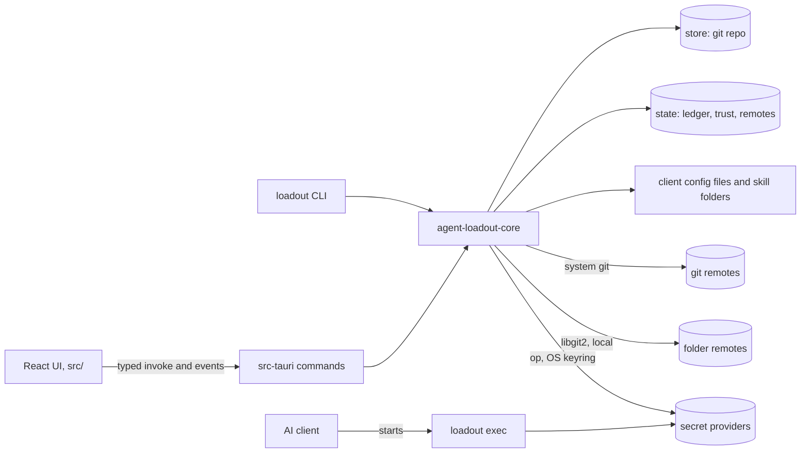
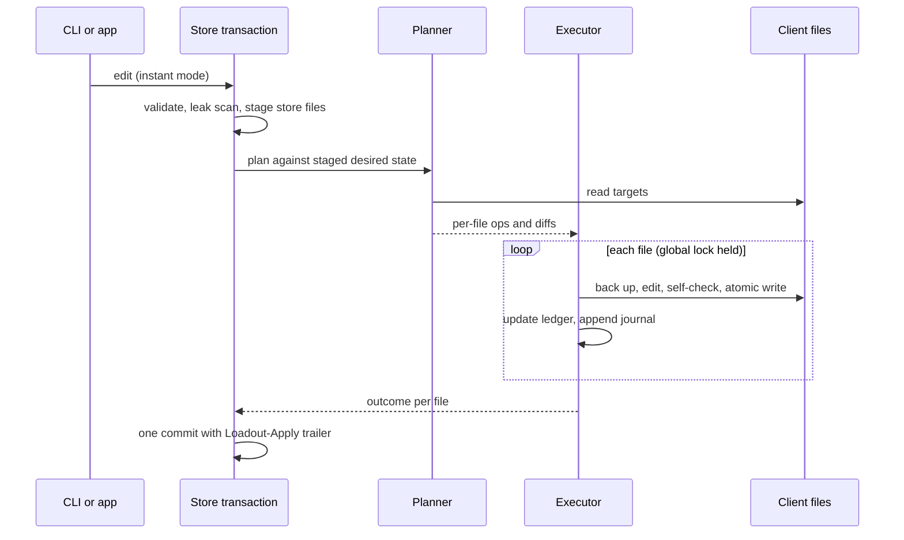
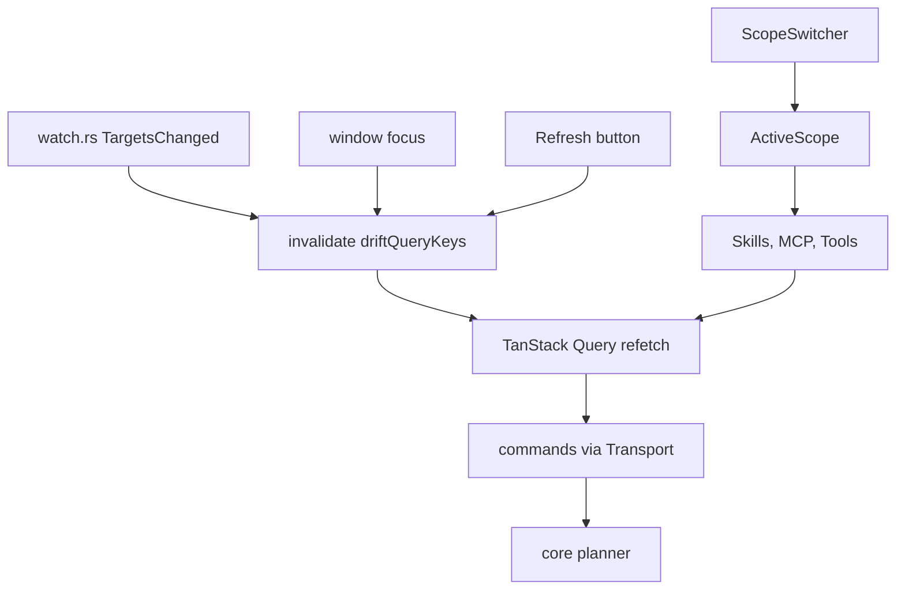

# Architecture

How Loadout's code is organized and how data moves through it. The design
contract is [SPEC.md](../SPEC.md) (section 4 for architecture); this page
describes the code as it is. For the user-level ideas see
[concepts.md](concepts.md).

## Crates and processes

| Path | Crate | Role |
|---|---|---|
| `crates/agent-loadout-core` | `agent-loadout-core` (library) | All logic: schemas, store, formats, adapters, layering, apply, secrets, skills, remotes, migration. No Tauri dependency. |
| `crates/agent-loadout` | `agent-loadout` (binary `loadout`) | The CLI (clap). Thin over core; also `loadout exec` and the hidden `loadout git-credential`. |
| `crates/agent-loadout-testkit` | `agent-loadout-testkit` (unpublished) | Hermetic test helpers: `TempHome`, `RootedFs`, `MemKeyring`, `op-stub`, `gh-stub`, isolated git config. |
| `src-tauri` | `agent-loadout-app` (unpublished) | The Tauri 2 desktop app. Its own Cargo workspace, so the root workspace builds without WebView tooling. Commands are thin wrappers over core. |
| `src` | (npm, private) | React 18 + TypeScript frontend, Vite, TanStack Query, CodeMirror 6. |

Rules every layer follows:

- **Core reads no process-global state.** No `std::env`, home-folder
  lookups or system clock outside `env.rs`: callers pass an `Env` (OS,
  known folders, environment variables, clock) and an `Fs`
  (`crates/agent-loadout-core/src/env.rs`, `fs.rs`). The CLI and the app
  build them from the process (`Env::from_process`); tests build them from
  a temp root.
- **Typed errors.** `CoreError` carries a stable snake_case `ErrorCode`
  (`error.rs`). The CLI maps codes to exit codes; the app sends them over
  IPC and the frontend looks up the text in `src/i18n/en.ts`. No localized
  strings cross IPC.
- **One transaction per change.** Store edits go through
  `store/transaction.rs`: validate, write store files, run the leak
  scanner, commit once.
- **One lock.** `state/loadout.lock` (`store/lock.rs`) is held by any
  process that changes the store, ledger or client files. The CLI and the
  app can run at the same time; the second waits, then fails with exit
  code 6.
- **Brand strings in one place.** Names, folders, the environment variable
  and the app id are constants in `brand.rs`.

## Core module map

`crates/agent-loadout-core/src/`:

| Module | Owns |
|---|---|
| `model/` | Store file schemas (`server.rs`, `secrets.rs`, `clients.rs`, `project.rs`, `machine.rs`, `applied.rs`, `settings.rs`, `skill_meta.rs`), id rules (`ids.rs`), validation. JSON Schemas in `docs/schema` are generated from these types. |
| `store/` | The git-backed store (libgit2, vendored, no network features): `bootstrap.rs` (init), `transaction.rs`, commit `trailers.rs`, `log.rs`, `diff.rs`, `tags.rs`, `restore.rs`, `revision.rs`, `merge.rs` (per-entity merge for pulls), `lock.rs`. |
| `formats/` | Format-preserving editors: `jsonc.rs` (JSON and JSONC), `toml.rs`, `yaml.rs`, `json5.rs`, `text.rs`. Unowned bytes stay identical. |
| `adapters/` | The adapter table (`spec.rs`), per-client mappers (`omp.rs`, `claude_code.rs`, `codex.rs`, `pi.rs`, `claude_desktop.rs`, `copilot.rs`, `cursor.rs`, `vscode_legacy.rs`, `gemini.rs`, `antigravity.rs`, `opencode.rs`, `grok.rs`, `windsurf.rs`, `devin.rs`, `ported.rs`), capabilities (`caps.rs`), detection (`detect.rs`), path templates (`location.rs`), shared mapping (`mapper.rs`). |
| `layering/` | Project manifests (`manifest.rs`), merge rules (`merge.rs`), effective config with provenance (`effective.rs`), known projects (`projects.rs`), project servers edited from the app (`project_servers.rs`), trust by content hash (`trust.rs`), `.git/info/exclude` handling (`git.rs`), Discover projects from client files (`discover.rs`). |
| `apply/` | Rendering desired entries (`render.rs`), planning (`plan.rs`), execution (`exec.rs`), the ownership ledger (`ledger.rs`), backups (`backup.rs`), journals (`journal.rs`), rollback (`rollback.rs`), Discard pending (`discard.rs`), import and adopt (`import.rs`), the drift resolver (`resolve.rs`). |
| `secrets/` | Reference grammar (`grammar.rs`), catalog (`catalog.rs`), providers (`providers/`: env, keyring, 1Password), statuses (`status.rs`), delivery selection and rendering (`delivery.rs`, `render.rs`), secret classification (`classify.rs`), the leak scanner (`scanner.rs`). |
| `skills/` | Skill store (`store.rs`), installs from git, folders and archives (`install.rs`), links, junctions and copies (`link.rs`), folder classification (`classify.rs`), adopt and bulk import of unmanaged folders (`adopt.rs`), `SKILL.md` frontmatter (`frontmatter.rs`), the agents CLI folder (`agents_cli.rs`). |
| `remote/` | Remote config (`config.rs`), folder remotes (`folder.rs`), git remotes through the system git (`git.rs`), GitHub CLI helpers (`gh.rs`), token credentials (`credential.rs`), push and pull (`sync.rs`), sync-tool artifact filtering (`sync_artifacts.rs`), restore on a new machine (`restore.rs`), the remote manifest (`manifest.rs`), UNC paths (`unc.rs`). |
| `migrate/` | SkillDock import (`skilldock.rs`) and the client scan (`scan.rs`). |
| `paths.rs`, `local_settings.rs` | `LOADOUT_HOME` resolution and sync-folder detection; machine-local settings. |

## Apply data flow

In review mode the edit commits on its own and apply runs later as its own
commit. The CLI commands that edit and apply at once (`server add`,
`server rm`, `secrets set`, `project trust` and others) follow the instant
path.

## CLI

`crates/agent-loadout/src/main.rs` defines the clap tree and the global
options `--home`, `--json` and `--yes`, builds a `Context` (resolved
`LOADOUT_HOME`, `Env`, output mode) and dispatches to one module per
command in `src/cmd/`. `src/exec/` is `loadout exec`, which parses its own
arguments before clap, never writes to stdout (the MCP channel) and does
not read the store. `src/keyring.rs` is the OS keyring provider. The full
command reference is [cli.md](cli.md), generated from the clap help by
`scripts/gen-cli-docs.mjs`.

## Desktop app

### Backend: `src-tauri/`

- `src/main.rs` builds the `tauri-specta` builder with every command and
  event, and registers the drift watcher.
- `src/commands/*.rs` group commands by page (`servers.rs`, `apply.rs`,
  `tools.rs`, `projects.rs`, `project_servers.rs`, `effective.rs`,
  `resolve.rs`, `history.rs`, `remotes.rs`, `secrets.rs`, `skills.rs`,
  `discover.rs`, `migrate.rs`, `updates.rs`). Each one calls core on a
  blocking thread and returns
  `{ status: "ok", data } | { status: "error", error: IpcError }`.
- Commands take ids, not paths: folders picked in the OS dialog are kept in
  the backend and the frontend gets an opaque token, and paths shown in the
  UI use `~` and `
` placeholders.
- `src/commands/watch.rs` watches client config folders, project manifest
  folders and skill folders (debounced, not recursive) and sends one
  payload-free `TargetsChanged` event.
- `tauri.conf.json` sets a strict CSP; `capabilities/` grants only window
  controls and events. Release builds add `tauri.release.conf.json`
  (bundles the CLI) and, when the updater key is configured, the updater.

### IPC bindings

`src/ipc/bindings.ts` is generated from the Rust command signatures by
`tauri-specta`. After changing a command, run `npm run bindings` (it runs
the ignored test `tests::write_bindings` in `src-tauri`). Never edit the
file by hand.

`src/ipc/transport.ts` defines the `Transport` (commands, window controls,
events). The app uses the Tauri transport; tests and `npm run dev:mock`
use the explicit mock in `src/test/mockTransport.ts`. There is no silent
fallback: outside Tauri without the mock, calls fail.

### Frontend: `src/`

| Path | Contents |
|---|---|
| `src/main.tsx`, `src/app/App.tsx` | Shell: sidebar with the scope switcher and nav, header slots, window chrome, route error boundary |
| `src/app/routes/<page>/` | One folder per page: `skills`, `mcp`, `projects`, `tools`, `install`, `history`, `settings` (`versioning`, `secrets`, `updates`), `migrate` |
| `src/app/apply/` | Pending changes pill and drawer, change notices, query keys, drift triggers, Refresh |
| `src/app/resolver/` | The drift resolver dialog |
| `src/app/scope/` | `ActiveScope.tsx` (User or one project; not persisted) and `ScopeSwitcher.tsx` |
| `src/app/components/` | Shared controls ported from SkillDock |
| `src/i18n/en.ts` | Every display string, keyed by message key, enum or error code (English only) |
| `src/styles/tokens.css` | Design tokens |

**Server state** lives in TanStack Query. The shared keys are
`storeQueryKeys` in `src/app/apply/changeNotice.ts`; each is the command
name (`["list_servers"]`, `["pending_plan"]`, `["list_project_servers", id]`,
`["effective_matrix", id]`, `["list_skills", scope]` and so on). After a
mutation the app invalidates the affected keys.

**Drift triggers** (`src/app/apply/driftTriggers.ts`): on every
`TargetsChanged` event and every time the window gains focus, the app
invalidates `driftQueryKeys` (pending plan, servers, project servers,
pending store changes, projects, effective matrices, tools, skills, skill
tool folders). The Refresh buttons do the same. Drift is found by the
planner and never reverted on its own.

**Active scope** (`src/app/scope/ActiveScope.tsx`): `useActiveScope()`
returns `{ kind: "user" }` or `{ kind: "project", id }`; Skills, MCP and
Tools read it. A project that disappears from the list falls back to User.

## Generated files

| File | Generator |
|---|---|
| `src/ipc/bindings.ts` | `npm run bindings` |
| `docs/adapters.md` table | `LOADOUT_UPDATE_DOCS=1 cargo test -p agent-loadout-core --test docs_adapters` |
| `docs/schema/*.schema.json` | `LOADOUT_BLESS=1 cargo test -p agent-loadout-core --test model` |
| `docs/cli.md` | `node scripts/gen-cli-docs.mjs` |
