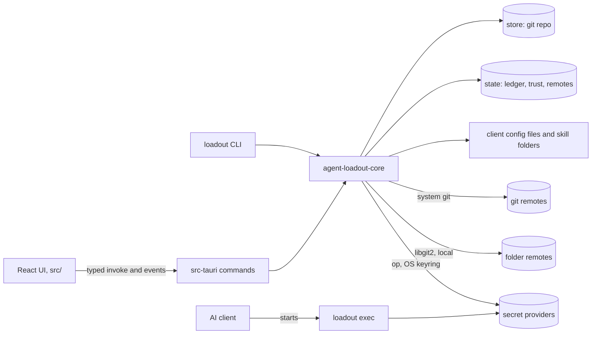
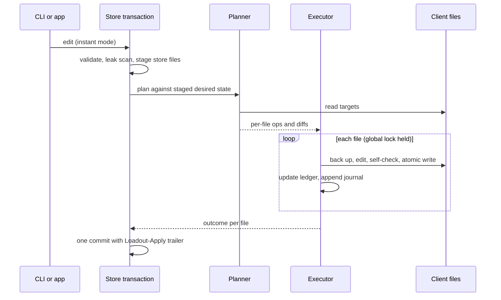
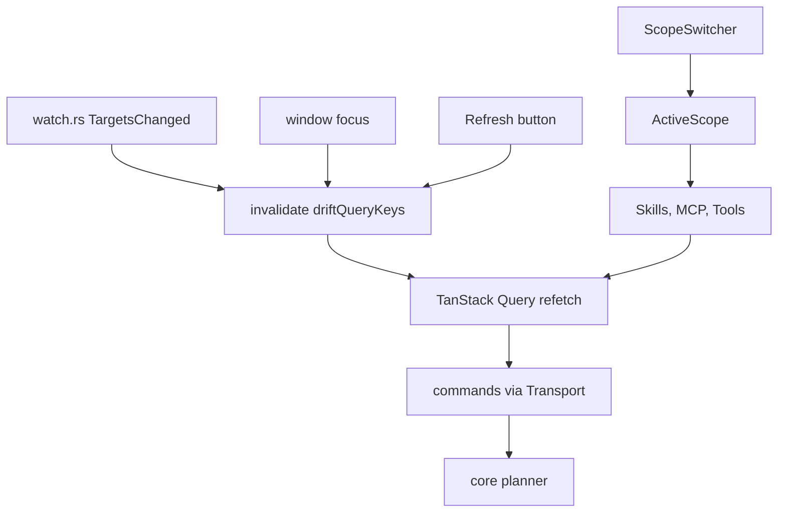

# Architecture

How Loadout's code is organized and how data moves through it. The design
contract is [SPEC.md](../SPEC.md) (section 4 for architecture); this page
describes the code as it is. For the user-level ideas see
[concepts.md](concepts.md).

## Crates and processes

| Path | Crate | Role |
|---|---|---|
| `crates/agent-loadout-core` | `agent-loadout-core` (library) | All logic: schemas, store, formats, adapters, layering, apply, secrets, skills, sources, scan, catalogs, the agent skill, remotes, migration. No Tauri dependency. Also holds the bundled agent skill's files (`agent-skill/loadout/`). |
| `crates/agent-loadout` | `agent-loadout` (binary `loadout`) | The CLI (clap). Thin over core; also `loadout exec` and the hidden `loadout git-credential`. |
| `crates/agent-loadout-testkit` | `agent-loadout-testkit` (unpublished) | Hermetic test helpers: `TempHome`, `RootedFs`, `MemKeyring`, `op-stub`, `gh-stub`, isolated git config. |
| `src-tauri` | `agent-loadout-app` (unpublished) | The Tauri 2 desktop app. Its own Cargo workspace, so the root workspace builds without WebView tooling. Commands are thin wrappers over core. |
| `src` | (npm, private) | React 18 + TypeScript frontend, Vite, TanStack Query, CodeMirror 6. |

Rules every layer follows:

- **Core reads no process-global state.** No `std::env`, home-folder
  lookups or system clock outside `env.rs`: callers pass an `Env` (OS,
  known folders, environment variables, clock) and an `Fs`
  (`crates/agent-loadout-core/src/env.rs`, `fs.rs`). The CLI and the app
  build them from the process (`Env::from_process`); tests build them from
  a temp root.
- **Typed errors.** `CoreError` carries a stable snake_case `ErrorCode`
  (`error.rs`). The CLI maps codes to exit codes; the app sends them over
  IPC and the frontend looks up the text in `src/i18n/en.ts`. No localized
  strings cross IPC.
- **One transaction per change.** Store edits go through
  `store/transaction.rs`: validate, write store files, run the leak
  scanner, commit once.
- **One lock.** `state/loadout.lock` (`store/lock.rs`) is held by any
  process that changes the store, ledger or client files. The CLI and the
  app can run at the same time; the second waits, then fails with exit
  code 6.
- **Brand strings in one place.** Names, folders, the environment variable
  and the app id are constants in `brand.rs`.

## Core module map

`crates/agent-loadout-core/src/`:

| Module | Owns |
|---|---|
| `model/` | Store file schemas (`server.rs` with `[meta.source]`, `secrets.rs`, `sources.rs`, `catalogs.rs`, `clients.rs`, `project.rs`, `machine.rs`, `applied.rs`, `settings.rs`, `skill_meta.rs` with `[bundled]`), id rules (`ids.rs`), validation. JSON Schemas in `docs/schema` are generated from these types. |
| `sources/` | Source trust: keys and scopes built from a git URL or local path, canonical and credential-free, with their own keys for `http://` and `git://` (`key.rs`); force-push and redirect detection on fetch (`detect.rs`); the read-only `check` the trust dialog shows, the gate `admit` (and `would_admit`, `refuse_blocked`, which run before any clone or fetch), `trust`, `block`, `untrust` and `lapse`, each one store commit to `store/sources.toml` (`mod.rs`). `store/merge.rs` merges that file record by record on pull. |
| `store/` | The git-backed store (libgit2, vendored, no network features): `bootstrap.rs` (init), `transaction.rs`, commit `trailers.rs`, `log.rs`, `diff.rs`, `tags.rs`, `restore.rs`, `revision.rs`, `merge.rs` (per-entity merge for pulls), `lock.rs`. |
| `formats/` | Format-preserving editors: `jsonc.rs` (JSON and JSONC), `toml.rs`, `yaml.rs`, `json5.rs`, `text.rs`. Unowned bytes stay identical. |
| `adapters/` | The adapter table (`spec.rs`), per-client mappers (`omp.rs`, `claude_code.rs`, `codex.rs`, `pi.rs`, `claude_desktop.rs`, `copilot.rs`, `cursor.rs`, `vscode_legacy.rs`, `gemini.rs`, `antigravity.rs`, `opencode.rs`, `grok.rs`, `windsurf.rs`, `devin.rs`, `ported.rs`), capabilities (`caps.rs`), detection (`detect.rs`), path templates (`location.rs`), shared mapping (`mapper.rs`). |
| `mcp_source/` | MCP servers from a Git repository or folder: `resolve` clones shallow (no hooks, no submodules) into `cache/mcp-sources/.tmp-*` or reads a folder in place, skipping dependency and build folders, and turns `server.json`, MCPB/DXT manifests, committed client configs or the repository itself into drafts (`convert.rs`; paste detection shared with the app in `snippet.rs`); `save` runs the trust gate, then the scan of the files and every launch line, and commits; checkouts in `LOADOUT_HOME/servers/<id>` (placed, replaced and removed inside the store transaction, marked with `.git/loadout-checkout`); `runnable` blocks a server's entries at render time (`checkout_out_of_date`, `folder_on_other_machine`); `check_update`, `update`, `prepare_checkout`, `restore_checkout`; `sweep_temp_clones` (`mod.rs`). |
| `layering/` | Project manifests (`manifest.rs`), merge rules (`merge.rs`), effective config with provenance (`effective.rs`), known projects (`projects.rs`), project servers edited from the app (`project_servers.rs`), trust by content hash (`trust.rs`), `.git/info/exclude` handling (`git.rs`), Discover projects from client files (`discover.rs`). |
| `apply/` | Rendering desired entries (`render.rs`), planning (`plan.rs`), execution (`exec.rs`), the pending-plan cache the app shares (`cache.rs`), the ownership ledger (`ledger.rs`), backups (`backup.rs`), journals (`journal.rs`), rollback (`rollback.rs`), Discard pending (`discard.rs`), import and adopt of foreign entries across user and project files, with conflicts, secret extraction and removal of backups holding old values (`import.rs`), the not-managed findings and acknowledged entries behind the app's lists and notice (`unmanaged.rs`), the drift resolver (`resolve.rs`). |
| `secrets/` | Reference grammar (`grammar.rs`), catalog (`catalog.rs`), providers (`providers/`: env, keyring, 1Password), statuses (`status.rs`), delivery selection and rendering (`delivery.rs`, `render.rs`), secret classification (`classify.rs`), secret extraction shared by import and the SkillDock migration (`extract.rs`), the leak scanner (`scanner.rs`). |
| `skills/` | Skill store (`store.rs`; listings read only `SKILL.md` and file metadata through `summarize_folder`), installs from git, folders and archives with the review step and the gates before the commit (`install.rs`: `prepare`, `install_prepared`, `Decisions { allow_dangerous, trust, moved_trust, via }`, update checks with force-push and move detection, `sweep_temp_clones`), links, junctions and copies, with client detection probed once per operation (`link.rs`, `DetectedClients`), folder classification (`classify.rs`), adopt and bulk import of unmanaged folders (`adopt.rs`), content summaries of skill folders cached by their file listing (`hash_cache.rs`), `SKILL.md` frontmatter (`frontmatter.rs`), the agents CLI folder (`agents_cli.rs`). |
| `scan/` | The built-in offline scanner: rules as data (`rules.toml`, parsed and checked in `rules.rs`), matching, line numbers and masked excerpts (`engine.rs`), results cached by content hash in `cache/scan` (`cache.rs`), the findings model, `Scanner` and the `scan_blocked` gate (`mod.rs`). Used by skill installs and updates and by MCP drafts from a repository. |
| `catalog/` | Online catalogs: the catalog list (built-ins plus `store/catalogs.toml`), the machine-local Online catalogs switch, search, show and refresh per catalog (in parallel, each with its own status), the handoff of an entry to the existing reviews (`mcp_handoff`, `skill_request`, skills.sh addresses), and `catalog:<source>/<id>` references (`mod.rs`); the HTTP client behind the `Http` trait, `ureq` with rustls and the platform verifier, time limits, an 8 MiB cap after decompression, https-only redirects and the proxy rules (SOCKS refused, never a direct fallback) (`http.rs`); the MCP Registry client (`/v0.1`, falling back to `/v0`), its pinning and trust keys on what runs (`registry.rs`); Git taps, shallow and sparse through the system git, skill folders and Claude Code plugin marketplaces (`tap.rs`); the 24-hour cache in `cache/catalogs` keyed on the catalog's address (`cache.rs`). Nothing here runs in the background. |
| `agent.rs` | The Loadout skill for agents: the bundled files (`include_str!` of `agent-skill/loadout/`, LF line endings), its status in the store (`Current`, `Outdated`, `Customized`, `Newer`, by content hash and the `[bundled]` version), `install` (with `reset`), `remove`, `refresh` and `startup_refresh` (re-checked under the store lock; a customized copy is reported once per version through `agent_skill_notice` in `state/local-settings.toml`), and `materialize` into `cache/agent-skill/loadout` for `agent skill-path`. |
| `remote/` | Remote config (`config.rs`), folder remotes (`folder.rs`), git remotes through the system git (`git.rs`), GitHub CLI helpers (`gh.rs`), token credentials (`credential.rs`), push and pull (`sync.rs`), sync-tool artifact filtering (`sync_artifacts.rs`), restore on a new machine (`restore.rs`), the remote manifest (`manifest.rs`), UNC paths (`unc.rs`). |
| `migrate/` | SkillDock import (`skilldock.rs`) and the client scan (`scan.rs`). |
| `paths.rs`, `local_settings.rs` | `LOADOUT_HOME` resolution and sync-folder detection; machine-local settings. |
| `access.rs` | Write access to client files and folders: the probe that never writes (Windows: read-only attribute, then open for writing without creating or truncating, and the folder's add-file right; Unix: `access(W_OK)`), run on worker threads under a two-second budget per plan and cached per path and content fingerprint; `ReadOnlyKind` (`acl`, `attribute`, `owner`, `share`) and the mapping of a refused write to `read_only_target`. Reached through `Fs::write_probe`. |

## Apply data flow

In review mode the edit commits on its own and apply runs later as its own
commit. The CLI commands that edit and apply at once (`server add`,
`server rm`, `secrets set`, `project trust` and others) follow the instant
path.

**Planning cost** (#14, #15). One plan parses each client file once,
however many entries or targets read it (`~/.claude.json` serves several),
and looks ledger entries up through an index. A store change plans only
what it touched: the files that hold or own the changed server's entries,
or the one project a trust, init, project server edit or share concerns.
The app keeps one full plan in `apply::cache::PlanCache`: while a plan is
computed, a recording view of the `Fs` notes every read (existence,
content hash, folder listing), and the plan is served again only while
every noted read gives the same answer. The drift watcher's event drops
it; a plan that read secret values is shared with the requests waiting
for it but never kept. The planner also probes every target
file once (`access::probe_files`, results cached with the plan) and turns
entries that would write a read-only file into `blocked` /
`read_only_target`; the executor maps a refused write the same way and
goes on with the other files.

**Installing from a source** (skills and MCP servers). Every path that
saves content from a source runs the same steps, in this order:

1. `sources::refuse_blocked`: a blocked source is refused before git is
   started.
2. Fetch and read: a shallow clone into a temporary folder (or a picked
   folder read in place). Nothing from the source runs.
3. The scan (`scan::Scanner`): the files, plus every launch line for MCP
   drafts. The app shows the result in a review; the CLI prints it.
4. Before the store commit: `sources::admit` (with the user's grant, for the
   typed source and a redirect target separately), then `scan::gate`
   (`scan_blocked` unless allow-dangerous). One commit, then the instant
   apply.

The app keeps reviews between steps 3 and 4 by token: skill reviews in
`AppState.reviews` and MCP source reviews in `commands/mcp_source.rs`, at
most 8 of each, the oldest dropped with its temporary clone; a review
survives a failed save (trust, scan, id taken) so the dialog can retry
with the user's answer, and is spent by a successful one. Temporary clones
(`.tmp-*`) and replaced checkouts (`servers/.old-*`) left by an
interrupted run are swept once they are an hour old: at app start, and
when a CLI server command starts.

## CLI

`crates/agent-loadout/src/main.rs` defines the clap tree and the global
options `--home`, `--json` and `--yes`, builds a `Context` (resolved
`LOADOUT_HOME`, `Env`, output mode) and dispatches to one module per
command in `src/cmd/`. `src/exec/` is `loadout exec`, which parses its own
arguments before clap, never writes to stdout (the MCP channel) and does
not read the store. `src/keyring.rs` is the OS keyring provider. The full
command reference is [cli.md](cli.md), generated from the clap help by
`scripts/gen-cli-docs.mjs`. Commands that change the store open it through
`Context::open_store_for_change`, which first replaces an outdated agent
skill copy (`cmd::agent::refresh_before_change`); read commands never
write or take the lock. Tests in `main.rs` check that every command and
long flag the agent skill's `references/commands.md` cites exists, and
that decision flags (`--yes`, `--trust-source`, `--allow-dangerous`, ...)
appear there only in "never" guidance.

## Desktop app

### Backend: `src-tauri/`

- `src/main.rs` builds the `tauri-specta` builder with every command and
  event, and registers the drift watcher.
- `src/commands/*.rs` group commands by page (`servers.rs`, `apply.rs`
  (with `recheck_targets`, which drops the cached plan and the permission
  probes), `tools.rs`, `projects.rs`, `project_servers.rs`, `effective.rs`,
  `resolve.rs`, `history.rs` (pages of 200 with a `before` cursor),
  `remotes.rs`, `secrets.rs`, `skills.rs` (installs through a review),
  `scan.rs` (the scan DTOs), `sources.rs` (Settings > Sources and the trust
  dialog), `mcp_source.rs` (MCP servers from a Git repository or folder),
  `catalogs.rs` (Install > Browse and Settings > Catalogs; one
  `search_catalog` call per catalog, `open_catalog_link` looks the URL up
  itself and opens only https), `agent.rs` (Settings > Agent integration and
  the update at app start), `import.rs` (scan and apply an import,
  not-managed summaries and the notice), `discover.rs`, `migrate.rs`,
  `updates.rs`). Each one calls core on a
  blocking thread and returns
  `{ status: "ok", data } | { status: "error", error: IpcError }`.
- Commands take ids, not paths: folders picked in the OS dialog are kept in
  the backend and the frontend gets an opaque token, and paths shown in the
  UI use `~` and `
` placeholders.
- `src/commands/watch.rs` watches client config folders, project manifest
  folders and skill folders (debounced, not recursive) and sends one
  payload-free `TargetsChanged` event.
- `tauri.conf.json` sets a strict CSP; `capabilities/` grants only window
  controls and events, and `bundle.resources` ships the agent skill's
  folder as `agent-skill/loadout/` (the AUR source package has no resource
  folder; **View skill files** then opens the cache copy). Release builds
  add `tauri.release.conf.json` (bundles the CLI) and, when the updater key
  is configured, the updater.

### IPC bindings

`src/ipc/bindings.ts` is generated from the Rust command signatures by
`tauri-specta`. After changing a command, run `npm run bindings` (it runs
the ignored test `tests::write_bindings` in `src-tauri`). Never edit the
file by hand.

`src/ipc/transport.ts` defines the `Transport` (commands, window controls,
events). The app uses the Tauri transport; tests and `npm run dev:mock`
use the explicit mock in `src/test/mockTransport.ts`. There is no silent
fallback: outside Tauri without the mock, calls fail.

### Frontend: `src/`

| Path | Contents |
|---|---|
| `src/main.tsx`, `src/app/App.tsx` | Shell: sidebar with the scope switcher and nav, header slots, window chrome, route error boundary |
| `src/app/routes/<page>/` | One folder per page: `skills` (with the update review), `mcp` (with `McpSourceUpdate.tsx`: Check for update, Restore copy), `projects`, `tools`, `install` (skill review, `McpSourcePanel.tsx`: MCP From Git or folder, `catalog/`: Browse with `BrowsePanel.tsx` and `EntryDetail.tsx`), `import` (MCP import, the not-managed section and sidebar notice, `skills/` adopt, `projects/` Discover projects), `history`, `settings` (`versioning`, `secrets`, `sources`, `catalogs`, `agent`, `updates`), `migrate` |
| `src/app/apply/` | Pending changes pill and drawer, change notices, query keys, drift triggers, Refresh |
| `src/app/resolver/` | The drift resolver dialog |
| `src/app/scope/` | `ActiveScope.tsx` (User or one project; not persisted) and `ScopeSwitcher.tsx` |
| `src/app/components/` | Shared controls ported from SkillDock, the shared `Modal` (focus trap, inert page, Escape, focus restore), `ReadOnlyBadge` (lock, reason text and note), `TrustDialog.tsx` (the trust question and `useTrustPrompt`), `ScanFindings.tsx` (findings and the "anyway" gate) and `useVirtualSlots.tsx` (long Skills and MCP lists render only the cards near the viewport; each card keeps a named slot) |
| `src/i18n/en.ts` | Every display string, keyed by message key, enum or error code (English only) |
| `src/styles/tokens.css` | Design tokens |

**Server state** lives in TanStack Query. The shared keys are
`storeQueryKeys` in `src/app/apply/changeNotice.ts`; each is the command
name (`["list_servers"]`, `["pending_plan"]`, `["list_project_servers", id]`,
`["effective_matrix", id]`, `["list_skills", scope]` and so on). After a
mutation the app invalidates the affected keys.

**Drift triggers** (`src/app/apply/driftTriggers.ts`): on every
`TargetsChanged` event and every time the window gains focus, the app
invalidates `driftQueryKeys` (pending plan, servers, project servers,
pending store changes, projects, effective matrices, tools, skills, skill
tool folders, and the not-managed summaries and notice checks, which
focus and watcher events refetch at most once a minute). The
Refresh buttons do the same, and first call `recheck_targets` so a change
of only file permissions shows; a window focus does that too when the last
recheck is five minutes old or more. Drift is found by the planner and
never reverted on its own.

**Active scope** (`src/app/scope/ActiveScope.tsx`): `useActiveScope()`
returns `{ kind: "user" }` or `{ kind: "project", id }`; Skills, MCP and
Tools read it. A project that disappears from the list falls back to User.

## Generated files

| File | Generator |
|---|---|
| `src/ipc/bindings.ts` | `npm run bindings` |
| `docs/adapters.md` table | `LOADOUT_UPDATE_DOCS=1 cargo test -p agent-loadout-core --test docs_adapters` |
| `docs/schema/*.schema.json` | `LOADOUT_BLESS=1 cargo test -p agent-loadout-core --test model` |
| `docs/cli.md` | `node scripts/gen-cli-docs.mjs` |
