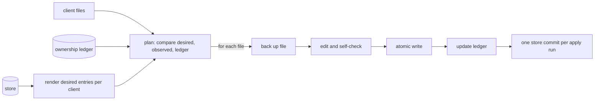
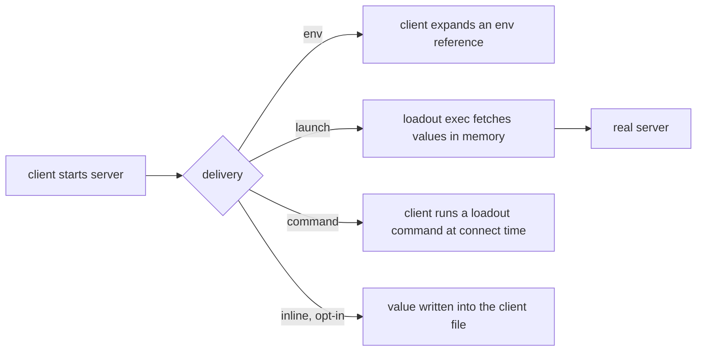

# Concepts

This page explains the ideas Loadout is built on. For step-by-step tasks see
the [user guide](user-guide.md); for every command and option see the
[CLI reference](cli.md); for the full design see [SPEC.md](../SPEC.md).

## The store

The **store** is the single source of truth for what your clients should
have. It is a git repository in your data directory (`<LOADOUT_HOME>/store`,
see [Where Loadout keeps its data](user-guide.md#where-loadout-keeps-its-data))
holding plain TOML files:

| File | Holds |
|---|---|
| `servers/<id>.toml` | One MCP server: command or URL, args, env, headers, which clients get it, secret delivery |
| `secrets.toml` | Secret aliases and the provider reference each one points at (never values) |
| `sources.toml` | Your trust and block decisions for skill and MCP server sources |
| `catalogs.toml` | The catalogs you added or turned off (the built-in ones are always listed) |
| `clients.toml` | Per-client preferences (turn a client off, native disable, omp profiles, VS Code variants) |
| `settings.toml` | Portable settings, such as `apply_mode` |
| `skills/<id>/`, `skill-meta/<id>.toml` | Installed skills and their source and enablement |
| `projects/<id>/` | Mirrors of project manifests |
| `machines/<machine-id>.toml` | Per-machine overrides (for example a secret reference that differs on this machine) |

Every change is one commit, made by the app or the CLI, so the History page
and `loadout history` show who changed what and when, and any earlier
version can be restored. You can also edit the files by hand and commit the
edit with `loadout backup`. JSON Schemas for editor completion are in
[schema/](schema).

Next to the store, `state/` holds facts about this machine only (the
ownership ledger, trusted projects, remotes, apply records), `backups/`
holds copies of client files taken before each write, and `servers/<id>`
holds the local copies (checkouts) of MCP servers that run from their
repository's files. None of these is versioned or pushed.

## Clients and adapters

A **client** is an AI coding tool that reads MCP servers or skills from its
own config files: omp (the recommended client), Claude Code, Codex, Pi,
Claude Desktop, VS Code with GitHub Copilot, Cursor and 31 more. An
**adapter** knows one client's files, their format (JSON, JSONC, TOML, YAML,
JSON5), where the server map lives inside the file, what the client can
express (transports, disable flags, env references, headers) and where its
skill folders are. [adapters.md](adapters.md) lists them all with tiers and
verification status.

Loadout edits client files with **format-preserving editors**: comments,
key order, indentation and every entry it does not own stay byte for byte
the same.

A client is **detected** when its config folder exists or its program is
on `PATH`. Detection only reads.

## Scopes

Loadout works at two kinds of scope:

- **User**: your user-level client files (for example `~/.claude.json` or
  `~/.omp/agent/mcp.json`). Store servers apply here. (The CLI's `--scope`
  option still calls this scope `system`.)
- **Project**: one folder with a project manifest. Project servers go into
  the client's project files (for example `<P>/.mcp.json` for Claude Code).

In the desktop app, the **Scope** switcher at the top of the sidebar picks
User or one project; the Skills, MCP and Tools pages follow it. History and
Projects always cover every scope. The app starts at User each time.

## Apply, plan and drift

**Apply** makes the client files match the store. It works in three steps:



The **plan** compares, for every entry name in every target file, what the
store wants (desired), what the file holds (observed) and what Loadout last
wrote (the ledger). Each entry gets a state:

| State | Meaning |
|---|---|
| in sync | The file matches the store and what Loadout wrote |
| to create, to update, to remove | The store changed; the file has not been updated yet |
| changed outside (drift) | Loadout owns the entry, and someone edited it since |
| missing | Loadout owns the entry, and someone deleted it |
| conflict | Drift, and the store changed too |
| not managed (foreign) | An entry Loadout did not write; never touched |
| collision | A foreign entry has the same name as a store server |
| blocked | Cannot be written now (missing secret, untrusted project, parse error, unsupported transport, file locked, read-only file, and so on) |

`loadout status` shows the states, `loadout diff` shows the file diffs the
next apply would make, and `loadout apply` writes them. Drift is never
reverted on its own: apply asks (or follows `--on-conflict`), and in the
app **Resolve...** offers Overwrite, Import theirs into store, Release
ownership, Skip, Re-create and Respect deletion.

The app rechecks drift when a client file, manifest or skill folder changes
on disk (a file watcher), when the window gains focus, and when you click
Refresh.

### Read-only files and folders

Some client files can be read but not written by your account: a project
folder managed by a separate, security-focused installer, a file marked
read only, a read-only network share. Loadout still shows them
(status, effective config, import, the not-managed lists and the app's
views), marked **read only** with the reason:

| Reason | Meaning |
|---|---|
| `acl` | The file's or folder's permissions deny your account writing |
| `attribute` | The file is marked read only (Windows), or its owner has no write permission (macOS, Linux) |
| `owner` | Another user owns it, and your account may not write it (macOS, Linux) |
| `share` | A network share that denies writing, a read-only mount or write-protected media |

Loadout never plans or tries a write into such a file: the entries it would
write there are **blocked** (`read_only_target`), and everything else
applies as usual. Adopting an entry that already matches still works, and
import can still copy a definition from a read-only file into the store; it
just never overwrites the entry there. If a file turns read only between the
check and the write, the write is reported the same way and the other files
of the run still apply. A read-only file does not make `loadout apply` fail:
the exit code ignores it. The check gives up after two seconds (a stalled
network share), and then the file counts as writable until the write says
otherwise.

### Instant and review mode

- **Instant** (the default): each edit in the app or CLI is validated,
  applied and committed as one step. A notification shows the result and
  offers undo.
- **Review**: set `apply_mode = "review"` in `store/settings.toml` (then
  `loadout backup` to commit that edit). Edits wait in the **Pending
  changes** drawer, where you apply all, apply some, or **Discard
  pending** (throw away store edits this machine has not applied).

### Undo

Every apply run is one commit that records what it wrote. **Undo this
apply** (History) or `loadout rollback <apply-id|last>` puts the store back
to the state before that run and applies it, still respecting ownership:
entries you edited since are not overwritten without asking. For an exact
byte-for-byte copy of a client file as it was before a run, use
`loadout restore --files <apply-id>` or the History page's Client file
backups tab.

## Ownership: managed and foreign entries

Loadout keeps an **ownership ledger** (`state/ledger.json`) on each
machine. An entry is **managed** only when the ledger says Loadout wrote it
(`created`) or you handed it over (`adopted`). Everything else in a client
file is **foreign**:

- Foreign entries are never edited, disabled or removed.
- They are not in the store, so the MCP list and the Tools > Manage
  switches do not include them. Instead, **Not managed by Loadout** below
  the MCP list and in Tools > Manage lists them per client and file
  ("7 managed, 3 not managed by Loadout"), each Tools card counts its
  client's, and a one-line sidebar notice ("7 not managed") says when new
  ones appear.
- To bring them under Loadout, **import** them: the app's Import page or
  `loadout import --scan` lists them (user files and the files of every
  project this machine knows, identical definitions collapsed, differing
  ones side by side), and the import copies the chosen definitions into
  the store and takes ownership; literal secrets move to the OS keyring,
  1Password or an environment variable on the way. `loadout import
  --only` copies the definitions without taking ownership. An entry found
  only in a project's files becomes a store definition that is not
  enabled; name it in the project's manifest (`from = "<id>"`, or **Add
  to project manifest** in the app) to manage it there.
- To take over an entry that has the same name as a store server,
  **adopt** it: `loadout adopt CLIENT/NAME` overwrites it with the store's
  definition and records ownership, `--theirs` takes the client's version
  into the store instead, and `--all-identical` adopts every entry that
  already matches a store server, without a write.

The ledger is machine-local and is not synced: ownership is a fact about
the files on one machine.

## Secrets by reference

Secret values never enter the store. A server refers to an **alias**:

```toml
[env]
GITHUB_PERSONAL_ACCESS_TOKEN = "${secret:GITHUB_PAT}"
```

`secrets.toml` maps the alias to a **provider reference**: an environment
variable (`env:NAME`), the OS keyring (`keyring://service/account`), a
1Password item (`op://vault/item/field`) or a 1Password Environment variable
(`op-env://<id>/<NAME>`). A machine can override the reference for itself.

How the value reaches the server is the server's **delivery mode**:



A server whose secret cannot be resolved on this machine is **blocked** for
the clients that need it rather than written with an empty value. A leak
scanner checks every store commit and refuses commits that contain
something that looks like a secret value. Details:
[user guide, Secrets](user-guide.md#secrets) and [security.md](security.md).

## Projects and trust

A **project** is a folder with a manifest in `<P>/.loadout/`:
`project.local.toml` (private, the default for new manifests, hidden from
git through `.git/info/exclude`) and `project.toml` (shared, committed for
the team). A manifest can add servers for that folder, override a store
server there, or hide one (`enabled = false`).

What a client loads in a folder is the **effective config**: store servers
(User layer), then the shared manifest, then the private one.
`loadout effective PATH` and the Projects page's Effective config show it,
with the file each entry comes from.

Because a manifest can start programs (stdio servers), Loadout applies it
only after you **trust** its exact content. A new manifest, or one that
changed since you trusted it (for example after `git pull`), is not
applied: its targets are blocked, commands exit with code 7, and the app
shows **Review change & trust** with the diff. Untrusted projects are read
only in the app.

## Skills

A **skill** is a folder with a `SKILL.md`. Loadout installs skills into the
store (from git, a folder, or a `.zip`/`.skill` archive; each install and
update is scanned, and a git source is asked about first, see
[Sources, trust and the scan](#sources-trust-and-the-scan)) and makes them
available to each client by **linking** the store folder into the client's
skill folder: a directory junction on Windows (no administrator rights
needed), a symbolic link elsewhere, or a copy if you ask. Project-scope
links are hidden from git through `.git/info/exclude`. `loadout skills
scan` (and the Skills page's source tabs) classify each client's skill
folder entries as managed, unmanaged or mismatch; unmanaged folders are
never silently replaced. **Adopting** them (`loadout skills adopt`, the
Import page's Skills section, or **Adopt** on the Skills page) copies each
into the store, enables it where it was found, and replaces a folder with
the managed link only when its content equals the store copy; the
original goes to `backups/trash`. A folder the store copy would lose
something from (different content, a git repository, an empty folder, an
executable file on Linux and macOS) or that the project's repository
tracks is kept, with the reason. Unmanaged folders can also be imported
one by one or moved to the trash.

## Sources, trust and the scan

Skills and MCP servers can come from anywhere: a Git repository (https,
ssh, a local repository) or a folder on this machine. What they bring runs
with your permissions (a skill instructs your agents and can ship scripts;
an MCP server is a program a client starts), so everything from a source
passes two checks before it is saved to the store.

**Source trust.** A **source** is a repository, named by a key such as
`github.com/acme/skills`. Trusting one is a decision you make and Loadout
records, like trusting a project:

- The first install, update or save from a source you have not trusted
  asks: **this time only** (nothing recorded), **always** for the
  repository, for every repository of its owner (`github.com/acme/*`), or,
  on a self-hosted server, for the whole host (`git.example.com/*`), or
  **cancel**. Public services such as github.com never offer the host
  scope. Sources under `github.com/anthropics` and
  `github.com/modelcontextprotocol` are marked official, but they are asked
  about like any other.
- Decisions live in `store/sources.toml`, so they are versioned and sync
  with your remotes. A **block** wins over any trust, and a blocked source
  is never contacted.
- Trust is never implicit. `--yes` never answers the question; a run
  without a terminal (a script, an agent, `--json`) fails with
  `source_trust_required` unless it passes the explicit
  `--trust-source[=once|repo|owner|host]` or you run `loadout source
  trust`.
- Trust **lapses** when the repository changes under you: a force-push
  that drops the commit you have, or a rename or transfer (the host
  redirects it). The next update asks again. A redirect only ever adds a
  question about the new location. An unencrypted address (`http://`,
  `git://`) has its own key, so trusting the HTTPS or SSH address does not
  cover it.
- A skill folder or archive you pick on this machine is not asked about;
  a folder you pick for an MCP server is, at the repository scope only.

**The built-in scan.** Every skill install and update, and every MCP
server saved or updated from a source (its files and every command line it
launches with), is scanned offline with Loadout's own rules: download-and-run
commands, encoded payloads, reverse shells, credential reads next to
network calls, hidden Unicode and HTML-comment instructions, prompt
injection, turned-off safety prompts, edits of agent configuration,
native binaries, and unpinned packages, Git URLs and images in server
commands. Each finding has a severity (`info`, `warning`, `dangerous`), and
the verdict is the worst one. A `dangerous` verdict blocks the save
(`scan_blocked`, exit code 8) until you review the findings and choose to
go ahead anyway; warnings never block. Trusting a source never skips the
scan, and a clean verdict means no rule matched, not that the content is
safe. Nothing is sent anywhere; results are cached by content.

**A second scanner, if you want one.** For skills, Loadout can also run
**Snyk Agent Scan**, an external scanner, beside the built-in one. The two
differ in where they run:

| | Built-in scan | Snyk Agent Scan (optional) |
|---|---|---|
| On by default | Always on | Off until you install it, set a token and turn it on |
| Where it runs | On your computer, offline | Sends the skill to Snyk's cloud (`api.snyk.io`) |
| What it scans | Skills, MCP server files and command lines | Skills only |
| Needs | Nothing | A pinned, verified download and your Snyk API token (as a secret reference) |
| When | Every install, update and save from a source | Reviews of skills from Git, a catalog or an update; a local folder or library skill on request |

Both report findings in the same form, labeled by scanner, and a
`dangerous` verdict from either needs the same explicit "install anyway".
When Snyk can't scan (its daily limit, offline, a timeout), the skill is
"not scanned" by it: that never blocks and never counts as clean. While
Snyk Agent Scan is on, the app won't install from a source or update
until the Snyk result (or its not-scanned reason) is in the review. MCP
servers aren't sent to Snyk: its scanner would send a server's
configuration even when it declines to start it.

**MCP servers from a source.** `loadout server add --from` and **Install >
MCP > From Git or folder** read a repository or folder and propose
**drafts**: from an MCP Registry `server.json`, an MCPB `manifest.json`,
committed client configs, or the repository itself as the server. Nothing
runs while proposing. Commands are pinned to the reviewed commit or
package version (a registry package without a version is marked **Not
pinned**), secret values are never copied (declared secrets become
`${secret:ALIAS}` references), and the saved server file records only
where it came from (`[meta.source]`), so `loadout server update` can read
the source again and show what changes.

- A server that runs from its repository's files keeps a **checkout** in
  `LOADOUT_HOME/servers/<id>`, on this machine only. The server file names
  the commit; while this machine's copy is missing or at another commit
  (for example after another machine updated the server and you pulled
  the store), its entries are blocked (`checkout_out_of_date`) until you
  restore the copy (`loadout server checkout <ID>`, or **Restore copy** in
  the app), behind the same trust question and scan.
- A server added from a **folder** runs from that folder and belongs to
  the machine that added it. On your other machines its entries are
  blocked (`folder_on_other_machine`).

## Catalogs

A **catalog** lists MCP servers and skills you can install. Loadout knows
three kinds:

- an **MCP registry**: any server of the MCP Registry API, such as the
  built-in Official MCP Registry (`registry.modelcontextprotocol.io`);
- a **Git tap**: a repository of skill folders and/or a Claude Code plugin
  marketplace (`.claude-plugin/marketplace.json`), such as the built-in
  `github.com/anthropics/skills`;
- a **link**: skills.sh, which Loadout opens in your browser; a pasted
  `https://skills.sh/<owner>/<repo>/<skill>` address installs that skill
  from its GitHub repository.

The list lives in `store/catalogs.toml`, so it syncs with your remotes.
Whether this machine may contact catalogs at all is a separate,
machine-local switch, **Online catalogs**, which is **off** until you turn
it on (the app asks once, naming the hosts; `loadout catalog online on`).
Even then, Loadout contacts only the catalogs you turned on, only when you
open Browse, search, open an entry, refresh or install (or check a
registry server for updates), and sends only your search words. Nothing
runs in the background.

**Saved results.** Answers are cached in `LOADOUT_HOME/cache/catalogs` for
24 hours. Each catalog is searched on its own with time limits; one that
can't be reached shows its saved results labeled **stale** with their age,
and with online catalogs off, Browse and `catalog search` show only saved
results.

**A catalog is not a source of trust.** It only finds things. Installing an
entry hands it to the existing paths: an MCP server to the review of
[servers from a source](#sources-trust-and-the-scan) (drafts, the trust
question, the scan, the client picker), a skill to the git skill install
review. The trust key is what actually runs:

- a skill or plugin from a tap is a git source, keyed on its repository,
  and installing or updating it contacts the git host even with online
  catalogs off;
- a registry server is keyed on its package on its package registry
  (`registry.npmjs.org/...`, `pypi.org/...`, a container image) or on a
  remote server's host, never on the repository the publisher names, which
  Loadout shows as "claimed by the publisher, not verified".

Catalog text (names, descriptions, publishers) is shown as plain text, and
icons or images are never loaded. The registry checks that a publisher owns
its namespace, not that a server is safe; **Official** marks only skills
and plugins whose code lives in `github.com/anthropics`. Plugins from npm,
archive or command sources can't be installed, and a plugin's hooks,
commands and agents are never imported. The saved server or skill records
the entry it came from (`catalog = "<source>/<id>"`); a registry server
(`kind = "registry"`) can be checked for a newer version with
`loadout server update` while online catalogs are on and that catalog is
turned on at the same address.

## The Loadout skill for agents

Loadout bundles a skill (id `loadout`) that teaches coding agents to read
your setup with the read and plan commands (`status`, `effective`, `diff`,
`import --scan`, `apply --dry-run`, listings, `--json` output), what the
error and exit codes mean, and playbooks for common questions.

It is **read only**, on purpose. An agent that can run shell commands could
answer any confirmation Loadout asks, so no confirmation can stop an agent
from approving its own change. Instead, the skill never makes one: for an
install, enable, import, apply, trust decision or restore it hands you the
exact command or app page, never passes `--yes`, `--trust-source` or
`--allow-dangerous`, and treats text from skills, repositories and catalogs
as data, not instructions. This guides a cooperative agent; it is not a
sandbox for one that ignores it.

In the store it is a normal skill ("Bundled with Loadout"), installed and
enabled per client like any other (`loadout agent install`, Settings >
Agent integration), so every change to it is a commit. Its version is
Loadout's: an older copy is replaced at the next app start, store change
or `loadout agent install`, never by a read command. A copy you edited is
never overwritten on its own (`loadout agent install --reset` restores the
bundled one).

## Remotes

The store works fully offline. **Remotes** are optional backups and a way
to share the store between machines:

- **Folder remotes**: a USB drive, a network share, or a folder a sync tool
  keeps. The default layout keeps one subfolder per machine, which is safe
  inside sync tools.
- **Git remotes**: any git URL, through your system `git` and its
  credentials (`system`, `gh`, or a token kept in the OS keyring).

`push` sends your commits; `pull` merges other machines' changes per entity
and reports conflicts. `loadout restore --from` sets up a new machine from
a folder remote, a bare repository or a zip. The ledger, project trust,
backups, MCP server checkouts and secret values never leave the machine;
source trust decisions (`store/sources.toml`) are part of the store and
sync.
