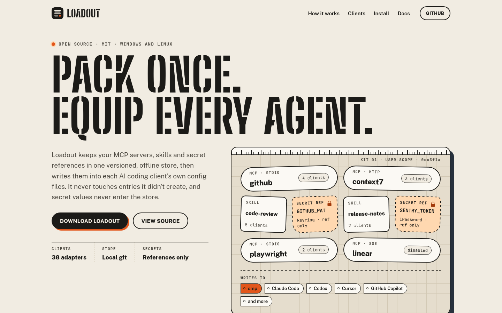
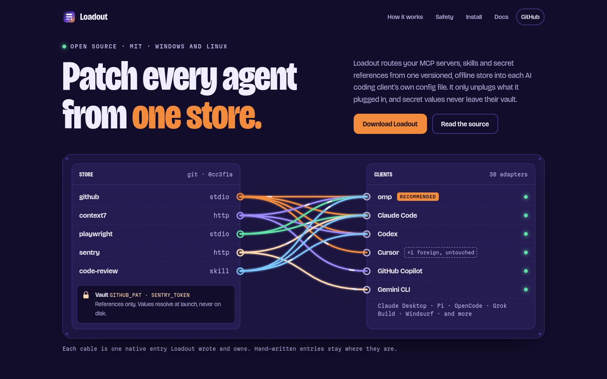
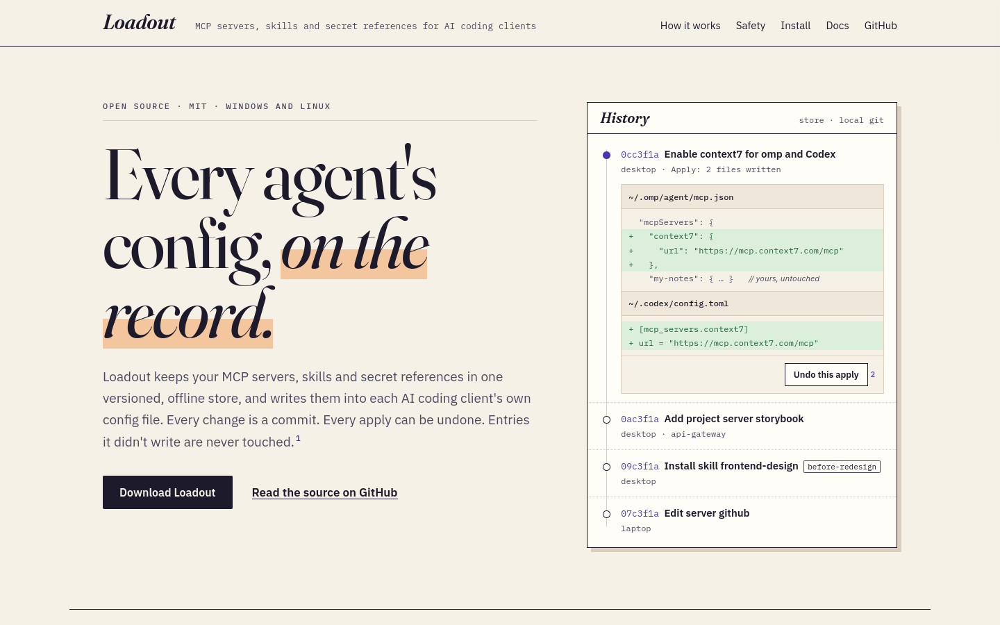

# Loadout website: Phase 1 design exploration

Three distinct visual directions for the Loadout product site, each a static
prototype of the hero plus three key sections. The brief (audience,
positioning, tone, content outline, information architecture, constraints) is
in [brief.md](brief.md).

```
site/design/
  brief.md
  README.md                  (this file)
  shared/                    mark (src-tauri/icons/icon.svg) and app screenshots (docs/milestones/M28-*)
  direction-a/               Field Kit
  direction-b/               Patch Bay
  direction-c/               Ledger
    index.html, style.css, one small .js file
    fonts/                   self-hosted woff2 plus the license file for each family
    preview-desktop.png      1440 x 900, first screen
    preview-mobile.png       390 x 844, first screen
    preview-full.png         whole page at 1440 wide, half scale
```

To view: `python -m http.server 5190 --directory site/design`, then open
`http://127.0.0.1:5190/direction-a/` (or `-b`, `-c`). Each prototype works
offline, uses no framework, CDN or tracker, and links into `../shared/` only for
the mark and the app screenshots.

## Direction A: Field Kit



**Concept.** A loadout is the kit you lay out before a job. The hero is a
knolled flat-lay on a cutting mat: MCP servers as long rounded bars (the shape
of the bars in the Loadout mark), skills as cards, secret references as sealed
pouches marked "ref only". Below the mat, luggage tags name the clients the kit
ships to. "How it works" is a packing slip with an "Applied" stamp and a taped
photo of the Pending changes drawer; the clients grid is a wall of luggage tags
on a steel panel; install options are shipping labels with hazard-tape tops.

- **Palette.** Bone `#f1ece2`, ink `#1c1b18`, safety orange `#e2561b` (fills
  and large type) with `#a33a0b` for small orange text, tool steel `#27313d`,
  peach `#ffd8b0` and violet `#5a3fd0` from the mark.
- **Type.** Big Shoulders Stencil Display 800 for headlines (crate stencil),
  Public Sans for text, JetBrains Mono for labels and commands.
- **Motion.** Kit items drop and settle into their slots one after another on
  load; items lift on hover. Off under reduced motion.
- **Reflects the product as** one curated kit, packed once, handed to every
  agent; secrets visibly sealed and never copied.

## Direction B: Patch Bay



**Concept.** Loadout as a patch bay at dusk. The store is a module of output
jacks (servers and a skill), the clients a module of input jacks, and every
patch cable is one native entry Loadout wrote and owns. Cursor shows
"+1 foreign, untouched" to make the ownership rule visible; a sealed vault in
the store lists secret aliases with no cables leaving it. Sections continue
the rack: a three-unit signal path (Store, Plan, Apply) with code readouts and
"Undo this apply", four safety modules beside the dark History screenshot, and
a tabbed install console.

- **Palette.** Taken from the mark's gradient: night indigo `#120d2b`, panels
  `#1c1540` and `#251c52`, signal orange `#f28b3c`, peach `#ffd8b0`, violet
  `#9c8bff`, plus mint `#5fe0a5` for "applied" LEDs and sky `#7cc7ff` as a
  cable color.
- **Type.** Bricolage Grotesque (variable width, weight and optical size:
  condensed and heavy for headlines, normal for text) and Martian Mono for jack
  labels and readouts.
- **Motion.** Cables draw in one by one from store to client, each client's
  LED turns green as its first cable lands, then small signal pulses travel
  the cables. Reduced motion shows the finished patch with no pulses.
- **Reflects the product as** one store fanning out into many client configs,
  with ownership drawn as literal connections.
- **Implementation note.** The store and client lists are real HTML; `bay.js`
  measures the jacks and draws the SVG cables, and redraws on resize. On
  phones the modules stack and the cables become a vertical bundle. Without
  JS the lists still read correctly.

## Direction C: Ledger



**Concept.** Loadout's character is accountability, so the site is typeset
like a well-made technical broadsheet. The hero headline ("Every agent's
config, *on the record*") gets a highlighter sweep; beside it, a History card
shows the latest commit expanded into a diff across two client files, with a
hand-written entry marked "yours, untouched" and an "Undo this apply" button.
Sections are numbered (§ 1 to § 3) with footnotes: a Rosetta stone showing one
store entry rendered for omp, Cursor and OpenCode, each with its own spelling
of the same secret reference; "Terms of engagement" as numbered articles
beside a plate of the trust review dialog; and an install index table with
honest Available and Pending labels.

- **Palette.** Paper `#f6f1e7`, indigo ink `#1d1a2b`, violet `#4b33b8` for
  links and numerals, the mark's orange as a translucent highlighter, diff
  green `#dcefdc` / `#1d6034`.
- **Type.** Fraunces (variable optical size, roman and italic) for display,
  IBM Plex Sans for text, IBM Plex Mono for code and metadata.
- **Motion.** The headline highlighter sweeps in once; diff lines in the
  History card write themselves in when the card scrolls into view. Off under
  reduced motion.
- **Reflects the product as** a record: versioned, diffable, reversible, and
  exact about every file it touches.

## Comparison

| | A: Field Kit | B: Patch Bay | C: Ledger |
|---|---|---|---|
| **One-glance explanation** | Good: a kit of servers, skills and sealed secrets, tagged for clients | Best: one store visibly wired to many clients, foreign entry and vault included | Indirect: the diff shows multi-client writes; the Rosetta section explains the rest |
| **Strengths** | Most memorable and ownable; plays on the name; warm and tactile; nothing like other dev-tool sites | Ties to the existing mark and the app's dark theme; the cables carry the ownership story; strong on mobile as a bundle | Most credible for skeptical readers and IT pros; showcases format-preserving, per-client output; lightest to build and maintain; ages well |
| **Risks** | Stencil and "kit" imagery read military or outdoorsy; stencil type is less legible at small sizes (headlines only); hand-tuned item layout needs care as content changes | Dark-only page (a light theme would need a second pass); the cable script must stay robust across sizes; can drift toward "synth" styling if overdone | Editorial serif can feel literary rather than technical to some developers; leans on long copy; less visual punch in a social preview |
| **Accessibility** | AA verified for all text pairs (lowest: ink on orange tags at 4.58:1) | AA verified (lowest: orange on panel at 6.9:1); tabs follow the WAI-ARIA pattern with arrow keys | AA verified (lowest: diff green at 6.3:1); real footnotes with back links |
| **Fonts (woff2, latin)** | 100 KB, 6 files | 149 KB, 3 files | 244 KB, 7 files (can drop to about 150 KB by subsetting Fraunces) |
| **JS** | Copy buttons only | Cable layout, tabs, copy buttons (about 4 KB) | One IntersectionObserver |
| **Build effort for the full site** | Medium: CSS-heavy, items and tags hand-composed | Medium to high: cable layout, responsive bundle, motion polish | Low to medium: mostly typography and content |

## Recommendation

**Build on B, Patch Bay, and borrow C's "One entry, many dialects" section.**

B is the only direction where the hero alone answers "what does this do?":
one store, many clients, and Loadout owns only the cables it plugged in. It
grows out of the existing mark (indigo to violet to orange) and the app's dark
theme, so the site, the app and the icon read as one brand without a logo
refresh. Its weak spot, explaining *how* each client gets a different native
entry, is exactly what C's Rosetta section does best, and that section ports
to B's palette and type with little change. If the maintainer prefers a light
page or a lower build cost, C is the safe, credible alternative. A is the most
distinctive, but its kit imagery puts personality ahead of the trust signals
this audience looks for.

## Open questions for the maintainer

1. **Direction.** B (recommended), B with C's Rosetta section, or another mix?
2. **Domain.** Stay on `daileng.github.io/agent-loadout/` or add a custom
   domain (needs a `CNAME` file and DNS)? This sets canonical URLs and social
   preview links.
3. **Logo.** Keep the current mark as is (all three prototypes use it; A
   recolors it to ink and orange), or refresh it alongside the site?
4. **Theme.** For B, ship dark only, or add a light theme that follows the
   system setting?
5. **Download button.** Detect the OS and link straight to the right asset
   from the latest release (needs a small build step or a client-side GitHub
   API call), or always jump to the Install section?
6. **Screenshots.** Fine to use the M28 mock-data captures, or should Phase 2
   take fresh ones at a fixed window size and theme?
7. **Client names.** Text-only names are used everywhere. Should Phase 2 ask
   vendors about logo use, or stay text-only?
8. **Pending packages.** Keep "pending" labels for winget, Chocolatey, AUR
   and crates.io, or hide those rows until they are live?

## Decisions (Phase 2)

- **Direction:** B (Patch Bay) with C's "One entry, many dialects" section,
  restyled into B's system. Built in `site/`.
- **Theme:** dark by default, plus a light theme following
  `prefers-color-scheme`; every text pair is checked by
  `site/tools/contrast.mjs`.
- **Domain:** `https://daileng.github.io/agent-loadout/`, set once in
  `site/data/site.json`.
- **Download button:** OS-aware, resolved through the GitHub API at run
  time, with the release page as the fallback.
- **Pending packages:** shown with "Pending" labels, driven by
  `site/data/channels.json`.
- **Logo:** option **A, Refined** (`logo/option-a-refined.svg`, with
  `logo/option-a-refined-small.svg` for 16 and 32 px). It replaced the mark
  in `src-tauri/icons/icon.svg` and the generated icon set, the app's
  sidebar mark, the installer images, and the site (`site/img/mark.svg`,
  favicons, `og.png`). `logo/` keeps the three options, the previous mark
  (`logo/current.svg`) and the comparison sheets (`logo/preview-*.png`) as
  the record.

## Fonts and licenses

All fonts are under the SIL Open Font License 1.1, taken as latin-subset
woff2 from the Fontsource npm packages (version 5.3.0). Each `fonts/` folder
carries the license text shipped with the package.

| Direction | Family | Files |
|---|---|---|
| A | Big Shoulders Stencil Display (800) | `BigShouldersStencilDisplay-OFL.txt` |
| A | Public Sans (400, 600, 800) | `PublicSans-OFL.txt` |
| A | JetBrains Mono (400, 700) | `JetBrainsMono-OFL.txt` |
| B | Bricolage Grotesque (variable: weight, width, optical size) | `BricolageGrotesque-OFL.txt` |
| B | Martian Mono (400, 600) | `MartianMono-OFL.txt` |
| C | Fraunces (variable: weight, optical size; roman and italic) | `Fraunces-OFL.txt` |
| C | IBM Plex Sans (400, 400 italic, 600) | `IBMPlexSans-OFL.txt` |
| C | IBM Plex Mono (400, 500) | `IBMPlexMono-OFL.txt` |

Fontsource's license file for Big Shoulders names "Google Inc." as the
copyright holder; the upstream project (xotypeco/big_shoulders) credits "The
Big Shoulders Project Authors". If A is chosen, replace that file with the
upstream `OFL.txt` in Phase 2.

## Screenshot sources

`shared/screens/` holds copies of `docs/milestones/M28-mcp.png`,
`M28-skills.png`, `M28-history.png`, `M28-apply-drawer.png` and
`M28-projects-trust.png`. They show mock data only: no user names, and paths
appear only as `~/...` or `<P>/...`. The preview images were taken in omp's
headless WebKit browser from a local static server.
